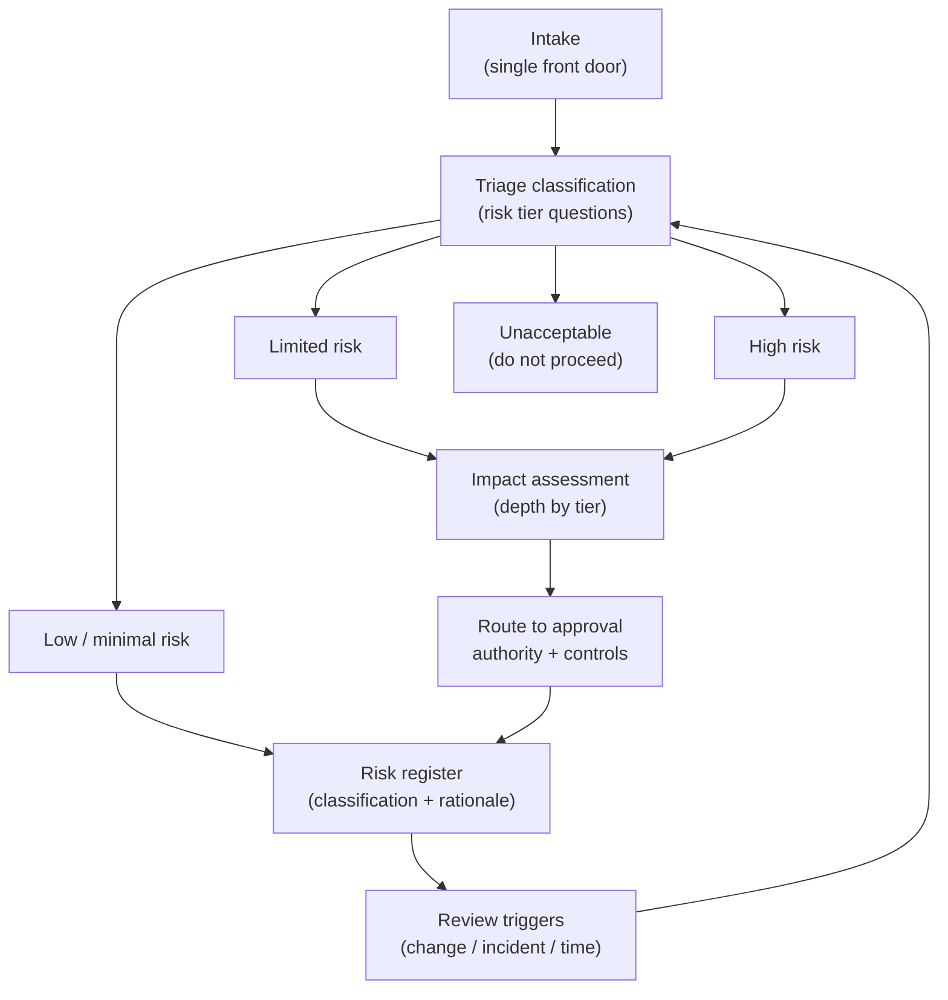
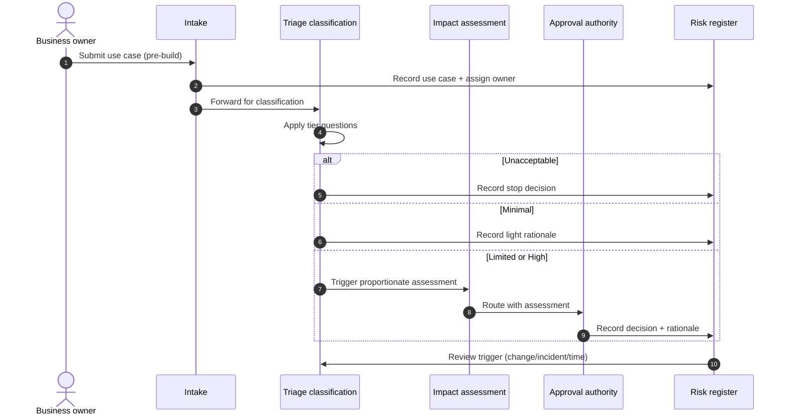

# Chapter 4: Risk Classification and Impact Assessment

This is the first mechanism chapter, and it deliberately begins with the one control that every later control depends on: deciding how risky a given AI use case is, and recording why. It is tempting to treat classification as administrative overhead and move straight to the controls that feel substantive, but that would be a mistake. Without classification, governance has no way to apply itself in proportion, so it either governs everything equally, which is unaffordable and quickly bypassed, or governs by instinct, which is inconsistent and indefensible. The skill on display in this chapter is calibration: matching the weight of governance to the risk of the use case.

---

## 1. The Governance Problem

An organisation is accumulating AI use cases faster than it can review them. They range from a tool that drafts internal emails to a model that influences who is offered credit, who is shortlisted for a job, or how a clinical pathway is prioritised. These are not the same, and governing them as if they were is a failure in both directions: trivial uses are smothered in process, while consequential ones receive no more scrutiny than the trivial.

The problem is genuine and structural. There is no single level of risk across the estate, there is no reliable inventory of what exists, and there is no shared language for saying how risky something is. In its absence, each team makes its own judgement, approvals depend on who happens to review, and the organisation cannot answer a regulator, an auditor or its own board when asked which of its AI systems are high risk and why.

The constraint that matters most here is proportionality. The organisation could subject every use case to the fullest assessment, but that would spend scarce governance effort where it creates little value and would train the business to route around governance entirely. The governance question is therefore not "how do we assess everything thoroughly?" but "how do we reliably decide how much assessment each use case needs, and record the decision so it can be challenged?"

---

## 2. 🧩 The Mechanism at a Glance

- **Mechanism name:** Risk Classification and Impact Assessment
- **Risk addressed:** Governance applied out of proportion to risk, and consequential use cases escaping scrutiny.
- **Primary objective:** A consistent, defensible decision about the risk tier of each AI use case, driving the controls that follow.
- **When to use:** As the mandatory entry point for every AI use case, before significant build or procurement, and on material change.
- **When not to use:** As a one time gate that is never revisited, or as a substitute for the deeper assessments it should trigger.
- **Relevant frameworks / obligations:** EU AI Act risk tiering; NIST AI Risk Management Framework (NIST AI RMF) Map function; ISO/IEC 42001 risk based controls; sector impact assessment regimes.
- **Primary governance concern:** Proportionality, applying only the governance each use case warrants while ensuring high risk uses are caught reliably.

Classification is the control plane of governance: it decides what happens next. The deeper impact assessment is the detailed examination that a higher tier triggers. The two work together, a fast, universal triage followed by proportionate depth.

---

## 3. The Operating Model

The reference operating model is deliberately simple to enter and progressively deeper to clear:

- **Intake** captures every proposed or existing AI use case through a single front door, so nothing enters the estate unseen.
- **Triage classification** places the use case in a risk tier using a small set of consistent questions about impact, autonomy, affected parties and data sensitivity.
- **Impact assessment** applies depth in proportion to the tier: minimal for low tiers, a full assessment for high tiers covering affected individuals, fairness, safety, privacy and legal basis.
- **Routing** sends the use case to the appropriate approval authority and control set for its tier.
- **The register** records the classification, the assessment and the rationale as durable evidence.
- **Review triggers** return a use case to classification on material change, incident or elapsed time.

Each component has a clear role. Intake guarantees coverage. Triage guarantees consistency. The impact assessment guarantees depth where it is warranted. The register guarantees evidence. The review triggers guarantee that classification is a living judgement rather than a one time stamp.

---

## 4. The Decision & Control Flow

> **Step 1:** A business owner submits a use case through intake, before significant build or procurement.
> **Step 2:** Intake records the use case in the register and assigns a provisional owner.
> **Step 3:** Triage asks a consistent set of questions: who is affected, what decision does the system influence, how autonomous is it, how sensitive is the data, and what is the consequence of error.
> **Step 4:** The answers place the use case in a tier: minimal, limited, high, or unacceptable.
> **Step 5:** An unacceptable use case is stopped and the decision recorded; it does not proceed.
> **Step 6:** A minimal use case records a light rationale and proceeds under baseline controls.
> **Step 7:** A limited or high use case triggers an impact assessment proportionate to its tier.
> **Step 8:** The impact assessment examines affected individuals, fairness, safety, privacy, legal basis and the degree of human oversight required.
> **Step 9:** The use case is routed to the approval authority for its tier with the assessment attached.
> **Step 10:** The authority approves, approves with conditions, or declines, and the decision and rationale are recorded.
> **Step 11:** The classification, assessment and decision are stored in the register as assurance evidence.
> **Step 12:** A review trigger (material change, incident, or elapsed time) returns the use case to triage for reclassification.

The flow makes the mechanism's logic concrete: one universal entry, a fast consistent triage, depth applied only where the tier warrants it, and a durable record at every step.

---

## 5. Why This Mechanism Works

The mechanism works because it matches the depth of governance to the risk of the use case. A universal triage is cheap enough to apply to everything, which solves the coverage problem, while the expensive impact assessment is reserved for the minority of use cases that justify it, which solves the affordability problem. The organisation gains a single, consistent language for risk that replaces scattered individual judgement.

It also works because it produces evidence as a by-product of operating. Every classification and decision is recorded with its rationale, so the organisation can answer, at any time and for any system, how risky it was judged to be and why. That record is what turns a set of opinions into governance that can be assured and defended.

---

## 6. 🏛️ Governance Decisions

| Decision | Options | Recommended approach | Reason |
| --- | --- | --- | --- |
| Entry coverage | Voluntary / Mandatory single front door | Mandatory single front door | Nothing should enter the estate unclassified |
| Tiering basis | Technology type / Impact and context | Impact and context | Risk comes from use and consequence, not the model type |
| Triage depth | Full assessment for all / Proportionate triage | Proportionate triage then depth | Affordability and adoption without losing high risk cases |
| Authority by tier | Single body / Tiered authorities | Tiered authorities | Match approval weight to risk; avoid a central bottleneck |
| Reclassification | One time / Trigger based | Trigger based | AI changes continuously; classification must be revisited |
| Evidence | Informal / Register of record | Register of record | Assurance and regulatory defence require durable evidence |

These defaults favour proportionality, but each remains a decision. If the organisation finds itself giving every use case a full assessment, or none, the calibration is wrong and should be revisited rather than endured.

---

## 7. ⚖️ Trade-offs

**Benefits:** A consistent, defensible basis for every downstream control; reliable capture of high risk use cases; a shared risk language; and assurance evidence generated by default.

**Friction:** A mandatory front door adds a step before build and can be experienced as a gate. If triage is slow or opaque, teams route around it, which is worse than a lighter control they would actually use.

**Cost:** Low for triage, higher for full impact assessments. The cost is concentrated where risk is concentrated, which is the intended distribution.

**Operational overhead:** Running intake, triage and the register is an ongoing function, not a one time project. It requires owners, service levels and tooling to stay usable at scale.

**Risk reduction:** High, because it is the precondition for applying every other control proportionately. Its absence does not merely add risk; it removes the organisation's ability to see risk at all.

**Speed to deliver:** A well run triage adds little delay and can accelerate low risk work by clearing it quickly. A poorly run one becomes the bottleneck the whole business complains about.

**Unintended consequences:** If classification questions are gameable, owners will understate impact to secure a lower tier. The questions and some assurance sampling must guard against this.

---

## 8. 🔐 Risk, Safety & Responsible AI

Classification is where responsible AI outcomes first attach to a use case. The triage questions should surface, at a minimum, whether the system affects people's rights, access to services or safety; whether it makes or materially influences a decision about an individual; how autonomous it is; and what categories of data it uses. These are the signals that determine whether fairness, transparency, privacy, safety and human oversight controls, covered in Part IV, are required and at what strength.

The deeper impact assessment is where those outcomes are examined rather than merely flagged. For a high risk use case it should identify the affected individuals and the plausible harms, state how fairness and safety will be evaluated, confirm the lawful basis for the data, and specify the human oversight the system requires. Classification without this follow through records risk without controlling it, which is the appearance of governance rather than the substance.

---

## 9. 📜 Regulatory & Assurance Alignment

Risk classification is the mechanism most directly mandated by regulation, which makes alignment both achievable and expected.

The **EU AI Act** is itself a risk tiering regime, distinguishing unacceptable, high, limited and minimal risk, with the heaviest obligations on high risk systems. A classification mechanism that maps to these tiers lets the organisation locate its obligations rather than guess at them. The **NIST AI RMF** places this activity in its Map function, framing it as understanding context and identifying risk before measuring and managing it. **ISO/IEC 42001** expects a risk based approach in which controls follow from assessed risk, which is exactly what classification provides.

Sector obligations layer on top and are often stricter. In **financial services**, model risk management expectations treat higher impact models with greater scrutiny, aligning naturally with tiering. In **healthcare**, a use case touching clinical safety or a medical device sits at a high tier by default. In **employment**, rules on automated employment decision tools can make a hiring use case high risk regardless of its technical simplicity. The assessment should therefore record which sector obligations the tier triggers.

The evidence an auditor or regulator will expect is specific: a complete inventory of AI use cases, the tier assigned to each with the questions and answers that produced it, the impact assessments for higher tiers, and the approval decisions with rationale. A classification mechanism that stores this as it operates satisfies the request as a matter of routine. This book provides governance guidance rather than legal advice, and the mapping to any specific obligation requires local legal interpretation.

---

## 10. ⚠️ Failure Modes & Resilience

- **Shadow AI:** Use cases that never enter intake are never classified, so the mechanism's coverage is only as good as its reach. Resilience comes from making intake the path of least resistance, discovering unregistered systems through procurement and platform signals, and treating undiscovered AI as a tracked risk in its own right.
- **Assessment theatre:** A classification completed to satisfy the process, with little genuine analysis, produces a tier that looks defensible and is not. Independent sampling by the second line and challenge of thin assessments are the mitigation.
- **Gaming the tier:** Owners understate impact to secure lighter controls. Objective, hard to game questions and assurance review of a sample of self classifications reduce this.
- **Stale classification:** A use case classified once and never revisited drifts out of its tier as data, usage or the model changes. Trigger based reclassification is the control, and its absence is a common governance gap.
- **Bottleneck:** If triage or assessment cannot keep pace with demand, the business bypasses it. Service levels, proportionate depth and tiered authorities keep throughput acceptable.

The recurring theme is that the mechanism fails quietly. Its failures do not raise errors; they produce confident classifications that are incomplete, stale or gamed, which is why independent assurance over the mechanism itself is essential.

---

## 11. 👁️ Monitoring & Operations

The function should monitor, at minimum: the proportion of the estate that is classified and the rate of newly discovered unregistered systems; the distribution of use cases across tiers over time; triage and assessment turnaround against service levels; the rate of reclassification and what triggered it; and the results of assurance sampling over classification quality. These signals reveal both the health of the mechanism and the shape of the organisation's AI risk.

Distinguish, as elsewhere, monitoring of the control, is classification happening, consistently and on time, from monitoring of the use cases it governs, which is addressed in the lifecycle and responsible AI chapters. A classification function that is punctual but produces poor tiers is failing just as surely as one that is slow.

---

## 12. 💷 Cost & Proportionality

The cost drivers are the effort of triage, which is small and universal, and the effort of impact assessment, which is larger and concentrated at the higher tiers. The mechanism is proportionate by design: it spends least where risk is least and most where risk is greatest.

The proportionality risk is miscalibration in either direction. Set the bar for a full assessment too low and the function drowns in assessments for trivial systems, raising cost and inviting avoidance. Set it too high and consequential systems clear on a light triage, leaving real risk uncontrolled. The lever is the tiering criteria, which should be reviewed against outcomes: if high tier systems are rarely found, or incidents arise from systems that were classified low, the thresholds need adjusting.

---

## 13. When to Use This Mechanism

Use this mechanism when:

- the organisation operates more than a handful of AI use cases;
- use cases vary materially in impact, from trivial to consequential;
- governance effort must be directed where it matters most;
- a regulator, auditor or board may ask which systems are high risk and why; and
- the organisation needs a single, consistent language for AI risk.

In practice this is every organisation deploying AI at any scale, which is why classification is positioned as the mandatory entry point rather than an optional refinement.

---

## 14. When NOT to Use This Mechanism

This mechanism is close to universal, so the caution is about misuse rather than non use:

- Do not use it as a **one time gate** that is never revisited; a classification that is never refreshed becomes false as the system changes.
- Do not let it become a **substitute for the assessments it should trigger**; a tier assigned but never acted upon records risk without reducing it.
- Do not apply **full impact assessment uniformly** to every use case; that is not this mechanism but its miscalibration, and it drives the avoidance that undermines coverage.

The lighter alternative is not to skip classification but to keep the triage genuinely light for low risk cases, so the mechanism remains proportionate and therefore used.

---

## 15. Mechanism Variations

- **Small organisation:** A single lightweight triage questionnaire and a shared register, with impact assessments reserved for the rare high risk case. The whole mechanism may sit with one accountable owner.
- **Scaling organisation:** A standard triage, defined tiers, tiered approval authorities, and a maintained inventory, as AI use cases outgrow informal review.
- **Large enterprise:** A federated model in which a central function owns the tiering standard and assurance while business units perform triage and many assessments locally, with the register consolidated for an enterprise view.
- **Highly regulated enterprise:** Stricter tiering aligned explicitly to sector obligations, mandatory full assessment for defined categories, and independent validation of classifications for the highest tiers.

The variations differ mainly in how much of the mechanism is centralised and how formal the assessment becomes, not in the underlying logic of triage then proportionate depth.

---

## 16. Governance Decision Checklist

- [ ] Does every AI use case enter through a single, mandatory front door?
- [ ] Is the tiering based on impact and context rather than technology type?
- [ ] Are the triage questions consistent, objective and hard to game?
- [ ] Does a higher tier trigger a proportionate impact assessment that is actually completed?
- [ ] Is approval authority matched to tier rather than concentrated in one body?
- [ ] Are classifications reclassified on change, incident or elapsed time?
- [ ] Is every classification, assessment and decision recorded with its rationale?
- [ ] Does the mechanism map tiers to the applicable cross cutting and sector obligations?
- [ ] Is classification quality itself assured by an independent line?

---

## 17. 📐 The Governance Verdict

> Risk classification and impact assessment is the right mechanism, and effectively a mandatory one, whenever an organisation operates more than a few AI use cases of varying consequence. It earns its place by making every later control proportionate: a cheap universal triage guarantees coverage, while depth is reserved for the use cases that justify it, and the record it produces is the evidence that turns opinion into defensible governance. Its weaknesses are inherent rather than accidental. It fails quietly through shadow AI, assessment theatre, gaming and staleness, so it must be instrumented, triggered by change, and assured independently. Calibrate it so that triage stays light and high risk cases are caught reliably, and it becomes the control plane on which the rest of the governance system runs. Classify first, in proportion, and record why. That is where governance at scale begins.
