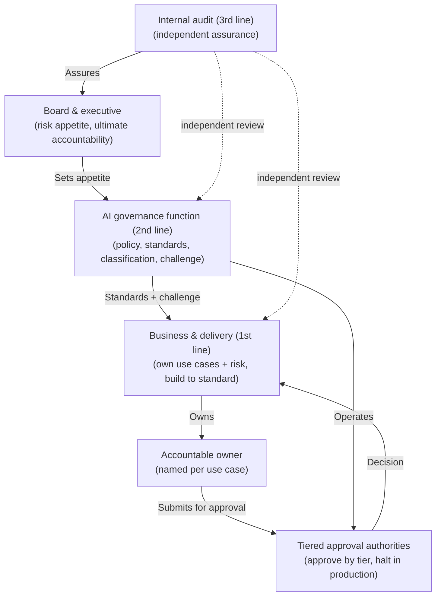
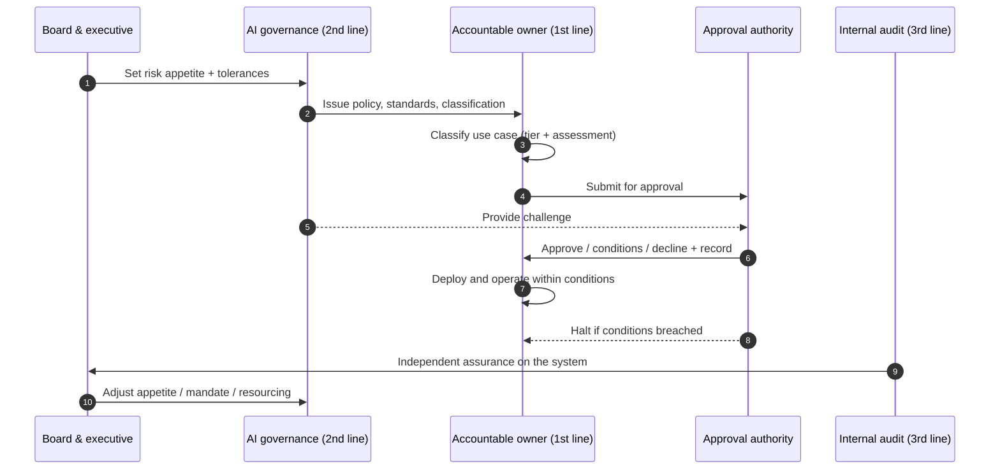

# Chapter 5: Accountability and the Governance Operating Model

Chapter 4 gave the organisation a way to decide how risky each AI use case is. This chapter answers the question that immediately follows: who decides, who oversees, and who assures. A risk tier is only as good as the structure that acts on it. An organisation can classify perfectly and still fail if no one is accountable for the decision, if decision rights are ambiguous, or if the body that builds a system is also the only body that approves it. The skill on display here is organisational design: placing authority, oversight and assurance where they create genuine challenge without creating a bottleneck.

---

## 1. The Governance Problem

An organisation has policies, a classification mechanism and good intentions, yet risk still accumulates. The reason is rarely a missing rule. It is that responsibility for AI is diffuse. A business sponsor assumes the data science team owns the risk; the data science team assumes the vendor does; the vendor assumes the customer does. When something goes wrong, there is no single person who was answerable, which means there was no one whose job it was to prevent it.

The problem is structural, not individual. Decision rights are unstated, so approvals default to whoever is willing. Oversight and delivery are blurred, so the people building a system also judge whether it is safe, removing the challenge that makes a judgement trustworthy. Assurance is absent or captured, so the board is told everything is fine by the same function that would have to report if it were not. None of this is bad faith; it is the natural result of an operating model that was never deliberately designed.

The constraint that matters most here is that accountability cannot be delegated to a process. A workflow can route a decision, but it cannot be answerable for it. The governance question is therefore not "what is the approval process?" but "who is accountable for each AI use case, who holds the right to approve and to halt it, and who provides independent assurance that the system is working?"

---

## 2. 🧩 The Mechanism at a Glance

- **Mechanism name:** Accountability and the Governance Operating Model
- **Risk addressed:** Diffuse responsibility, ambiguous decision rights, and oversight that lacks independence.
- **Primary objective:** A clear operating model in which every AI use case has an accountable owner and authority is placed across distinct lines of defence.
- **When to use:** As the organising structure for the entire governance function, established before scaling AI adoption.
- **When not to use:** As a reason to centralise every decision, or as an organisation chart that is published but not operated.
- **Relevant frameworks / obligations:** The three lines model; NIST AI RMF Govern function; ISO/IEC 42001 management system roles; sector accountability rules (for example senior manager accountability regimes in financial services).
- **Primary governance concern:** Placing accountability and decision rights so that challenge is real and the model scales without becoming a bottleneck.

The operating model is the organisational counterpart to classification. Classification decides what a use case needs; the operating model decides who provides it. Together they form the spine of the governance system.

---

## 3. The Operating Model

The reference operating model places authority across three lines of defence, connected by explicit decision rights:

- **The board and executive** set risk appetite, hold ultimate accountability, and receive independent assurance.
- **An AI governance function (second line)** owns the policy, standards and the classification mechanism, reviews and challenges risk, and reports to the board.
- **Business and delivery teams (first line)** own their AI use cases and the risks they create, perform classification and build within the standards.
- **Internal audit (third line)** provides independent assurance that the whole system operates as intended.
- **Accountable owners** are named for every use case, carrying answerability for its outcomes.
- **Tiered approval authorities** hold the right to approve use cases in proportion to their risk tier, and the right to halt a system in production.

Each component has a clear role. The board owns appetite and ultimate accountability. The second line owns policy and challenge but does not build. The first line builds and owns its risk. The third line assures independently and reports to the board, not to the function it reviews. The named owner carries answerability. The tiered authorities hold the decision rights. The separation is the point: it is what makes oversight more than self assessment.

---

## 4. The Decision & Control Flow

> **Step 1:** The board sets the organisation's AI risk appetite and the tolerances that make it operational.
> **Step 2:** The second line translates appetite into policy, standards and the classification mechanism.
> **Step 3:** A first line team proposing an AI use case is assigned a named accountable owner.
> **Step 4:** The owner runs the use case through classification, producing a risk tier and assessment.
> **Step 5:** The use case is routed to the approval authority matched to its tier.
> **Step 6:** The authority, drawing on second line challenge, approves, approves with conditions, or declines.
> **Step 7:** The decision, its conditions and its rationale are recorded against the owner and the use case.
> **Step 8:** The first line deploys and operates within the approved conditions, retaining ownership of the risk.
> **Step 9:** If monitoring reveals the system breaching its conditions or tolerances, the authority may halt it.
> **Step 10:** The third line periodically reviews whether classification, approval and oversight are operating as intended.
> **Step 11:** The third line reports its independent findings to the board.
> **Step 12:** The board adjusts appetite, mandate or resourcing in response, closing the loop.

The flow makes the separation operational: the board owns appetite, the second line owns the rules and the challenge, the first line owns the risk and the build, the authority owns the decision, and the third line independently tells the board whether it is all working.

---

## 5. Why This Mechanism Works

The mechanism works because it attaches answerability to a person and separates the roles that must not be combined. A named owner cannot pass responsibility to a process or a vendor, which is what makes risk visible before it crystallises. Keeping the second line's challenge distinct from the first line's delivery means a system is judged by someone other than those motivated to ship it, and keeping the third line's assurance independent of both means the board hears an unfiltered account.

It also works because it scales through proportion rather than centralisation. By matching approval authority to risk tier, trivial use cases clear quickly at a local level while consequential ones rise to a weightier authority. The central function sets the rules and assures them without having to approve everything itself, which avoids the bottleneck that makes heavy governance collapse under its own volume.

---

## 6. 🏛️ Governance Decisions

| Decision | Options | Recommended approach | Reason |
| --- | --- | --- | --- |
| Accountability | Shared / Named owner per use case | Named owner per use case | Answerability cannot be collective or delegated to a process |
| Lines of defence | Combined / Separated first, second, third | Separated | Challenge and assurance require independence from delivery |
| Approval authority | Single central body / Tiered by risk | Tiered by risk | Scale without a bottleneck; match weight to consequence |
| Operating model | Centralised / Federated / Distributed | Federated under common standards | Local context and speed with enterprise consistency |
| Right to halt | Owner only / Authority and second line | Authority (with second line trigger) | A system breaching tolerance must be stoppable by someone other than its builder |
| Assurance reporting | To the function / To the board | To the board | Independence is lost if assurance reports to the reviewed |

These defaults favour separation and proportion. If the same body sets the standard, approves the system and assures the outcome, the model has collapsed into self assessment regardless of what the chart says.

---

## 7. ⚖️ Trade-offs

**Benefits:** Clear answerability for every use case; genuine challenge through separated lines; independent assurance to the board; and a model that scales by proportion rather than by adding reviewers.

**Friction:** Named ownership and tiered approval introduce roles and steps that did not exist before. If authorities are slow or the second line is adversarial rather than enabling, delivery teams experience governance as an obstacle.

**Cost:** The standing cost of a second line function and third line assurance capacity. This is an ongoing organisational investment, not a project expense.

**Operational overhead:** Maintaining owners, authorities, committees and reporting lines requires continuous effort and clear terms of reference. An operating model that is published once and not maintained decays into fiction.

**Risk reduction:** High, because most governance failures at scale are failures of accountability rather than of controls. Placing answerability and independent challenge addresses the root cause.

**Speed to deliver:** Tiered authority can accelerate low risk work by clearing it locally, but a poorly resourced authority at a higher tier becomes the chokepoint for the most important systems.

**Unintended consequences:** Separation can harden into an adversarial relationship in which the second line only says no. The function must be positioned as enabling safe delivery, not as a gate, or the first line will conceal rather than consult.

---

## 8. 🔐 Risk, Safety & Responsible AI

The operating model is where responsible AI acquires an owner. Fairness, transparency, safety, privacy and human oversight are not self executing; each needs someone accountable for ensuring the relevant control is in place and effective. The named owner carries that answerability for their use case, while the second line owns the standard that defines what good looks like, and the third line assures that the standard is met in practice.

Human oversight in particular depends on this structure. A system's design may require a human to review or override its decisions, but oversight is meaningless unless a specific role holds the authority, the information and the time to exercise it. The operating model is what connects an abstract oversight requirement to a real person with the standing to act, and the right to halt a system is the ultimate expression of that oversight when a system breaches its tolerances.

---

## 9. 📜 Regulatory & Assurance Alignment

Accountability is a theme regulators return to repeatedly, which makes a well designed operating model directly responsive to obligation.

The **three lines model** is the established assurance structure this mechanism applies to AI, and auditors recognise it immediately. The **NIST AI RMF** places accountability and oversight in its Govern function, treating a culture of clear roles and responsibilities as the foundation on which the other functions rest. **ISO/IEC 42001**, as a management system standard, expects defined roles, responsibilities and authorities for AI, along with top management commitment, which maps closely to the board and second line roles described here.

Sector obligations often make accountability personal and explicit. In **financial services**, senior manager accountability regimes require a named individual to be responsible for specified functions, which translates directly into named ownership of material AI systems. In the **public sector**, administrative accountability means a decision maker must be identifiable and answerable, which an automated process must not be allowed to obscure. Across sectors, data protection rules on automated decision making presuppose that an accountable controller exists.

The evidence an auditor or regulator will expect includes a current map of accountabilities, documented decision rights and approval authorities by tier, terms of reference for the governance bodies, and independent assurance reports to the board. An operating model that maintains these as living artefacts satisfies the request directly. As throughout, this is governance guidance rather than legal advice, and the mapping to any specific accountability regime requires local legal interpretation.

---

## 10. ⚠️ Failure Modes & Resilience

- **Collapsed lines:** The commonest failure is the first and second lines merging, so the team that builds a system also approves it. Resilience requires that approval and challenge sit with people who are not measured on shipping the system.
- **Captured assurance:** If the third line reports to the function it reviews, its independence is lost and the board hears a filtered account. Assurance must report to the board or audit committee directly.
- **Ownership in name only:** A named owner who lacks the authority, information or time to discharge the role is a fiction that gives false comfort. Ownership must come with genuine standing and support.
- **Bottleneck at the top:** Centralising approval of every use case in one body stalls the estate and drives teams to avoid governance. Tiered authority is the structural mitigation.
- **Adversarial second line:** A function that only refuses, without helping teams deliver safely, is routed around. It is concealed from rather than consulted, which leaves more risk than a lighter, enabling posture.
- **Chart without operation:** An operating model that exists as a diagram but is not resourced, convened or followed is among the most dangerous failures, because it looks like governance while providing none.

The theme is that this mechanism fails through erosion of independence and answerability rather than through a visible breakdown. It must be actively maintained, and its independence must be protected deliberately.

---

## 11. 👁️ Monitoring & Operations

The function should monitor, at minimum: the proportion of material use cases with a genuinely active accountable owner; approval turnaround by tier against service levels; the rate of conditions imposed, breached and acted upon; the number of systems halted and why; the currency of committee terms of reference and membership; and the status of third line findings and their remediation. These signals reveal whether the operating model is actually operating or merely declared.

Distinguish monitoring of the operating model, are the roles live, the decisions timely, the assurance independent, from monitoring of the use cases themselves, which the lifecycle chapters address. An operating model with a complete organisation chart but stale committees and unactioned findings is failing regardless of how it reads on paper.

---

## 12. 💷 Cost & Proportionality

The principal cost drivers are the standing second line function, the time of approval authorities, and third line assurance capacity. These are real and recurring, and an organisation must size them to the scale and risk of its AI estate rather than to an abstract ideal.

Proportionality applies to the operating model itself. A small organisation does not need three separate departments; it needs the three roles discharged by people with enough separation to provide challenge, which may mean one person wearing a clearly bounded second hat and an external party providing periodic assurance. A large regulated enterprise needs genuine functional separation. The failure in both directions is familiar: over building the model creates cost and friction that invite avoidance, while under building it removes the independence that makes oversight meaningful. The lever is how much separation the organisation's risk and scale actually justify.

---

## 13. When to Use This Mechanism

Use this mechanism when:

- the organisation operates AI use cases that anyone outside the building team must rely on;
- responsibility for AI risk is currently diffuse or unstated;
- decisions default to whoever is willing rather than whoever is authorised;
- a regulator or board expects a named, answerable owner for material systems; and
- governance needs to scale beyond what a single central reviewer can handle.

In practice every organisation scaling AI needs an operating model; the only variable is how formal and separated it must be, which the variations below address.

---

## 14. When NOT to Use This Mechanism

The caution is against misapplication rather than against having an operating model:

- Do not use it to **centralise every decision**; concentrating all approval in one body is not strong governance but a bottleneck that drives avoidance.
- Do not treat it as an **organisation chart to publish**; a model that is diagrammed but not convened, resourced or followed provides false assurance.
- Do not let separation become **pure obstruction**; a second line that only refuses, with no mandate to enable safe delivery, is concealed from rather than consulted.

The lighter alternative for a genuinely small or low risk context is not to abandon the three roles but to discharge them with proportionate formality, preserving independence while avoiding standing committees the organisation cannot sustain.

---

## 15. Mechanism Variations

- **Small organisation:** The three roles are held by a few people with deliberate separation, a single accountable owner per use case, and periodic external assurance in place of a standing audit function.
- **Scaling organisation:** A dedicated second line function emerges, approval authorities are tiered, and internal audit begins covering AI as a defined area.
- **Large enterprise:** A federated model in which the central second line owns standards and assurance while business units hold local authorities and named owners, with consolidated reporting to a group level AI governance committee.
- **Highly regulated enterprise:** Personal accountability mapped to a senior manager regime, formally constituted committees with terms of reference, and independent validation and assurance aligned to the sector's expectations.

The variations differ in the formality and separation of the roles, not in the principle that answerability must be named and that challenge and assurance must be independent of delivery.

---

## 16. Governance Decision Checklist

- [ ] Does every material AI use case have a single named accountable owner with real standing?
- [ ] Are the first, second and third lines genuinely separated in practice, not just on paper?
- [ ] Are decision rights, who approves, who halts, explicit and matched to risk tier?
- [ ] Does approval authority scale by tier rather than concentrating in one body?
- [ ] Does independent assurance report to the board rather than to the function it reviews?
- [ ] Can a system breaching its tolerances be halted by someone other than its builder?
- [ ] Is the second line positioned to enable safe delivery, not only to refuse?
- [ ] Are committees, terms of reference and reporting lines maintained rather than merely declared?
- [ ] Does the model align with any applicable personal accountability regime?

---

## 17. 📐 The Governance Verdict

> An accountability and operating model is the structural precondition for governance at scale, and effectively mandatory once anyone outside the building team must rely on an AI system. It earns its place by attaching answerability to a named person and separating the roles that must not be combined, so that systems are challenged by someone other than those who built them and the board hears an independent account. It scales through proportion, matching approval authority to risk tier, rather than through a central body that approves everything and inevitably becomes a bottleneck. Its weaknesses are failures of independence and answerability: collapsed lines, captured assurance, ownership in name only, and the published chart that is never operated. Protect the separation deliberately, position the second line as an enabler rather than a gate, and resource the model to the organisation's actual risk. Name who is accountable, place the decision rights, and keep assurance independent. A control without an owner is a hope, not a control.
