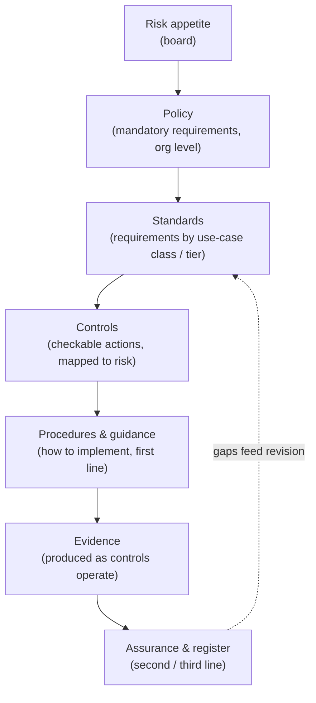
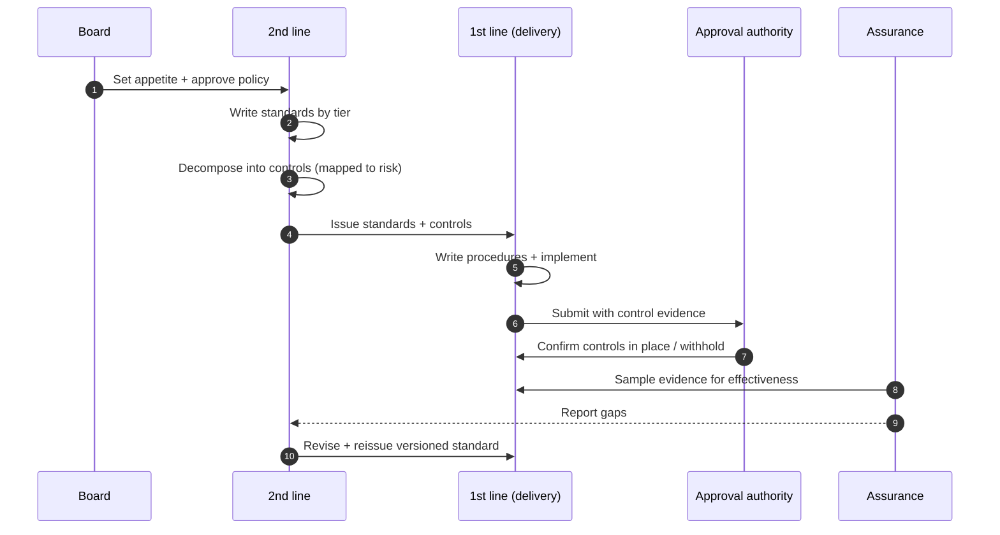

# Chapter 6: Policy, Standards and Control Design

Chapter 4 decided how risky a use case is, and Chapter 5 decided who is accountable for it. This chapter supplies what those two mechanisms act upon: the written expression of what the organisation requires, and the controls that make the requirement real. Policy, standards and controls are the instruments through which risk appetite becomes day to day practice. Done well, they turn a tier and an owner into a specific, checkable set of obligations. Done badly, they become a library of documents no one reads and no one can evidence. The skill on display here is translation: converting intent into controls that are proportionate, operable and provable.

---

## 1. The Governance Problem

An organisation writes an AI policy. It is approved, circulated and filed. A year later, an auditor asks how a particular high risk system meets the policy, and no one can answer. The policy said AI must be fair, but it never said what fairness test applies, who runs it, at what threshold, or what evidence is kept. The gap between a principle and an operable control was never closed, so the policy governs nothing.

The problem is that intent and practice sit at different altitudes and nothing connects them. A principle such as fairness is too abstract to act on. A line of code that computes a bias metric is too specific to govern by. Between them must sit a layer that says, for a given class of use case, exactly what must be done, by whom, to what standard, with what evidence. Most organisations have the top layer and some of the bottom, and almost nothing in between, which is why their governance feels simultaneously heavy and ineffective.

The constraint that matters most here is that a control the organisation cannot operate or evidence is not a control. It is possible to write requirements so numerous, so vague or so demanding that no team can comply and no auditor can verify, at which point the document becomes theatre. The governance question is therefore not "what should our policy say?" but "how do we express requirements at the right altitude, so they are proportionate to risk, operable by delivery teams, and provable to an auditor?"

---

## 2. 🧩 The Mechanism at a Glance

- **Mechanism name:** Policy, Standards and Control Design
- **Risk addressed:** Intent that never becomes practice; requirements that cannot be operated or evidenced.
- **Primary objective:** A layered instrument set, policy to standards to controls, that turns risk appetite into proportionate, operable, provable obligations.
- **When to use:** As the written backbone of the governance system, established alongside classification and the operating model.
- **When not to use:** As a reason to write exhaustive documentation detached from delivery, or to copy a generic framework without tailoring.
- **Relevant frameworks / obligations:** ISO/IEC 42001 management system documentation; NIST AI RMF as a control catalogue source; EU AI Act requirements for high risk systems; sector control standards.
- **Primary governance concern:** Altitude and proportionality, expressing each requirement at the level where it can be both complied with and verified.

The instruments form a hierarchy. Policy states what the organisation requires and why. Standards state what that means for a class of use case. Controls state the specific, checkable actions that satisfy a standard. Evidence proves the control operated.

---

## 3. The Operating Model

The reference model is a layered chain from appetite to evidence, with each layer deriving from the one above:

- **Risk appetite**, set by the board, is the source: the requirements exist to keep AI within it.
- **Policy** expresses the mandatory requirements and principles at the organisation level, approved by the board or executive.
- **Standards** translate policy into specific requirements for a class of use case or risk tier, owned by the second line.
- **Controls** are the concrete, checkable actions that satisfy a standard, mapped to the risk they address.
- **Procedures and guidance** tell the first line how to implement a control in their context.
- **Evidence** is produced as controls operate, feeding assurance and the register.

Each layer has a clear altitude. Policy is stable and short. Standards change as practice and regulation evolve. Controls are specific enough to check. Procedures are owned close to delivery. Evidence is a by-product of operating rather than a separate exercise. The feedback from assurance back to standards keeps the chain alive rather than static.

---

## 4. The Decision & Control Flow

> **Step 1:** The board sets risk appetite and tolerances for AI.
> **Step 2:** The second line drafts policy expressing the mandatory, enduring requirements, and the board approves it.
> **Step 3:** For each class of use case or risk tier, the second line writes a standard stating what the policy requires in that context.
> **Step 4:** Each standard is decomposed into specific controls, and each control is mapped to the risk it reduces.
> **Step 5:** The first line writes procedures showing how it will implement each control in its own environment.
> **Step 6:** A use case, having been classified, inherits the standards and controls for its tier.
> **Step 7:** The team implements the controls and records evidence as it does so.
> **Step 8:** The approval authority checks that required controls are in place before deployment.
> **Step 9:** Assurance samples evidence to confirm controls operate as designed, not merely that they exist on paper.
> **Step 10:** Gaps, incidents or regulatory change feed back into revision of the affected standard or control.
> **Step 11:** Revised standards are versioned and reissued, and affected use cases are re-checked against them.

The flow makes the translation concrete: appetite becomes policy, policy becomes standards, standards become controls with evidence, and assurance closes the loop by testing whether the controls actually work.

---

## 5. Why This Mechanism Works

The mechanism works because it places each requirement at the altitude where it can be both obeyed and verified. A principle stays in policy where it belongs; the operable detail lives in standards and controls that a delivery team can follow and an auditor can test. This resolves the common complaint that governance is both vague and burdensome: vagueness is a sign the detail was never written, and burden is a sign it was written at the wrong altitude or without regard to proportionality.

It also works because evidence is designed in rather than bolted on. When a control specifies what proof it produces, compliance and assurance draw on the same artefacts the team generates by doing the work. The organisation is not asked to reconstruct evidence after the fact; it accumulates it continuously, which is what makes the governance provable rather than merely asserted.

---

## 6. 🏛️ Governance Decisions

| Decision | Options | Recommended approach | Reason |
| --- | --- | --- | --- |
| Instrument layering | Single policy document / Layered policy-standard-control | Layered | Separates stable intent from changeable detail at the right altitude |
| Control derivation | Copy a framework wholesale / Derive from assessed risk | Derive from risk, informed by frameworks | Controls must address the organisation's actual risks, not a generic list |
| Specificity | Principles only / Checkable controls | Checkable controls under principles | A requirement that cannot be verified cannot be assured |
| Proportionality | Uniform controls / Controls by tier | Controls by tier | Match control weight to risk; avoid smothering low risk work |
| Evidence | Reconstructed on request / Produced by the control | Produced by the control | Assurance needs artefacts generated as work happens |
| Change | Static documents / Versioned, feedback driven | Versioned, feedback driven | Standards must evolve with practice and regulation |

These defaults favour operability and proportionality. If a standard cannot be mapped to a risk, or a control cannot be evidenced, that is a signal the instrument is at the wrong altitude and should be rewritten rather than retained.

---

## 7. ⚖️ Trade-offs

**Benefits:** Intent becomes operable and provable; requirements are proportionate to risk; evidence is generated by default; and the instrument set adapts as practice and regulation change.

**Friction:** Building a layered instrument set is substantial initial work, and maintaining it is ongoing. If standards lag practice, teams follow reality rather than the document, and the two diverge.

**Cost:** The authoring and maintenance effort of the second line, plus the first line's effort to implement controls and produce evidence. Concentrated at higher tiers by design.

**Operational overhead:** Version control, mapping of controls to risks and obligations, and periodic review. Without ownership this layer rots quietly into inaccuracy.

**Risk reduction:** High, but indirect: policy and standards do not reduce risk themselves; the controls they specify do, and only if implemented and evidenced. The instrument set is the means, not the end.

**Speed to deliver:** Clear standards accelerate delivery by telling teams exactly what is required up front. Vague or excessive standards slow it, because teams cannot tell when they are done.

**Unintended consequences:** Over documentation is a real failure mode. A vast control catalogue that no team can satisfy produces either non compliance or box ticking, both of which are worse than a smaller set that is genuinely operated.

---

## 8. 🔐 Risk, Safety & Responsible AI

This mechanism is where responsible AI outcomes become concrete requirements. Fairness, transparency, privacy, safety and human oversight each need a standard that says what they mean for a given class of use case, and controls that make them checkable: which fairness test, at what threshold, reviewed by whom; what must be disclosed and to whom; what lawful basis is required; what safety evaluation is run before release; what human oversight the system must support. Part IV examines these outcomes in depth, but it is here that they acquire the operable form that classification can require and assurance can test.

The design principle is Principle → Risk → Control → Evidence. A principle alone governs nothing; it must be connected through the risk it addresses to a control that reduces it and the evidence that proves the control operated. A policy that proclaims fairness without a fairness control is an aspiration, and treating an aspiration as a control is one of the commonest ways responsible AI fails in practice.

---

## 9. 📜 Regulatory & Assurance Alignment

Policy, standards and controls are the layer regulators and auditors most directly inspect, because they are where obligation becomes demonstrable.

**ISO/IEC 42001**, as a management system standard, expects documented policy, defined controls and the records that show they operate, which maps directly onto this layered instrument set. The **NIST AI RMF** supplies a structured source of controls through its Map, Measure, Manage and Govern functions, useful as a catalogue to derive from rather than adopt wholesale. The **EU AI Act** imposes specific requirements on high risk systems, including risk management, data governance, documentation, transparency and human oversight, each of which should appear as a standard with controls and evidence rather than as a line in a policy.

Sector obligations add their own control expectations. In **financial services**, model risk standards expect documented validation, monitoring and governance for material models. In **healthcare**, quality management system requirements for software as a medical device demand documented controls and records. In the **public sector**, transparency obligations may require that the existence and logic of an automated decision be documented and disclosable. The standards layer is where these sector specific controls are expressed so that delivery teams inherit them automatically through classification.

The evidence an auditor expects is the chain itself: an approved policy, standards mapped to obligations, controls mapped to risks, and records showing the controls operated for specific systems. An instrument set built this way answers the inspection by design. As throughout, this is governance guidance, not legal advice, and mapping a control to a specific obligation requires local legal interpretation.

---

## 10. ⚠️ Failure Modes & Resilience

- **Shelfware:** A policy approved and then ignored is the signature failure. Resilience comes from deriving standards that delivery teams actually need and from assurance that tests operation, not existence.
- **Altitude error:** Requirements written too abstractly cannot be complied with; written too specifically they cannot keep pace with practice. The layered structure is the mitigation, provided each requirement sits at its proper level.
- **Framework transplant:** Adopting a generic control catalogue without tailoring produces controls that address risks the organisation does not have and miss ones it does. Deriving controls from assessed risk, informed by frameworks, avoids this.
- **Evidence gap:** Controls that do not specify their evidence leave the organisation reconstructing proof under audit pressure. Designing evidence into each control prevents it.
- **Drift:** Standards that are not maintained fall behind regulation and practice, and teams quietly follow reality instead. Versioning and a feedback loop from assurance keep the documents true.
- **Over documentation:** A control set too large to satisfy drives box ticking. Proportionality by tier, and a willingness to retire controls that add friction without reducing risk, keep the set operable.

The theme is that this layer fails by becoming detached, from delivery, from risk, or from reality. Its resilience depends on being derived from risk, tested by assurance, and maintained as a living instrument.

---

## 11. 👁️ Monitoring & Operations

The function should monitor, at minimum: coverage, whether every risk tier has standards and every standard has mapped controls; currency, the age of standards against regulatory and practice change; compliance, the proportion of in scope use cases with required controls implemented and evidenced; effectiveness, the results of assurance sampling on whether controls actually work; and exceptions, the number and age of approved deviations from standard. These signals distinguish an instrument set that governs from one that merely exists.

Distinguish monitoring of the instruments, are they complete, current and operated, from monitoring of the outcomes the controls are meant to secure, which the responsible AI and lifecycle chapters address. A control catalogue that is comprehensive on paper but unevidenced in practice is failing, however impressive the documentation.

---

## 12. 💷 Cost & Proportionality

The cost drivers are the authoring and maintenance of standards and controls by the second line, and the implementation and evidence effort by the first line. Both are ongoing, and both should be concentrated where risk is concentrated.

Proportionality is the central discipline of this layer. The right number of controls is the smallest set that addresses the assessed risks and can be genuinely operated and evidenced. Every control added imposes friction on delivery, so each must earn its place by reducing a real risk; a control that adds burden without reducing risk should be removed, not tolerated. The lever is the mapping of controls to risks: if a control maps to no material risk, or a risk has controls out of proportion to its severity, the set is miscalibrated. An organisation that cannot explain why each control exists has over built its instrument set.

---

## 13. When to Use This Mechanism

Use this mechanism when:

- the organisation needs its AI principles to become day to day practice;
- delivery teams need to know exactly what is required of them for a given use case;
- an auditor or regulator may ask how a system meets a stated requirement;
- requirements must be proportionate to risk rather than uniform; and
- the organisation needs its requirements to evolve with regulation and practice.

In practice every organisation governing AI needs this layer; the variable is how formal and extensive the instrument set must be, which the variations address.

---

## 14. When NOT to Use This Mechanism

The caution is against misuse rather than against having policy and controls:

- Do not use it to **produce exhaustive documentation** detached from delivery; volume is not rigour, and shelfware governs nothing.
- Do not **transplant a generic framework** as your control set without deriving from your own assessed risk; borrowed controls address borrowed risks.
- Do not write **principles with no controls** and call it governance; an unverifiable requirement cannot be assured.

The lighter alternative for a small or low risk context is a short policy with a compact set of risk mapped controls, not the absence of any instrument. Proportionality means fewer, sharper controls, never none where risk exists.

---

## 15. Mechanism Variations

- **Small organisation:** A single short policy and a compact control set for the few higher risk cases, with procedures held informally. One owner may maintain the whole instrument set.
- **Scaling organisation:** A policy, standards by risk tier, a mapped control catalogue, and version control, as the number and variety of use cases grow.
- **Large enterprise:** A federated model in which the central second line owns policy and core standards while business units add context specific standards and procedures within the common framework, all versioned and mapped.
- **Highly regulated enterprise:** Standards mapped explicitly to named obligations, mandatory controls for defined categories, formal exception management, and independent validation of the control set against regulatory requirements.

The variations differ in formality and extent, not in the principle that requirements must be layered by altitude, derived from risk, and designed to produce evidence.

---

## 16. Governance Decision Checklist

- [ ] Is there a short, stable policy expressing mandatory requirements and approved by the board?
- [ ] Does every risk tier have standards that translate policy into that context?
- [ ] Is every standard decomposed into specific, checkable controls?
- [ ] Is every control mapped to the risk it reduces and, where relevant, the obligation it meets?
- [ ] Does each control specify the evidence it produces?
- [ ] Are controls proportionate to tier rather than uniform across the estate?
- [ ] Does assurance test whether controls operate, not merely whether they exist?
- [ ] Are standards versioned and revised as regulation and practice change?
- [ ] Can the organisation explain why each control exists, or should some be retired?

---

## 17. 📐 The Governance Verdict

> Policy, standards and control design is the mechanism that turns risk appetite into day to day practice, and it is required wherever an organisation expects its AI principles to govern real systems. It earns its place by placing each requirement at the altitude where it can be both obeyed and verified, and by designing evidence into controls so that governance is provable rather than asserted. Its weaknesses are detachment and excess: shelfware that no one follows, borrowed frameworks that miss real risks, principles with no controls, and sprawling catalogues that drive box ticking. Keep the policy short and stable, derive controls from your own assessed risk, map each to the risk it reduces, and retire any that add friction without reducing it. Express intent at the right altitude, make it checkable, and let the controls, not the document, do the governing. A principle you cannot evidence is a hope; a control you can is governance.
