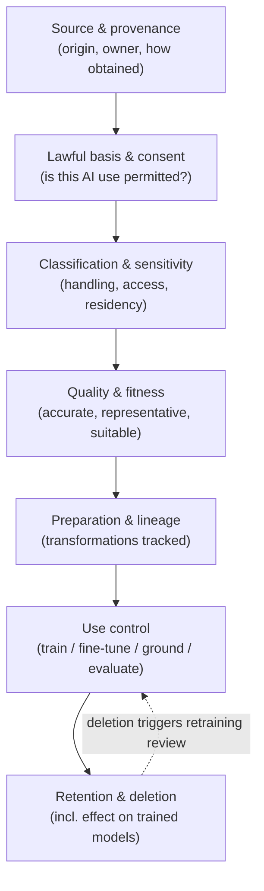
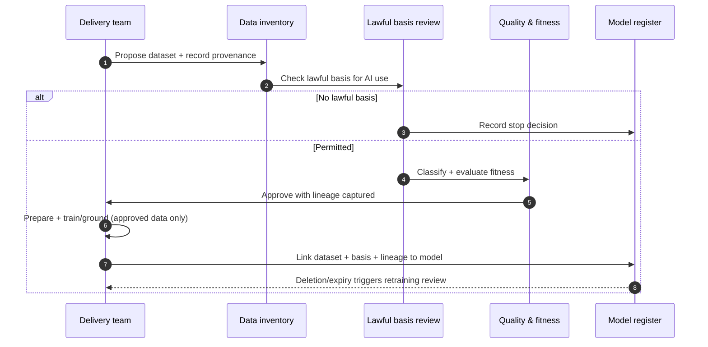

# Chapter 7: Data Governance for AI

This chapter opens Part III, which follows the AI lifecycle, and it begins where the lifecycle itself begins: with data. An AI system inherits the properties of the data it learns from, so most of what later goes wrong, bias, a privacy breach, an unexplainable decision, a model that degrades, has a root in data that was poorly understood or poorly controlled. Governing data for AI is therefore not a preliminary to governance; it is where a large part of the risk is either contained or created. The skill on display here is tracing consequences backwards: recognising that a fairness problem in deployment is often a provenance problem at ingestion.

---

## 1. The Governance Problem

A team builds a capable model and deploys it. Months later, three problems surface at once. The model performs worse for one group of customers than another, and no one can say why. A regulator asks for the lawful basis on which the training data was used, and the answer is uncertain. A customer requests deletion of their data, and the organisation cannot tell whether that data influenced a model already in production. Each is a data governance failure that became visible only after the model was live.

The problem is that data flows into AI through paths that conventional data governance was not designed to watch. Training data is copied, transformed, combined and embedded, often losing its provenance and its consent basis along the way. Many organisations govern data at rest in their primary systems but lose sight of it the moment it is extracted to train or ground a model. The result is that the most consequential uses of data, the ones that shape automated decisions about people, are frequently the least well governed.

The constraint that matters most is that data problems are hard to reverse once a model is trained. A biased dataset becomes a biased model, and the bias cannot be edited out of the weights; the model must be retrained. The governance question is therefore not "is our data secure?" but "do we know the provenance, quality, lawful basis, sensitivity and residency of every dataset that feeds a model, and can we control its use throughout the lifecycle?"

---

## 2. 🧩 The Mechanism at a Glance

- **Mechanism name:** Data Governance for AI
- **Risk addressed:** Bias, unlawful use, unexplainability and degradation arising from data that is poorly understood or poorly controlled.
- **Primary objective:** Known provenance, quality, lawful basis, sensitivity and residency for every dataset feeding a model, with control maintained across the lifecycle.
- **When to use:** Before any data is used to train, fine tune, ground or evaluate a model, and continuously thereafter.
- **When not to use:** As a one time clearance at ingestion that is never revisited, or as a reason to duplicate mature general data governance rather than extend it.
- **Relevant frameworks / obligations:** Data protection law (for example the EU GDPR) including automated decision making rules; EU AI Act data and data governance requirements; ISO/IEC 42001 data controls; sector data regimes.
- **Primary governance concern:** Provenance and lawful basis followed end to end, so a model's data lineage is always knowable.

Data governance for AI extends, rather than replaces, general data governance. It adds the lineage, consent tracking and quality evaluation that AI specific risks demand, and it follows the data into training and grounding where conventional governance usually stops.

---

## 3. The Operating Model

The reference model governs data along the path it actually takes into a model:

- **Source and provenance** record where each dataset originates, who owns it, and the basis on which it was obtained.
- **Lawful basis and consent** establish whether the intended AI use is permitted for this data, including any purpose limitation.
- **Classification and sensitivity** determine the handling, access and residency the data requires.
- **Quality and fitness** evaluate whether the data is accurate, representative and suitable for the intended model.
- **Preparation and lineage** track every transformation, combination and embedding so the path from source to model is traceable.
- **Use control** governs training, fine tuning, grounding and evaluation within the permitted basis.
- **Retention and deletion** enforce how long data persists and what happens, including to trained models, when it must be removed.

Each stage is a gate as well as a record. Data that lacks a lawful basis does not proceed to use. Data of unknown quality is not treated as fit. Lineage is captured as preparation happens, not reconstructed afterwards. The deletion feedback acknowledges the hard case: removing data may require revisiting the models trained on it.

---

## 4. The Decision & Control Flow

> **Step 1:** A team proposes using a dataset to train, ground or evaluate a model.
> **Step 2:** The dataset's source, owner and provenance are recorded in the data inventory.
> **Step 3:** The lawful basis for the intended AI use is established, including consent and purpose limitation.
> **Step 4:** If no lawful basis exists for this use, the data is not used, and the decision is recorded.
> **Step 5:** The data is classified for sensitivity, setting its access, handling and residency requirements.
> **Step 6:** Quality and fitness are evaluated: accuracy, completeness, representativeness and suitability for the task.
> **Step 7:** Preparation steps, cleaning, transformation, combination, embedding, are performed with lineage captured at each step.
> **Step 8:** The prepared dataset is approved for the specific use within its permitted basis and residency.
> **Step 9:** The model is trained, fine tuned or grounded using only approved data.
> **Step 10:** The dataset, its basis and its lineage are linked to the resulting model in the register.
> **Step 11:** Retention rules are enforced; a deletion request or expiry triggers review of affected datasets and models.
> **Step 12:** Material changes to a source or its basis trigger reassessment of the models that depend on it.

The flow makes the discipline concrete: no data reaches a model without known provenance, an established lawful basis, an understood quality, and captured lineage, and the link between data and model is recorded so the organisation can answer questions about either later.

---

## 5. Why This Mechanism Works

The mechanism works because it governs data where the risk is actually created, along the path into the model, rather than only at rest in primary systems. By establishing provenance and lawful basis before use, it prevents the two failures that are most expensive to reverse: training on data the organisation had no right to use, and training on data whose bias will propagate into every decision the model makes. Prevention is the point, because once a model is trained these problems cannot be patched out.

It also works because it captures lineage as a by-product of preparation. When every transformation is recorded as it happens, the organisation can always answer where a model's data came from, what basis permitted it, and which models a given dataset influenced. That lineage is what makes a deletion request answerable, a regulator's question about lawful basis answerable, and a fairness investigation able to trace a problem back to its source.

---

## 6. 🏛️ Governance Decisions

| Decision | Options | Recommended approach | Reason |
| --- | --- | --- | --- |
| Scope of governance | Data at rest only / Data along the path to the model | Along the path to the model | AI risk is created in training and grounding, not only at rest |
| Lawful basis | Assumed from original collection / Established for the AI use | Established for the AI use | Original consent rarely covers a new AI purpose |
| Quality evaluation | Technical accuracy only / Accuracy and representativeness | Accuracy and representativeness | Representativeness drives fairness; accuracy alone misses bias |
| Lineage | Reconstructed on demand / Captured during preparation | Captured during preparation | After the fact reconstruction is unreliable and often impossible |
| Data to model link | Untracked / Recorded in the register | Recorded in the register | Deletion, audit and fairness all require knowing which models used which data |
| Deletion effect | Delete source only / Review dependent models | Review dependent models | Data in a trained model is not removed by deleting the source |

These defaults follow the data into the model and keep its basis and lineage knowable. If the organisation cannot say which datasets trained a given model, the link was never recorded and the mechanism is incomplete.

---

## 7. ⚖️ Trade-offs

**Benefits:** Prevention of the hardest to reverse AI failures; answerable provenance and lawful basis; traceable lineage from source to model; and the ability to honour deletion and respond to fairness and audit questions.

**Friction:** Establishing lawful basis and capturing lineage adds steps before data can be used, which teams eager to train may experience as delay. If the process is heavy, teams extract data through unofficial paths and the governance is bypassed.

**Cost:** The effort of inventory, basis review, quality evaluation and lineage capture, plus the tooling to maintain lineage at scale. Concentrated on data feeding higher risk models.

**Operational overhead:** Maintaining a data inventory, lineage records and the data to model links is continuous. Without ownership these records decay and lineage breaks.

**Risk reduction:** High and distinctive, because it addresses risks at the only point where they are cheap to prevent. A fairness or lawfulness problem caught at ingestion costs far less than the same problem found in a deployed model.

**Speed to deliver:** A clear data clearance path can accelerate delivery by giving teams approved, documented datasets to work from. An unclear one slows every project and invites shortcuts.

**Unintended consequences:** Excessive restriction can starve legitimate work of data, pushing teams towards unapproved sources. Proportionality, lighter clearance for low risk, non personal data, keeps the mechanism usable.

---

## 8. 🔐 Risk, Safety & Responsible AI

Data governance is where fairness and privacy are most effectively addressed, because both originate in data. Fairness depends on representativeness: a dataset that under represents a group will produce a model that serves that group worse, and the only reliable way to prevent this is to evaluate representativeness before training, not to discover the disparity after deployment. Privacy depends on lawful basis and minimisation: using only the personal data for which a valid basis exists, and no more than the task requires, is a data control before it is anything else.

This mechanism also underpins explainability and contestability. When a person questions an automated decision, the organisation's ability to respond depends on knowing what data informed the model and on what basis. A model whose data lineage is unknown cannot be fully explained, and a decision that cannot be explained cannot be meaningfully contested. The responsible AI outcomes examined in Part IV are, to a large degree, cashed out here in the discipline of knowing and controlling the data.

---

## 9. 📜 Regulatory & Assurance Alignment

Data governance for AI sits at the intersection of data protection law and AI regulation, which makes it one of the most heavily regulated mechanisms in the book.

**Data protection law**, such as the EU GDPR and its equivalents, governs lawful basis, purpose limitation, data minimisation, the rights of individuals including erasure, and specific rules on automated decision making and profiling. These apply directly to data used in AI and often require a lawful basis distinct from the one under which the data was originally collected. The **EU AI Act** imposes explicit data and data governance obligations on high risk systems, including requirements for relevant, representative and appropriately managed training, validation and testing data. **ISO/IEC 42001** expects controls over data used in AI systems, including quality and provenance.

Sector regimes add further duties. In **healthcare**, health data attracts heightened protection (for example under HIPAA) and clinical data used to train a model carries both privacy and safety obligations. In **financial services**, model risk expectations extend to the data a model is built on, including its quality and appropriateness. In the **public sector**, records and transparency duties may require that the data behind an automated decision be documented and, in some cases, disclosable.

The evidence an auditor or regulator expects includes a data inventory, recorded lawful basis for each AI use, quality and representativeness evaluations, lineage from source to model, and the data to model links that make deletion and audit answerable. A mechanism that captures these as it operates meets the expectation directly. As throughout, this is governance guidance rather than legal advice, and lawful basis in particular requires local legal interpretation.

---

## 10. ⚠️ Failure Modes & Resilience

- **Lost provenance:** Data extracted, copied and transformed without recorded origin becomes unusable for governance even if technically useful for training. Capturing provenance at ingestion, before the trail goes cold, is the mitigation.
- **Basis assumed, not established:** Treating original collection consent as covering a new AI purpose is a frequent and serious error. An explicit basis review for the AI use prevents it.
- **Representativeness ignored:** Evaluating only technical accuracy misses the bias that under representation introduces. Fitness evaluation must include representativeness for the affected population.
- **Broken lineage:** Lineage reconstructed after the fact is often incomplete or wrong. Capturing it during preparation is the only reliable approach.
- **Unhonourable deletion:** An organisation that cannot link data to the models trained on it cannot honour a deletion request fully, because the data persists in the model. Recording the link, and reviewing dependent models on deletion, is the mitigation.
- **Shadow extraction:** If official clearance is slow, teams pull data through unofficial channels, defeating the controls. A proportionate, fast clearance path for low risk data keeps use within governance.

The theme is that data failures are latent: they are introduced early, stay invisible through development, and surface expensively in production. Resilience comes from governing at ingestion and preparation, when the problems are still cheap to prevent.

---

## 11. 👁️ Monitoring & Operations

The function should monitor, at minimum: inventory coverage, the proportion of datasets feeding models with recorded provenance and basis; basis currency, whether any source's lawful basis has changed or lapsed; quality and representativeness results for datasets feeding higher risk models; lineage completeness, whether every production model has a traceable data lineage; and deletion and retention compliance, including the status of models dependent on deleted data. These signals reveal whether data is genuinely under control or merely assumed to be.

Distinguish monitoring of the data governance, is provenance known, basis valid, lineage intact, from monitoring of the model's behaviour in production, which later chapters address. Note, however, that the two connect: when monitoring detects a model degrading or behaving unfairly, data lineage is what lets the organisation trace the cause back to its source.

---

## 12. 💷 Cost & Proportionality

The cost drivers are inventory and lineage tooling, the effort of lawful basis and quality review, and the storage and management of documented datasets. These should scale with the sensitivity of the data and the risk of the models it feeds.

Proportionality prevents data governance from becoming a universal tax. Low risk, non personal, non sensitive data used in a low risk model needs a light clearance; personal data feeding a high risk decision about individuals warrants full provenance, basis, representativeness and lineage. The failure in one direction is starving legitimate work with blanket restriction, which drives shadow extraction; the failure in the other is governing sensitive, high impact data as loosely as public data, which is where the serious breaches occur. The lever is classification: the sensitivity and risk tier should set the depth of data governance applied.

---

## 13. When to Use This Mechanism

Use this mechanism when:

- data is used to train, fine tune, ground or evaluate any model;
- personal, sensitive or regulated data may feed an AI system;
- the organisation must be able to state the lawful basis for its AI data use;
- fairness depends on the representativeness of training data; and
- individuals have rights, such as erasure, that reach data used in models.

In practice this is every organisation building or grounding models on real data, which is nearly all of them. The depth varies with data sensitivity and model risk.

---

## 14. When NOT to Use This Mechanism

The caution is against misapplication, since some data governance is always required where models use real data:

- Do not treat it as a **one time clearance** at ingestion; a basis can lapse and a source can change, so dependence must be revisited.
- Do not **duplicate mature general data governance**; extend it to follow data into training and grounding rather than building a parallel function.
- Do not apply **uniform heavy clearance** to all data; blanket restriction starves legitimate work and drives unofficial extraction.

The lighter alternative for genuinely low risk, non personal data is a fast, recorded clearance, not an absence of provenance. Even low risk data should have a knowable origin.

---

## 15. Mechanism Variations

- **Small organisation:** A simple data inventory, basis checks for any personal data, and lineage captured for the few models that matter, owned alongside general data governance.
- **Scaling organisation:** A maintained inventory, a standard basis and fitness review, lineage tooling, and recorded data to model links as the number of models grows.
- **Large enterprise:** A federated model in which central data governance owns standards and the enterprise inventory while business units manage their own datasets and lineage within the common framework.
- **Highly regulated enterprise:** Formal lawful basis documentation, mandatory representativeness evaluation for defined use cases, strict residency controls, and independent validation of data lineage for high risk models.

The variations differ in tooling and formality, not in the principle that data feeding a model must have known provenance, an established basis, evaluated fitness and captured lineage.

---

## 16. Governance Decision Checklist

- [ ] Does every dataset feeding a model have recorded provenance and a known owner?
- [ ] Is a lawful basis established for the specific AI use, not assumed from original collection?
- [ ] Is data classified for sensitivity, setting access, handling and residency?
- [ ] Is fitness evaluated for representativeness, not only technical accuracy?
- [ ] Is lineage captured during preparation rather than reconstructed later?
- [ ] Is the link between datasets and the models they trained recorded in the register?
- [ ] Can the organisation honour a deletion request that reaches data used in a model?
- [ ] Does a change to a source or its basis trigger reassessment of dependent models?
- [ ] Is the depth of data governance proportionate to data sensitivity and model risk?

---

## 17. 📐 The Governance Verdict

> Data governance for AI is the mechanism that contains risk at the only point where it is cheap to contain, before a model is trained, and it is required wherever models are built or grounded on real data. It earns its place by establishing provenance and lawful basis before use, evaluating representativeness that drives fairness, and capturing lineage that makes deletion, audit and fairness investigations answerable. Its weaknesses are latency and bypass: data problems are introduced early and surface expensively in production, and heavy clearance drives teams to unofficial sources. Extend your existing data governance to follow data into training and grounding, establish a basis for the AI use specifically, evaluate representativeness, and record which data trained which model. Govern the data before the model learns from it, because once it has learned, the data problem has become a model problem you cannot simply delete. Most AI failures are data failures wearing a later disguise.
