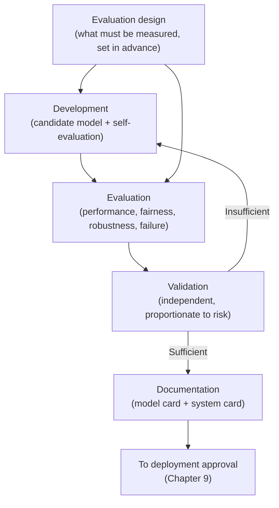
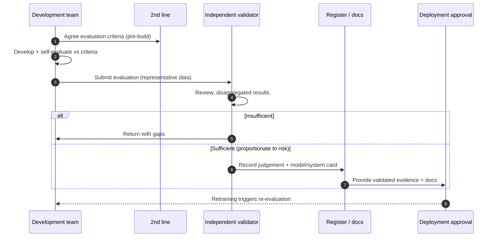

# Chapter 8: Development, Evaluation and Validation Controls

Chapter 7 governed the data that goes into a model. This chapter governs what happens as the model is built from it: how its behaviour is evaluated, how its fitness is validated before anyone relies on it, and how it is documented so that others can understand and challenge it. This is the stage at which an organisation decides, on evidence rather than optimism, whether a model is good enough to deploy. The temptation is to treat a model that performs well on a convenient test as ready. The skill on display here is disciplined scepticism: proving fitness against the conditions the model will actually face, not the ones that happen to flatter it.

---

## 1. The Governance Problem

A team reports that its model achieves ninety four per cent accuracy, and the business takes that as permission to deploy. The figure is real, but it answers the wrong question. It was measured on data drawn from the same source as the training data, so it reveals how well the model fits the past rather than how it will behave on the cases it has never seen. It is a single aggregate number, so it conceals that the model performs far worse for a minority of users. And it says nothing about how the model fails, how confident it is when wrong, or whether its behaviour can be explained. The model looks ready. The evidence that it is ready does not exist.

The problem is that building a model and proving it fit are different activities, and organisations routinely conflate them. The people who build a model are motivated to see it succeed and tend to evaluate it on terms that show it in a good light. Without a deliberate control, evaluation becomes self assessment by the optimistic, validation is skipped or performed by the same people, and documentation is an afterthought written, if at all, once the model is already in use.

The constraint that matters most is that evaluation must reflect reality, not convenience. A model is only as trustworthy as the conditions under which it was tested, and the conditions that matter are the ones it will meet in production, including the hard cases and the under represented groups. The governance question is therefore not "does the model perform well?" but "has its fitness been proven, independently where the risk warrants, against the conditions it will actually face, and documented so others can rely on and challenge it?"

---

## 2. 🧩 The Mechanism at a Glance

- **Mechanism name:** Development, Evaluation and Validation Controls
- **Risk addressed:** Models deployed on inadequate or self serving evidence of fitness, with hidden failure modes and poor documentation.
- **Primary objective:** Proven, proportionate evidence that a model is fit for its intended use, validated independently where risk warrants, and documented for reliance and challenge.
- **When to use:** Before any model is approved for deployment, and on material change or retraining thereafter.
- **When not to use:** As a single accuracy gate, or as a uniform heavyweight validation applied regardless of risk.
- **Relevant frameworks / obligations:** NIST AI RMF Measure function; EU AI Act testing, accuracy, robustness and documentation requirements; ISO/IEC 42001 performance evaluation; sector model validation regimes.
- **Primary governance concern:** Evaluating against real conditions and separating validation from the team that built the model, in proportion to risk.

Evaluation measures how a model behaves across the conditions that matter. Validation is the independent judgement that the evidence is sufficient for the intended use. Documentation, through model and system cards, records what the model is, how it was evaluated, and its known limitations.

---

## 3. The Operating Model

The reference model separates building, evaluating, validating and documenting, with independence increasing with risk:

- **Development** produces the candidate model and its own evaluation against defined criteria.
- **Evaluation design** sets, in advance, what must be measured: performance, fairness across groups, robustness, failure behaviour and, where relevant, explainability.
- **Evaluation** measures the model against those criteria using data representative of production conditions, including hard cases and under represented groups.
- **Validation** is an independent judgement, proportionate to risk, that the evaluation is sound and the model is fit for its intended use.
- **Documentation** captures the model card and, for a deployed system, the system card: purpose, data, metrics, limitations and oversight.
- **Approval input** feeds the validated evidence and documentation to the deployment decision in Chapter 9.

Each component has a clear role. Criteria are fixed before evaluation so they cannot be chosen to fit the result. Evaluation measures against production like conditions. Validation is the independent check that increases in rigour with risk. Documentation makes the evidence durable and legible. The loop back from insufficient validation to development is deliberate: a model that fails validation returns to be improved, not quietly waved through.

---

## 4. The Decision & Control Flow

> **Step 1:** Before building, the team and the second line agree the evaluation criteria for the use case's risk tier.
> **Step 2:** The criteria specify performance measures, fairness across defined groups, robustness, failure behaviour and explainability needs.
> **Step 3:** The team develops the candidate model and performs its own evaluation against the agreed criteria.
> **Step 4:** Evaluation uses held out data representative of production, including hard cases and under represented groups, not only convenient data.
> **Step 5:** Results are recorded disaggregated, so performance for each relevant group is visible rather than hidden in an average.
> **Step 6:** For higher risk tiers, an independent validator reviews the evaluation and may require additional testing.
> **Step 7:** The validator judges whether the evidence is sufficient for the intended use, and records the judgement.
> **Step 8:** If the evidence is insufficient, the model returns to development with the gaps identified.
> **Step 9:** If sufficient, the model card and system card are completed: purpose, data lineage, metrics, limitations and required oversight.
> **Step 10:** The validated evidence and documentation are passed to the deployment approval authority.
> **Step 11:** Retraining or material change triggers re-evaluation and, for higher tiers, revalidation before redeployment.

The flow makes the discipline concrete: criteria fixed in advance, evaluation against real conditions with results disaggregated, independent validation scaled to risk, and durable documentation, all feeding a deployment decision based on evidence rather than optimism.

---

## 5. Why This Mechanism Works

The mechanism works because it separates proving a model fit from building it, and scales that separation to risk. Fixing the evaluation criteria before development removes the temptation to choose the test that flatters the model, and independent validation for higher risk cases means the judgement of fitness is made by someone not invested in the model shipping. The result is evidence the organisation can trust, because it was not produced solely by those who most want the model approved.

It also works because it insists on evaluating the conditions that matter rather than the ones that are convenient. Disaggregated results expose the disparity that an aggregate accuracy figure hides, representative test data reveals behaviour on cases the model will actually meet, and explicit evaluation of failure behaviour shows how the model goes wrong, not just how often. Documentation then makes this evidence durable, so the model can be relied on, audited and challenged long after the team that built it has moved on.

---

## 6. 🏛️ Governance Decisions

| Decision | Options | Recommended approach | Reason |
| --- | --- | --- | --- |
| Evaluation criteria | Chosen after results / Fixed before development | Fixed before development | Prevents selecting the test that flatters the model |
| Test data | Convenient / Representative of production | Representative, incl. hard cases | Fitness means behaviour on real conditions, not familiar ones |
| Results granularity | Aggregate only / Disaggregated by group | Disaggregated by group | Averages hide disparities that matter for fairness |
| Validation independence | Same team / Independent, scaled to risk | Independent, scaled to risk | Fitness judged by someone not invested in shipping |
| Scope of evaluation | Accuracy only / Performance, fairness, robustness, failure | Multi dimensional | A single metric conceals how and for whom the model fails |
| Documentation | Optional / Model and system card required | Required | Reliance, audit and challenge need durable, legible records |

These defaults separate proof from build and match rigour to risk. If a model's only evidence of fitness is an aggregate accuracy figure produced by its builders, the mechanism has not been applied.

---

## 7. ⚖️ Trade-offs

**Benefits:** Trustworthy, risk proportionate evidence of fitness; exposure of hidden failure modes and group level disparities; independent judgement where it matters; and durable documentation for reliance, audit and challenge.

**Friction:** Fixing criteria in advance, evaluating against hard conditions and awaiting independent validation all add time before deployment. If validation is a slow, adversarial bottleneck, teams resent it and pressure builds to bypass it.

**Cost:** The effort of designing and running richer evaluations, the standing cost of an independent validation capability, and the time to produce documentation. Concentrated at higher risk tiers by design.

**Operational overhead:** Maintaining evaluation standards, validation capacity and documentation templates, and re-running them on retraining. Without this, validation becomes a one time event that staleness quietly invalidates.

**Risk reduction:** High, because it is the last substantive check before a model affects the real world. A failure caught in validation is far cheaper than the same failure discovered in production.

**Speed to deliver:** Clear criteria and proportionate validation can speed delivery by telling teams exactly what fitness requires. Heavyweight validation applied to low risk models slows everything and invites avoidance.

**Unintended consequences:** Over reliance on quantitative metrics can crowd out judgement about contexts a metric does not capture. Validation should include qualitative review of failure behaviour and intended use, not only numbers.

---

## 8. 🔐 Risk, Safety & Responsible AI

This mechanism is where fairness, robustness and safety are proven rather than hoped for. Fairness is evaluated by measuring performance disaggregated across the groups a system affects, against thresholds set in advance; an aggregate figure that looks acceptable can mask a model that is unfit for a minority, and only disaggregated evaluation reveals it. Robustness is evaluated by testing how the model behaves under unusual, adversarial or out of distribution inputs, because a model that is accurate on typical cases may fail unpredictably on the edges where harm concentrates.

Safety and explainability are addressed here too. Evaluating failure behaviour, how the model is wrong, how confident it is when wrong, and what the consequence of that error is, is what lets the organisation judge whether a given error rate is tolerable for the use. Where a use case requires that decisions be explainable, the evaluation must test whether the explanations the system produces are faithful and usable, not merely present. Part IV treats these outcomes in full; this chapter is where they are measured, because a responsible AI claim that is asserted but never evaluated is not a control.

---

## 9. 📜 Regulatory & Assurance Alignment

Evaluation and validation are explicitly expected by both AI regulation and established model risk regimes, which makes this mechanism directly responsive to obligation.

The **NIST AI RMF** places this activity in its Measure function, which calls for assessing AI risks and impacts using appropriate, representative methods and metrics. The **EU AI Act** requires high risk systems to be tested for accuracy, robustness and cybersecurity, to meet appropriate performance, and to be accompanied by technical documentation, obligations that map directly onto evaluation, validation and model and system cards. **ISO/IEC 42001** expects performance evaluation and the records that demonstrate it.

Sector regimes often make independent validation explicit. In **financial services**, model risk management expectations call for validation that is independent of model development, with documented testing, ongoing monitoring and review proportionate to the model's materiality, which is the clearest established analogue of this mechanism. In **healthcare**, software as a medical device must demonstrate clinical and analytical validity through documented evidence before use. In **employment**, rules on automated employment decision tools can require bias audits, which are a form of disaggregated fairness evaluation.

The evidence an auditor or regulator expects includes the pre agreed evaluation criteria, disaggregated results on representative data, the independent validation judgement for higher risk models, and the model and system cards. A mechanism that produces these as it operates meets the expectation directly. As throughout, this is governance guidance rather than legal advice, and the required validation for a specific obligation needs local interpretation.

---

## 10. ⚠️ Failure Modes & Resilience

- **Evaluation on convenient data:** Testing on data from the training distribution overstates fitness for production. Representative, held out data including hard cases is the mitigation.
- **Aggregate blindness:** A single headline metric hides group level disparities and rare but serious failures. Disaggregated and failure focused evaluation exposes them.
- **Criteria chosen to fit:** Selecting metrics or thresholds after seeing results produces flattering but meaningless evidence. Fixing criteria before development prevents it.
- **Validation by the builders:** Self validation lacks the independence that makes a fitness judgement trustworthy, especially under delivery pressure. Independence scaled to risk is the control.
- **Documentation as afterthought:** A model card written after deployment, or not at all, leaves the organisation unable to explain or challenge the model later. Requiring it before approval keeps it honest and current.
- **Stale validation:** A model validated once and then retrained or left to run as the world changes is no longer the model that was validated. Revalidation on material change and periodic review address this.

The theme is that evaluation fails by being too kind to the model: convenient data, flattering metrics, friendly validators and optimistic documentation all produce a model that looks fit and is not. Resilience comes from independence, representativeness and criteria fixed in advance.

---

## 11. 👁️ Monitoring & Operations

The function should monitor, at minimum: the proportion of deployed models with pre agreed criteria, disaggregated evaluation and, where required, independent validation; the currency of validation against retraining and material change; the completeness of model and system cards for production systems; the rate at which models fail validation and why; and the backlog and turnaround of the validation function. These signals show whether fitness is genuinely proven across the estate or assumed for most of it.

This mechanism also sets the baseline for production monitoring, which Chapter 10 covers. The metrics and thresholds established during evaluation become the reference against which drift is detected, so a model evaluated without clear, disaggregated baselines cannot be monitored well later. Evaluation and monitoring are two ends of the same measurement discipline.

---

## 12. 💷 Cost & Proportionality

The cost drivers are the effort of richer, disaggregated evaluation, the standing capacity for independent validation, and the production and maintenance of documentation. These should scale sharply with risk: a low risk internal tool needs a light evaluation and self validation, while a high risk decision affecting people warrants full disaggregated evaluation and genuinely independent validation.

Proportionality is the discipline that keeps the mechanism usable. Applying heavyweight independent validation to every model, regardless of risk, creates a bottleneck that delays low risk work and consumes validation capacity needed for the cases that matter. Applying light self evaluation to a high risk model leaves real harm unproven. The lever is the risk tier from Chapter 4, which should set both the depth of evaluation and the degree of validation independence. An organisation that validates everything equally has miscalibrated as surely as one that validates nothing.

---

## 13. When to Use This Mechanism

Use this mechanism when:

- a model's output will be relied upon for anything that matters;
- the model affects people, and fairness across groups must be proven;
- the cost of a hidden failure mode in production is significant;
- a regulator or auditor may ask for evidence of testing and validation; and
- the organisation needs durable documentation to rely on, audit and challenge the model later.

In practice every model bound for deployment needs evaluation and documentation; independent validation is reserved for the risk tiers that warrant it.

---

## 14. When NOT to Use This Mechanism

The caution is against both skipping and over applying:

- Do not reduce it to a **single accuracy gate**; one aggregate metric is not evidence of fitness and hides the failures that matter.
- Do not apply **uniform heavyweight validation** to every model; disproportionate validation bottlenecks delivery and drains capacity from high risk cases.
- Do not **defer documentation** until after deployment; a model card written in hindsight is unreliable and often never written.

The lighter alternative for a low risk model is proportionate self evaluation against pre agreed criteria with a concise model card, not the absence of evidence. Even low risk models should have a fitness record.

---

## 15. Mechanism Variations

- **Small organisation:** Pre agreed criteria, a straightforward disaggregated evaluation, and a concise model card, with independent validation bought in for the rare high risk model.
- **Scaling organisation:** Standard evaluation criteria by tier, a defined internal validation step for higher risk models, and model and system card templates.
- **Large enterprise:** A federated model in which a central validation function sets standards and independently validates the highest risk models, while business units evaluate and validate lower tiers within the framework.
- **Highly regulated enterprise:** Formally independent validation aligned to the sector's model risk regime, mandatory bias and robustness testing for defined categories, and documented revalidation on every material change.

The variations differ in the formality and independence of validation, not in the principle that fitness must be proven against real conditions, disaggregated, and documented before reliance.

---

## 16. Governance Decision Checklist

- [ ] Were the evaluation criteria fixed before development rather than chosen to fit the results?
- [ ] Is the model evaluated on data representative of production, including hard cases and under represented groups?
- [ ] Are results disaggregated so performance for each relevant group is visible?
- [ ] Does evaluation cover fairness, robustness and failure behaviour, not only aggregate accuracy?
- [ ] Is validation independent of the development team, in proportion to risk?
- [ ] Does a model that fails validation return for improvement rather than proceed?
- [ ] Are model and system cards completed before approval, not after deployment?
- [ ] Do retraining and material change trigger re-evaluation and, where warranted, revalidation?
- [ ] Is the depth of evaluation and validation proportionate to the risk tier?

---

## 17. 📐 The Governance Verdict

> Development, evaluation and validation controls are the mechanism that decides, on evidence rather than optimism, whether a model is fit to deploy, and they are required for any model whose output will be relied upon. The mechanism earns its place by separating proof from build, fixing criteria before development, evaluating against the conditions the model will actually face, and validating independently in proportion to risk. Its weaknesses all point the same way: evaluation that is too kind to the model, through convenient data, flattering metrics, friendly validators and hindsight documentation. Fix the criteria in advance, evaluate disaggregated against real conditions, make validation independent where the risk warrants, and document before approval. Prove the model fit for the world it will meet, not the test that happens to flatter it. A high accuracy figure is a claim; an independent validation against representative, disaggregated evidence is proof, and only proof should reach production.
