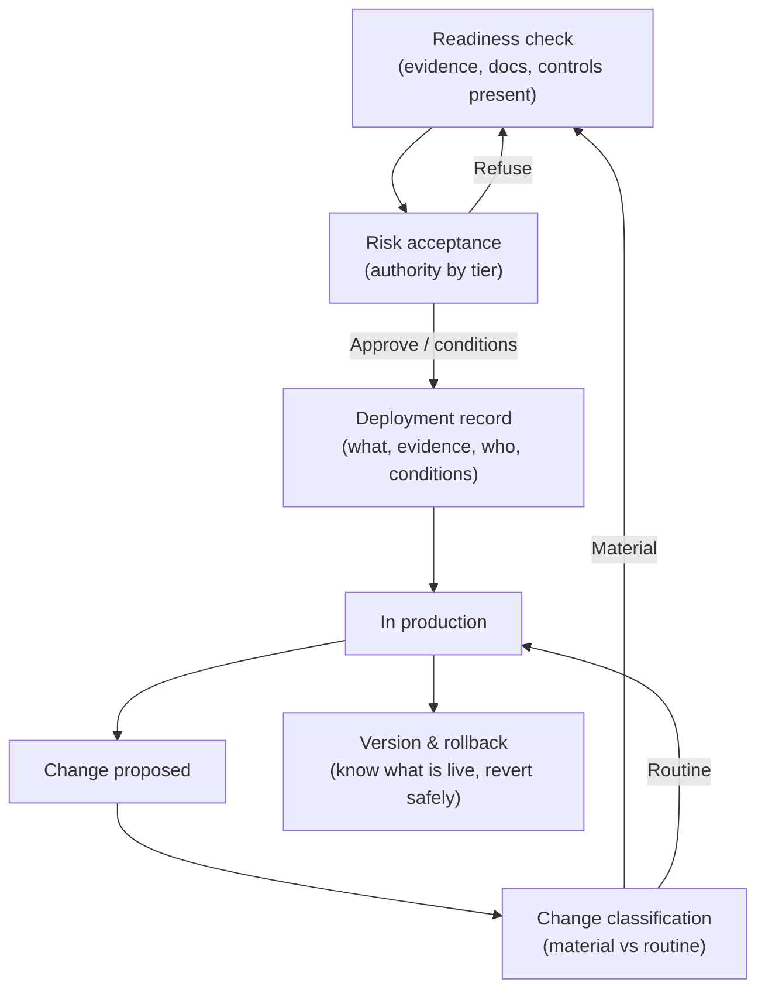
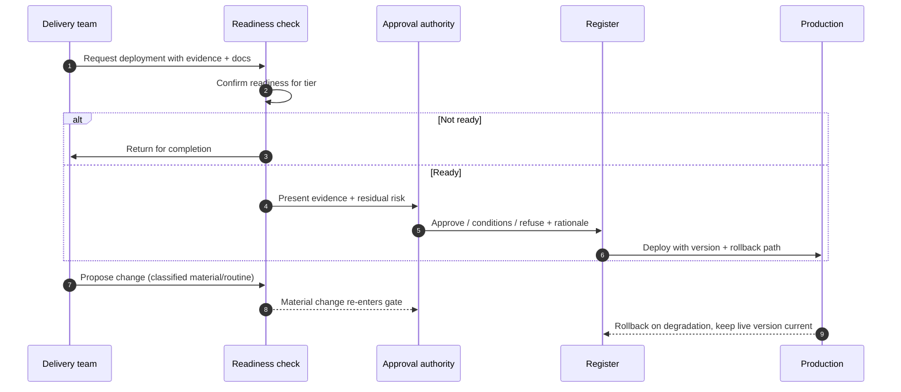

# Chapter 9: Deployment Approval and Change Control

Chapter 8 produced the evidence that a model is fit. This chapter governs the moment that evidence is acted upon: the decision to let a model affect the real world, and the control of every change to it thereafter. Deployment is the point at which governance either holds or is quietly bypassed, because it is where delivery pressure is highest and the temptation to ship first and document later is strongest. The skill on display here is holding a gate that is firm enough to matter and light enough that teams pass through it rather than around it.

---

## 1. The Governance Problem

A model has been evaluated and validated. The team is ready to deploy, and the business wants it live. In many organisations what happens next is informal: an engineer promotes the model to production, perhaps with a colleague's nod, and the system begins making real decisions. No authority formally accepted the risk, no record captures who approved what on what evidence, and when the model is updated next month the same informal promotion happens again. The organisation has a validation report and no gate that requires anyone to read it before going live.

The problem is twofold. First, deployment without a defined approval means no one with the authority to accept the risk actually did; the decision defaulted to whoever had access to the deployment pipeline. Second, AI systems change constantly, through retraining, a new model version, a changed prompt, a swapped vendor model, and each change can alter behaviour as much as the original deployment, yet changes are routinely treated as routine. A model governed carefully at first release and then updated freely is a governed model in name only.

The constraint that matters most is that the gate must be proportionate or it will be evaded. A deployment approval so heavy that it delays every release trains teams to batch changes, hide them, or route around the control entirely, which leaves more risk than a lighter gate that is actually honoured. The governance question is therefore not "how do we lock down deployment?" but "how do we ensure the right authority accepts the risk on adequate evidence, for the first release and for every material change, without the gate becoming something teams avoid?"

---

## 2. 🧩 The Mechanism at a Glance

- **Mechanism name:** Deployment Approval and Change Control
- **Risk addressed:** Models going live, and changing, without an accountable risk acceptance or a record of what was approved.
- **Primary objective:** A proportionate gate at which the right authority accepts the risk on adequate evidence, applied to first deployment and to every material change.
- **When to use:** Before any model reaches production, and before any material change to a deployed model.
- **When not to use:** As a uniform heavy gate on every change regardless of materiality, or as a rubber stamp that never declines.
- **Relevant frameworks / obligations:** EU AI Act conformity and post market obligations; NIST AI RMF Manage function; ISO/IEC 42001 operational control; sector change and release governance.
- **Primary governance concern:** Proportionate, accountable risk acceptance at release and at change, without creating a gate teams evade.

Deployment approval is the risk acceptance decision for first release. Change control extends the same discipline across the system's life, classifying each change by materiality so that significant changes are re-approved while trivial ones are not needlessly delayed.

---

## 3. The Operating Model

The reference model is a single gate, entered at first deployment and re-entered on material change, with depth set by risk tier and change materiality:

- **Readiness check** confirms the evidence from evaluation and validation, documentation and required controls are present.
- **Risk acceptance** is the explicit decision by the authority matched to the use case's tier, recording approval, conditions or refusal.
- **Deployment record** captures what was approved, on what evidence, by whom, with what conditions.
- **Change classification** judges each subsequent change as material or routine.
- **Re-approval** routes material changes back through readiness and risk acceptance; routine changes proceed under standing conditions.
- **Version and rollback** maintain the ability to identify what is live and to revert safely.

Each component has a clear role. The readiness check ensures the gate acts on real evidence rather than assurances. Risk acceptance attaches an accountable decision to going live. The record makes the decision durable. Change classification is the control that keeps the gate relevant over time, and version and rollback make the gate recoverable when a change goes wrong.

---

## 4. The Decision & Control Flow

> **Step 1:** A team requests deployment, presenting the validated evidence and completed documentation from Chapter 8.
> **Step 2:** A readiness check confirms the evidence, model and system cards, and required controls for the tier are all present.
> **Step 3:** If readiness is incomplete, the request is returned rather than approved on trust.
> **Step 4:** The approval authority matched to the risk tier reviews the evidence and the residual risk.
> **Step 5:** The authority approves, approves with conditions, or refuses, and records the decision and its rationale.
> **Step 6:** The deployment record captures what was approved, on what evidence, by whom and under what conditions.
> **Step 7:** The model is deployed, with its version and a rollback path recorded.
> **Step 8:** When a change is proposed, retrain, new version, prompt change, vendor model swap, it is classified as material or routine.
> **Step 9:** A material change re-enters the readiness and risk acceptance steps before it may go live.
> **Step 10:** A routine change proceeds under the standing conditions, with the change logged.
> **Step 11:** If a deployed change degrades behaviour, the recorded rollback path is used to revert.
> **Step 12:** The register is updated so the live version, its approval and its conditions are always current.

The flow makes the discipline concrete: no model goes live without an accountable acceptance on checked evidence, every material change returns through the same gate, and the organisation can always say what is live, who approved it and how to revert it.

---

## 5. Why This Mechanism Works

The mechanism works because it attaches an accountable decision to the single most consequential moment in the lifecycle. By requiring a named authority to accept the residual risk on checked evidence, it ensures that going live is a deliberate choice by someone empowered to make it, not a side effect of who holds deployment access. The record it produces answers, for any system, who approved it, on what evidence and under what conditions, which is precisely what an incident investigation or a regulator later needs.

It also works because change control keeps the gate honest over time. Recognising that a retrain or a vendor model swap can change behaviour as much as the original release, it routes material changes back through the same acceptance while letting routine changes pass, so the control stays both relevant and proportionate. The version and rollback discipline completes the picture: a gate that can let a change in must also be able to take it back, and a system whose live version is always known is one the organisation can actually govern.

---

## 6. 🏛️ Governance Decisions

| Decision | Options | Recommended approach | Reason |
| --- | --- | --- | --- |
| Deployment gate | Informal promotion / Formal risk acceptance | Formal risk acceptance | Going live must be an accountable decision, not a pipeline side effect |
| Approval authority | Single body / Matched to risk tier | Matched to risk tier | Proportionate weight; avoids a bottleneck on low risk releases |
| Change handling | All changes equal / Classified by materiality | Classified by materiality | Material change alters behaviour and must be re-approved; routine must not stall |
| Readiness | Approve on trust / Checked evidence present | Checked evidence present | The gate must act on evidence, not assurances |
| Record | Informal / Durable deployment record | Durable deployment record | Incident and audit need to know what was approved and why |
| Recovery | Forward only / Versioned with rollback | Versioned with rollback | A change that degrades behaviour must be reversible |

These defaults make release accountable and change proportionate. If the organisation cannot say who accepted the risk for a live model, or cannot identify the version in production, the gate is not operating.

---

## 7. ⚖️ Trade-offs

**Benefits:** Accountable risk acceptance at the decisive moment; a durable record for incident and audit; change kept under control across the system's life; and a reliable path to revert a bad change.

**Friction:** A gate before release adds a step at the point of greatest delivery pressure. If it is slow or heavy for routine work, teams batch changes, downplay materiality or bypass the pipeline, which is worse than a lighter gate they respect.

**Cost:** The time of approval authorities and the overhead of recording decisions and maintaining version and rollback. Concentrated at higher tiers and material changes.

**Operational overhead:** Running the gate, classifying changes and keeping the register's live version current is continuous. A register that drifts out of date undermines the whole mechanism.

**Risk reduction:** High, because it is the control that stands between validated evidence and real world impact, and because it extends governance across the many changes a model undergoes rather than only its first release.

**Speed to deliver:** A proportionate gate with fast routine paths can keep delivery brisk while catching material change. A uniform heavy gate slows everything and is the classic driver of avoidance.

**Unintended consequences:** If change classification is left to the deploying team alone, there is an incentive to label material changes routine to skip re-approval. Clear criteria and assurance sampling of classifications guard against this.

---

## 8. 🔐 Risk, Safety & Responsible AI

Deployment approval is where responsible AI commitments are enforced as conditions of going live. The authority should confirm that the fairness, robustness, privacy and oversight evidence required for the tier is present and acceptable, and may approve subject to conditions, for example a monitoring requirement, a usage limit or a mandated human review, that carry the responsible AI controls into operation. An approval that ignores these and considers only functional readiness lets a system go live with its responsible AI obligations unmet.

Change control is equally important for safety, because the quiet change is where responsible AI most often erodes. A retrain on newer data can reintroduce bias that was tested out; a vendor's silent model update can change behaviour no one evaluated; a prompt change can alter safety properties. Treating these as material changes that re-enter the gate is what prevents a system that was fair and safe at release from drifting into unfairness or unsafety without anyone deciding to accept that risk.

---

## 9. 📜 Regulatory & Assurance Alignment

Deployment and change are where several regulatory obligations crystallise, which makes a disciplined gate directly responsive to them.

The **EU AI Act** frames high risk systems around conformity before placing on the market and obligations that continue after deployment, including post market monitoring and keeping documentation current, which maps onto both the initial gate and change control. The **NIST AI RMF** places this in its Manage function, which concerns acting on assessed risks, including decisions to deploy and to respond to change. **ISO/IEC 42001** expects operational control over the AI system, including change management.

Sector regimes bring established release and change governance. In **financial services**, model risk and change management expectations require that material model changes be governed and documented, not promoted informally. In **healthcare**, a change to a medical device, including its software, can require renewed clearance, so an uncontrolled model update may carry regulatory consequence. In the **public sector**, administrative accountability means a change to an automated decision system should be traceable to an authorising decision.

The evidence an auditor or regulator expects includes the deployment approval record with its evidence and conditions, the change log with materiality classifications, the identification of the version live in production, and the rollback capability. A gate that records these as it operates satisfies the request directly. As throughout, this is governance guidance rather than legal advice, and whether a change triggers a specific regulatory obligation requires local interpretation.

---

## 10. ⚠️ Failure Modes & Resilience

- **Pipeline bypass:** When the gate is slow, teams deploy through routes that skip it. Resilience comes from making the governed path the fastest path and from technical controls that prevent ungoverned promotion for higher tiers.
- **Rubber stamp:** An authority that approves everything presented, without the standing or evidence to refuse, provides the appearance of a gate and none of the substance. Genuine authority, adequate evidence and a non zero refusal rate indicate a real gate.
- **Materiality gaming:** Teams label material changes routine to avoid re-approval. Objective materiality criteria and assurance sampling of change classifications mitigate this.
- **Silent vendor change:** A consumed model updated by its provider changes behaviour with no internal release. Contractual notice, version pinning where possible, and monitoring that detects behavioural shifts are the defences.
- **Stale register:** If the recorded live version drifts from reality, incident response and audit lose their footing. Automated reconciliation between the register and production keeps it true.
- **No way back:** A degrading change with no rollback forces a scramble under pressure. A tested rollback path, maintained as part of the gate, is the mitigation.

The theme is that this gate fails by being either evaded or hollow. Resilience depends on making it proportionate enough to honour and substantive enough to matter, and on extending it to the changes that would otherwise slip through unrecorded.

---

## 11. 👁️ Monitoring & Operations

The function should monitor, at minimum: the proportion of production models with a formal approval record; approval turnaround by tier against service levels; the refusal and conditional approval rates, as a sign the gate has teeth; the rate of material versus routine change and the results of sampling classifications for gaming; the accuracy of the register's live version against production; and the existence and testing of rollback paths. These signals reveal whether the gate is operating as a real, proportionate control.

Distinguish monitoring of the gate, are releases accountable, recorded and reversible, from monitoring of the deployed system's behaviour, which Chapter 10 covers. The two connect at change: a behavioural shift detected in production monitoring should prompt the question of whether an unapproved or misclassified change caused it.

---

## 12. 💷 Cost & Proportionality

The cost drivers are the time of approval authorities, the overhead of recording and change classification, and the engineering to maintain versioning and rollback. These should scale with risk tier and change materiality rather than apply uniformly.

Proportionality is what determines whether the gate is honoured. A low risk internal tool may need only a lightweight recorded sign off and self classified changes; a high risk decision system warrants a formal authority, checked evidence and re-approval of every material change. The failure in one direction is a uniform heavy gate that delays all releases and drives avoidance; in the other, a uniform light gate that lets high risk systems go live and change without real acceptance. The lever is the tier and the materiality criteria, which together set how much gate each release meets. A gate that teams route around has failed regardless of how rigorous it looks on paper.

---

## 13. When to Use This Mechanism

Use this mechanism when:

- a model's output will affect the real world, customers, employees, the public or operations;
- someone with authority must be seen to accept the residual risk of going live;
- models change over time through retraining, new versions or vendor updates;
- an incident or audit may require knowing what was approved, by whom and on what evidence; and
- the organisation needs to identify and revert the version running in production.

In practice every production model needs an accountable deployment decision and change control; the weight of the gate scales with risk.

---

## 14. When NOT to Use This Mechanism

The caution is against the two distortions of the gate:

- Do not apply a **uniform heavy gate** to every change regardless of materiality; disproportionate friction on routine work drives batching, hiding and bypass.
- Do not let it become a **rubber stamp** that never declines; an authority without the evidence or standing to refuse is not a control.
- Do not leave **change ungoverned** after first release; a model updated freely after a careful initial approval is governed in name only.

The lighter alternative for low risk releases is a fast recorded sign off with self classified routine changes, not the absence of any approval. Even low risk deployments should have an accountable owner of the decision.

---

## 15. Mechanism Variations

- **Small organisation:** A recorded sign off by an accountable owner, with material changes re-reviewed and a simple version and rollback discipline.
- **Scaling organisation:** Tiered approval authorities, defined materiality criteria, a deployment register, and a standard change log as the number of production models grows.
- **Large enterprise:** A federated model in which business units hold local approval authorities within a common gate standard, with the highest tiers escalated centrally and the register consolidated for an enterprise view of what is live.
- **Highly regulated enterprise:** Formal risk acceptance aligned to the sector's change and release governance, mandatory re-approval for defined change categories, version pinning of vendor models where feasible, and independent review of material changes.

The variations differ in formality and in how much is centralised, not in the principle that going live and material change must be accountable, recorded and reversible.

---

## 16. Governance Decision Checklist

- [ ] Does every production model have a formal risk acceptance by an authority matched to its tier?
- [ ] Does a readiness check confirm evidence, documentation and controls before approval?
- [ ] Is the approval recorded with its evidence, conditions and rationale?
- [ ] Are responsible AI conditions carried into operation through the approval?
- [ ] Is every change classified by materiality, with material changes re-entering the gate?
- [ ] Are materiality classifications assured against gaming?
- [ ] Are silent vendor model updates detected and treated as changes?
- [ ] Can the organisation identify the exact version live in production?
- [ ] Is there a tested rollback path for a change that degrades behaviour?
- [ ] Is the gate proportionate enough that teams pass through it rather than around it?

---

## 17. 📐 The Governance Verdict

> Deployment approval and change control is the mechanism that stands between validated evidence and real world impact, and it is required for any model whose output matters. It earns its place by attaching an accountable risk acceptance to the decisive moment of going live, recording what was approved and why, and extending that discipline across every material change rather than only the first release. Its weaknesses are evasion and hollowness: a gate too heavy is routed around, a gate too light is a rubber stamp, and a gate that stops at first release lets models drift through uncontrolled change. Make it proportionate so teams honour it, substantive so it can refuse, and continuous so material change returns through it, and keep the live version known and reversible. Let going live be a decision someone made on evidence, not a thing that happened because someone had access. A model in production that no one accountable approved is not deployed. It escaped.
