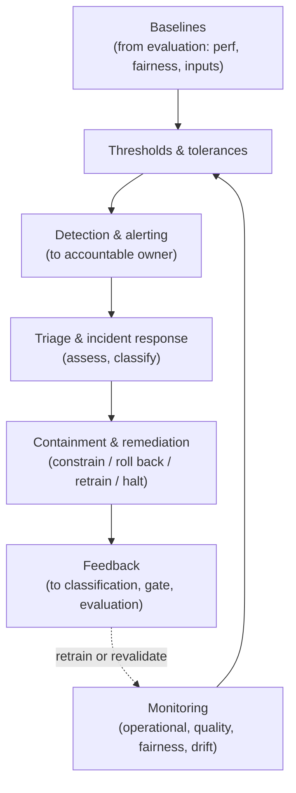
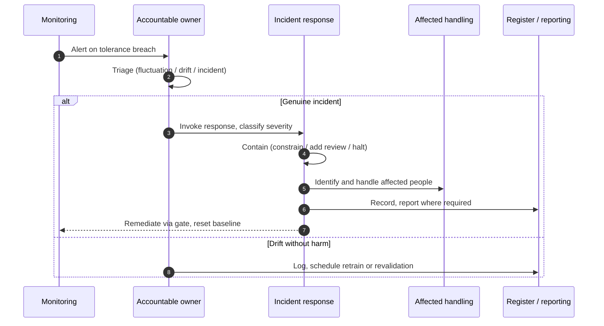

# Chapter 10: Monitoring, Drift and Incident Response

The previous chapter let a model into production on accountable evidence. This chapter governs what happens next, which is the part of the lifecycle most organisations neglect. A conventional application, once correct, tends to stay correct until someone changes it. An AI system does not. The world it was trained on moves, the data flowing through it shifts, and a model that was fit at deployment can degrade silently while every dashboard still shows green. Governing AI in production is the discipline of noticing that degradation before it becomes harm, and responding to it when it does. The skill on display here is vigilance against a failure that raises no error.

---

## 1. The Governance Problem

A model is deployed, validated and approved. For months it performs as expected. Then, gradually, its decisions start to drift: approvals creep, a group that was served well is served worse, the error rate ticks up. Nothing breaks. No exception is thrown, no alarm sounds, because from the system's point of view it is working exactly as built. The degradation is in the relationship between the model and a world that has changed, and that is invisible to conventional monitoring. By the time someone notices, through a complaint, a regulator, or a quarterly review, the model has been making worse decisions for months.

The problem is that AI fails in ways traditional operations do not watch for. Infrastructure monitoring tells you the service is up, fast and error free, and an AI system can be all three while being wrong. The things that matter, whether the input data still resembles what the model was trained on, whether output quality is holding, whether fairness across groups is maintained, whether the model is drifting, are not captured by uptime and latency. And when something does go wrong, many organisations have no defined way to respond to an AI incident specifically: who is told, who can halt the system, how affected people are handled, and how the cause is traced.

The constraint that matters most is that AI degradation is silent and continuous, so monitoring must be deliberate and ongoing rather than triggered by failure. The governance question is therefore not "is the system running?" but "are we watching the signals that reveal whether the model is still fit, and do we have a defined way to respond when it is not?"

---

## 2. 🧩 The Mechanism at a Glance

- **Mechanism name:** Monitoring, Drift and Incident Response
- **Risk addressed:** Silent degradation, drift and unfairness in production, and the absence of a defined response when an AI system causes harm.
- **Primary objective:** Continuous visibility of the signals that reveal model fitness, with defined detection, escalation and response when they breach tolerance.
- **When to use:** For the whole operational life of any deployed model, from go live to decommissioning.
- **When not to use:** As infrastructure monitoring alone, or as a dashboard no one is accountable for acting upon.
- **Relevant frameworks / obligations:** EU AI Act post market monitoring and incident reporting; NIST AI RMF Manage and Measure functions; ISO/IEC 42001 monitoring and improvement; sector incident and conduct regimes.
- **Primary governance concern:** Detecting degradation that raises no error, and responding to it through a defined, accountable process.

Monitoring observes the signals of fitness continuously. Drift detection identifies when input or output distributions move away from the validated baseline. Incident response is the defined, accountable process for acting when monitoring reveals a breach or a harm occurs.

---

## 3. The Operating Model

The reference model runs a continuous loop against the baselines set during evaluation, with a defined response path when tolerances are breached:

- **Baselines**, carried from Chapter 8's evaluation, define the expected performance, fairness and input distribution.
- **Monitoring** continuously captures the operational, quality, fairness and drift signals for the deployed model.
- **Thresholds and tolerances** define when a signal has moved far enough to warrant attention.
- **Detection and alerting** raise a flag when a tolerance is breached, to an accountable owner rather than a void.
- **Triage and incident response** assess the flag, classify any incident, and invoke the defined response.
- **Containment and remediation** act: constrain, roll back, add oversight, retrain or halt, and handle affected people.
- **Feedback** returns findings to classification, the gate and evaluation so the cause is addressed, not just the symptom.

Each component has a clear role. The baselines make monitoring meaningful, because drift is movement away from a known reference. Thresholds turn raw signals into decisions. Alerting reaches an owner who can act. Incident response gives structure to the reaction. Feedback ensures the loop improves the system rather than merely patching each symptom.

---

## 4. The Decision & Control Flow

> **Step 1:** At deployment, the evaluation baselines, performance, fairness across groups and input distribution, are registered as the monitoring reference.
> **Step 2:** Monitoring continuously captures operational signals, output quality, fairness by group, and input and output drift.
> **Step 3:** Each signal is compared against its tolerance, set in proportion to the use case's risk tier.
> **Step 4:** When a signal breaches tolerance, an alert is raised to the model's accountable owner.
> **Step 5:** The owner triages the alert: a transient fluctuation, a genuine drift, or an incident causing or risking harm.
> **Step 6:** A genuine incident is classified by severity and the defined incident response is invoked.
> **Step 7:** Containment acts immediately where needed, constrain usage, add human review, or halt the system.
> **Step 8:** Affected individuals are identified and handled according to the organisation's obligations and policy.
> **Step 9:** The cause is investigated, drawing on data lineage and the deployment record to trace it.
> **Step 10:** Remediation addresses the cause, retrain, revalidate, adjust or retire, through the appropriate gate.
> **Step 11:** The incident, its handling and its lessons are recorded, and reportable incidents are reported.
> **Step 12:** Findings feed back to classification, evaluation and the deployment gate so recurrence is prevented.

The flow makes the discipline concrete: signals compared against a known baseline, breaches reaching an owner who can act, a defined response when harm occurs, and feedback that fixes the cause rather than resetting the dashboard.

---

## 5. Why This Mechanism Works

The mechanism works because it watches the signals that actually reveal AI fitness, not the ones that merely show the service is alive. By carrying the evaluation baselines into production, it can detect drift as movement away from a validated reference, which is the only way to catch a degradation that throws no error. By setting tolerances in proportion to risk, it concentrates attention where harm would be greatest. The result is that silent decline becomes visible while it is still a warning rather than a crisis.

It also works because it pairs detection with a defined, accountable response. A signal that reaches no one, or an alert that no one is empowered to act on, is observation without governance. By routing breaches to an owner with the authority to contain or halt the system, handling affected people as a defined step, and feeding findings back to the controls that let the problem through, the mechanism turns monitoring into a closed loop that improves the system rather than merely narrating its decline.

---

## 6. 🏛️ Governance Decisions

| Decision | Options | Recommended approach | Reason |
| --- | --- | --- | --- |
| Monitoring scope | Infrastructure only / Fitness signals too | Fitness signals (quality, fairness, drift) | A healthy service can still be making wrong decisions |
| Baseline | None / Evaluation baselines carried forward | Evaluation baselines carried forward | Drift is only meaningful against a known reference |
| Tolerances | Uniform / Proportionate to risk tier | Proportionate to risk tier | Attention should concentrate where harm is greatest |
| Alert destination | Dashboard / Accountable owner | Accountable owner | Signals must reach someone empowered to act |
| Incident process | Ad hoc / Defined AI incident response | Defined AI incident response | Harm needs a structured, rehearsed reaction, not improvisation |
| Response to cause | Reset and continue / Feedback to gates | Feedback to classification, gate, evaluation | Fix the cause, not just the symptom |

These defaults make degradation visible and response accountable. If a model has no live baseline, or its alerts reach a dashboard no one owns, the mechanism is not operating.

---

## 7. ⚖️ Trade-offs

**Benefits:** Early visibility of silent degradation and drift; fairness maintained over time, not only at release; a defined, accountable response to harm; and feedback that prevents recurrence.

**Friction:** Fitness monitoring requires instrumentation, baselines and ground truth that infrastructure monitoring does not, and incident response requires standing readiness. Teams may resist the added telemetry and the interruptions that alerts bring.

**Cost:** The engineering to capture quality, fairness and drift signals, the storage and analysis of that telemetry, and the standing capacity for incident response. Concentrated on higher risk models.

**Operational overhead:** Monitoring is continuous for the whole operational life of every model, and baselines must be reset on each revalidation. An unowned monitoring stack decays into noise.

**Risk reduction:** High and distinctive, because it addresses the failure mode unique to AI, silent post deployment degradation, that every earlier control cannot reach once the model is live.

**Speed to deliver:** Monitoring does not slow delivery and can speed safe iteration by giving confidence that problems will be caught. Poorly tuned alerting, however, generates fatigue that erodes response.

**Unintended consequences:** Alert fatigue is the characteristic failure: too many low value alerts train owners to ignore them, so the one that matters is missed. Proportionate thresholds and good signal design are the mitigation.

---

## 8. 🔐 Risk, Safety & Responsible AI

Monitoring is where responsible AI is sustained rather than merely achieved. Fairness tested once at evaluation can erode as data drifts, so fairness must be monitored in production, disaggregated by group against the deployment baseline, or a system that was equitable at release can become discriminatory without anyone deciding it should. Safety likewise depends on watching for behaviour moving outside tested bounds, unsafe outputs, rising confident errors, or responses to inputs the model was never evaluated on.

Incident response is where the organisation's duty to those affected is discharged. An AI incident is not only a technical event; it may be a wrong decision about a person's credit, employment, care or access to a service. The defined response must therefore include identifying affected individuals, correcting or remediating decisions where possible, and meeting any obligation to inform them or a regulator. A response that restores the system but ignores the people it harmed has handled the incident technically and failed it in governance terms.

---

## 9. 📜 Regulatory & Assurance Alignment

Post deployment monitoring and incident handling are increasingly explicit regulatory requirements, which makes this mechanism directly responsive to obligation.

The **EU AI Act** requires providers of high risk systems to operate post market monitoring and to report serious incidents and malfunctions, obligations that correspond closely to continuous monitoring and defined incident response. The **NIST AI RMF** addresses this through its Measure and Manage functions, which call for ongoing measurement of performance and risk and for responding to incidents and changes. **ISO/IEC 42001** expects monitoring, measurement and continual improvement as part of the management system.

Sector regimes add specific duties. In **financial services**, model risk expectations require ongoing monitoring of model performance, and conduct rules may require reporting and remediation where customers are harmed. In **healthcare**, post market surveillance of a medical device and adverse event reporting are established obligations that extend to AI enabled devices. In the **public sector**, a wrong automated decision may trigger duties of correction and redress. These sector obligations often determine how fast an incident must be reported and to whom.

The evidence an auditor or regulator expects includes the monitoring baselines and signals for production models, the tolerances and alerting, the incident log with severity, handling and reporting, and the feedback that addressed causes. A mechanism that records these as it operates meets the expectation directly. As throughout, this is governance guidance rather than legal advice, and incident reporting obligations in particular require local interpretation.

---

## 10. ⚠️ Failure Modes & Resilience

- **Infrastructure only monitoring:** Watching uptime and latency while ignoring quality, fairness and drift misses the failure mode that matters. Fitness signals against a baseline are the mitigation.
- **No baseline:** Without the evaluation reference, drift cannot be measured and monitoring becomes guesswork. Carrying baselines forward at deployment is essential.
- **Alerts to a void:** A breach that reaches a dashboard no one owns changes nothing. Alerts must route to an accountable owner with authority to act.
- **Alert fatigue:** Excessive low value alerts train owners to dismiss them, so the critical one is lost. Proportionate thresholds and careful signal design preserve attention.
- **No incident process:** Improvising the response to an AI incident wastes the crucial early period and mishandles affected people. A defined, rehearsed response is the control.
- **Symptom resets:** Retraining or restarting to clear a signal without investigating the cause guarantees recurrence. Feedback to classification, the gate and evaluation addresses the root.
- **Stale baselines:** After revalidation, monitoring against the old baseline misleads. Baselines must be reset whenever the model is revalidated.

The theme is that this mechanism fails by watching the wrong thing, or by watching the right thing and doing nothing. Resilience requires fitness signals against live baselines, alerts that reach an empowered owner, and a response that closes the loop.

---

## 11. 👁️ Monitoring & Operations

Here the mechanism and the monitoring section coincide, so the emphasis is on what the governance function oversees about the monitoring itself: coverage, the proportion of production models with live fitness baselines and drift monitoring; the currency of baselines against the latest revalidation; alert quality, the ratio of actionable to dismissed alerts as a measure of fatigue risk; incident metrics, the number, severity, time to detect and time to contain; the proportion of incidents with affected individuals correctly handled and reported; and the rate at which incident findings produced changes upstream rather than mere resets.

Distinguish monitoring of the model, the fitness signals themselves, from monitoring of the monitoring, whether the mechanism is covering the estate, reaching owners and closing the loop. A monitoring stack that is comprehensive but unowned, or that generates alerts no one acts on, is failing however rich its telemetry.

---

## 12. 💷 Cost & Proportionality

The cost drivers are the instrumentation to capture quality, fairness and drift signals, the storage and analysis of telemetry over the model's life, the acquisition of ground truth to assess quality, and the standing capacity for incident response. These should scale with the model's risk tier and the consequence of its failure.

Proportionality governs both depth and sensitivity. A low risk internal tool may need basic quality and drift checks and a lightweight response; a high risk decision system warrants disaggregated fairness monitoring, tight tolerances and a rehearsed incident process with regulatory reporting. The failure in one direction is monitoring everything at high sensitivity, which generates fatigue and cost; in the other, monitoring high risk systems as lightly as low risk ones, which lets harm run undetected. The lever is the tier, which should set the signals captured, the tolerances applied and the readiness of the response. An organisation drowning in alerts has miscalibrated as surely as one that hears nothing.

---

## 13. When to Use This Mechanism

Use this mechanism when:

- a model operates in production and the world or data around it can change;
- silent degradation or drift would cause harm before a person noticed;
- fairness must be maintained over time, not only demonstrated at release;
- an AI failure could harm people and require a defined, accountable response; and
- a regulator expects post deployment monitoring and incident reporting.

In practice every deployed model needs monitoring for its whole life; the depth and the readiness of response scale with risk.

---

## 14. When NOT to Use This Mechanism

The caution is against partial or hollow monitoring rather than against monitoring:

- Do not rely on **infrastructure monitoring alone**; a healthy service can make steadily worse decisions.
- Do not build a **dashboard no one owns**; observation without an accountable actor is not a control.
- Do not **over alert**; indiscriminate sensitivity produces fatigue that hides the signal that matters.

The lighter alternative for a low risk model is basic quality and drift monitoring with a simple response path, not the absence of monitoring. Even low risk models can drift, and knowing is cheap compared with discovering through a complaint.

---

## 15. Mechanism Variations

- **Small organisation:** Core quality and drift checks against the deployment baseline, alerts to the accountable owner, and a simple documented incident procedure.
- **Scaling organisation:** Standard fitness monitoring by tier, disaggregated fairness monitoring for higher risk models, tuned alerting, and a defined incident response function.
- **Large enterprise:** A federated model in which business units monitor their own models against common standards while a central function consolidates incident reporting and oversees systemic drift across the estate.
- **Highly regulated enterprise:** Continuous disaggregated monitoring for defined categories, tight tolerances, rehearsed incident response aligned to regulatory reporting timelines, and independent review of incident handling.

The variations differ in depth and in how incident response is organised, not in the principle that fitness must be watched against a baseline and that breaches must reach an owner who can act.

---

## 16. Governance Decision Checklist

- [ ] Does monitoring cover fitness signals, quality, fairness and drift, not only infrastructure health?
- [ ] Are the evaluation baselines carried into production as the monitoring reference?
- [ ] Are tolerances set in proportion to the use case's risk tier?
- [ ] Do breaches alert an accountable owner empowered to act, not a dashboard?
- [ ] Is fairness monitored disaggregated by group over time, not only at release?
- [ ] Is there a defined AI incident response covering severity, containment and halting?
- [ ] Does incident handling include identifying and remediating affected individuals?
- [ ] Are reportable incidents reported within the required timelines?
- [ ] Do incident findings feed back to classification, the gate and evaluation?
- [ ] Is alerting tuned to avoid fatigue, and are baselines reset on revalidation?

---

## 17. 📐 The Governance Verdict

> Monitoring, drift and incident response is the mechanism that governs the part of the lifecycle most organisations neglect, and it is required for the whole operational life of any deployed model. It earns its place by watching the signals that reveal AI fitness, against the baselines set at evaluation, so that silent degradation becomes visible while it is still a warning, and by pairing detection with a defined, accountable response that includes the people a failure harms. Its weaknesses all reduce to watching the wrong thing or doing nothing about the right thing: infrastructure only monitoring, unowned dashboards, alert fatigue, and symptom resets that guarantee recurrence. Carry your baselines into production, monitor fairness and drift in proportion to risk, route breaches to an owner who can halt the system, and feed what you learn back to the controls that let the problem through. An AI system that is up, fast and error free can still be quietly wrong. Governance in production is the discipline of noticing.
