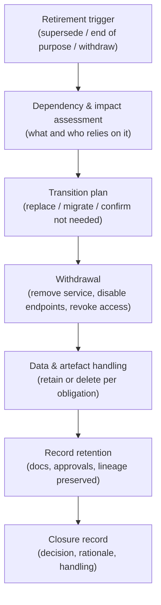
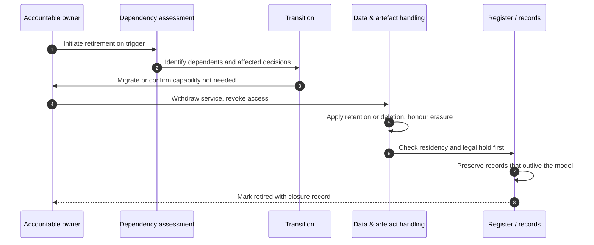

# Chapter 11: Decommissioning and Model Retirement

This chapter closes the lifecycle that Part III has followed. A model is proposed, its data governed, its fitness proven, its deployment approved and its operation monitored, and then, eventually, it must be retired. Decommissioning is the least glamorous stage and the most neglected, which is precisely why it accumulates risk. A model that is switched off carelessly can leave behind live endpoints, orphaned data, broken dependencies and a gap in the record that an auditor will later find. The skill on display here is finishing properly: treating the end of a model's life with the same discipline as its beginning.

---

## 1. The Governance Problem

A model is superseded by a better one, or the business need it served disappears. The team moves on. In most organisations what happens to the old model is simply neglect. It may be left running because no one is certain what depends on it. Its training data and artefacts linger in storage with no owner. The services that called it still hold credentials to do so. Its documentation stops being maintained, and its place in the register quietly goes stale. Months later, someone discovers an AI system still making decisions that no one has monitored since the team disbanded, or an auditor asks for records of a model that was switched off without anyone capturing why.

The problem is that retirement is a decision with consequences, not an absence of activity. Turning a model off touches data that may be subject to retention or deletion obligations, dependencies that may break, people whose decisions the model was making, and records that must survive the model itself. An AI system also carries a specific hazard: the model artefact embeds the data it learned from, so retiring a model is entangled with the organisation's ability to honour deletion requests and residency rules. Treating decommissioning as mere switch off ignores all of this.

The constraint that matters most is that a model's obligations do not end when its usefulness does. Records may need to outlive the model, data may need to be deleted when it is retired, and dependents may need an orderly transition. The governance question is therefore not "can we switch it off?" but "how do we retire a model so that its data, dependencies, affected decisions and records are all handled correctly, and the retirement itself is recorded?"

---

## 2. 🧩 The Mechanism at a Glance

- **Mechanism name:** Decommissioning and Model Retirement
- **Risk addressed:** Orphaned models, lingering data, broken dependencies and lost records left behind by careless switch off.
- **Primary objective:** An orderly, recorded retirement that handles data, dependencies, affected decisions and record retention correctly.
- **When to use:** Whenever a model is superseded, its purpose ends, or it must be withdrawn for risk or regulatory reasons.
- **When not to use:** As a reason to keep unused models running indefinitely to avoid the effort of retiring them.
- **Relevant frameworks / obligations:** Data protection retention and erasure duties; EU AI Act and sector record keeping obligations; ISO/IEC 42001 lifecycle and documented information control; sector retention regimes.
- **Primary governance concern:** Honouring data and record obligations and transitioning dependents, so retirement closes risk rather than hiding it.

Decommissioning is the deliberate withdrawal of a model from service. Retirement is the fuller set of obligations around it: handling the data and artefacts, transitioning or notifying dependents, preserving the records that must outlive the model, and recording the decision.

---

## 3. The Operating Model

The reference model is a controlled wind down that mirrors, in reverse, the discipline of deployment:

- **Retirement trigger** initiates the process: supersession, end of purpose, or withdrawal for risk or regulation.
- **Dependency and impact assessment** identifies what and who relies on the model, and the decisions it is making.
- **Transition plan** moves dependents to a replacement or an alternative, or confirms the capability is genuinely no longer needed.
- **Withdrawal** removes the model from service, disables endpoints and revokes the access that called it.
- **Data and artefact handling** applies retention or deletion to training data, the model artefact and derived data, honouring obligations.
- **Record retention** preserves the documentation, approvals and lineage that must survive the model.
- **Closure record** captures the retirement decision, its rationale and its handling in the register.

Each component has a clear role. The trigger makes retirement a decision rather than drift. The impact assessment prevents broken dependencies and abandoned decisions. Withdrawal removes the live footprint. Data handling discharges retention and deletion obligations, including the hard case of data embedded in the artefact. Record retention keeps the evidence that must outlive the model. The closure record ensures the end of life is as documented as its start.

---

## 4. The Decision & Control Flow

> **Step 1:** A retirement trigger is raised: a replacement is ready, the purpose has ended, or the model must be withdrawn for risk or regulatory reasons.
> **Step 2:** The accountable owner initiates the decommissioning process rather than leaving the model to linger.
> **Step 3:** A dependency and impact assessment identifies every system, process and decision that relies on the model.
> **Step 4:** Affected dependents and, where relevant, the people subject to the model's decisions are identified.
> **Step 5:** A transition plan moves dependents to a replacement or alternative, or confirms the capability is no longer required.
> **Step 6:** The model is withdrawn from service, its endpoints disabled and the credentials and access that reached it revoked.
> **Step 7:** Retention and deletion rules are applied to the training data, the model artefact and any derived data.
> **Step 8:** Outstanding deletion requests that reach data embedded in the model are honoured by the retirement.
> **Step 9:** Residency and legal hold requirements are checked before any data or artefact is deleted.
> **Step 10:** The records that must outlive the model, documentation, approvals, lineage, incidents, are preserved per the retention schedule.
> **Step 11:** The closure record captures the retirement decision, its rationale, and how data and dependents were handled.
> **Step 12:** The register is updated so the model is marked retired, not silently absent.

The flow makes the discipline concrete: retirement is initiated deliberately, dependents and affected people are handled, the live footprint is removed, data and record obligations are discharged in the right order, and the decision is recorded so the model is retired rather than merely gone.

---

## 5. Why This Mechanism Works

The mechanism works because it treats retirement as the mirror image of deployment, applying the same discipline to switching a model off as to turning it on. By triggering a deliberate process rather than permitting drift, it prevents the accumulation of orphaned models that no one monitors and no one can account for. By assessing dependencies first, it avoids the broken integrations and abandoned decisions that careless withdrawal causes.

It also works because it discharges obligations that outlast the model's usefulness, in the correct order. Checking residency and legal hold before deletion, honouring erasure requests that reach data embedded in the artefact, and preserving the records that must survive the model are all obligations that a simple switch off ignores. By sequencing them and recording the outcome, the mechanism ensures that retirement closes the model's risk cleanly rather than leaving a latent exposure that surfaces in a later audit or a later breach.

---

## 6. 🏛️ Governance Decisions

| Decision | Options | Recommended approach | Reason |
| --- | --- | --- | --- |
| Retirement | Drift into disuse / Deliberate triggered process | Deliberate triggered process | Unmanaged models accumulate unmonitored risk |
| Dependencies | Switch off and see / Assess before withdrawal | Assess before withdrawal | Avoid broken integrations and abandoned decisions |
| Data and artefact | Leave in place / Retain or delete per obligation | Retain or delete per obligation | The artefact embeds data subject to retention and erasure duties |
| Deletion order | Delete then check / Check residency and hold first | Check residency and legal hold first | Premature deletion can breach retention or legal hold |
| Records | Discard with the model / Preserve per schedule | Preserve per schedule | Approvals, lineage and incidents must outlive the model |
| Register state | Silently absent / Marked retired | Marked retired | The estate view must distinguish retired from unknown |

These defaults make retirement orderly and obligation aware. If a retired model's data lingers unowned, or its records are gone, or the register cannot say it was retired, the mechanism has not been applied.

---

## 7. ⚖️ Trade-offs

**Benefits:** No orphaned models or lingering data; dependencies transitioned without breakage; data and record obligations discharged; and a complete, honest estate view that distinguishes retired from unknown.

**Friction:** A proper retirement is real work at a point when attention has usually moved to the replacement. The effort competes with new delivery, which is why retirement is so often skipped.

**Cost:** The effort of impact assessment, transition, controlled data handling and record preservation. Modest per model but routinely under budgeted because retirement is unplanned.

**Operational overhead:** Maintaining retention schedules, legal hold awareness and the register's retired state is ongoing. Without it, the estate view degrades and obligations are missed.

**Risk reduction:** High and under appreciated, because the risks of neglected retirement, unmonitored live models, undeletable data, audit gaps, are exactly the ones that surface late and expensively.

**Speed to deliver:** Retirement does not affect delivery speed directly, but a reliable retirement process removes the drag of an estate cluttered with models no one dares switch off because no one knows what depends on them.

**Unintended consequences:** Over eager deletion can destroy records or data subject to retention or legal hold. Sequencing the checks before deletion is the safeguard, and it must not be skipped for speed.

---

## 8. 🔐 Risk, Safety & Responsible AI

Decommissioning is where two responsible AI obligations are finally discharged. The first is the right to erasure: because a model artefact embeds the data it was trained on, an organisation cannot fully honour a deletion request while that model remains in service, so retirement is often the point at which erasure becomes complete. A retirement process that ignores this leaves the organisation in continuing breach of a request it believed it had satisfied. The second is the orderly handling of people whose decisions the model was making: withdrawing a model that affects individuals requires a transition that does not leave them in limbo, whether by migrating to a replacement or by reverting to an alternative process.

Retirement also closes the safety loop. A model withdrawn for risk reasons, because it was found to be unfair, unsafe or unlawful, must be withdrawn completely, with its endpoints disabled and access revoked, not merely deprecated while quietly still reachable. A model that was ordered off but remains callable is a live hazard masquerading as a retired one, which is among the more dangerous conditions an estate can hold.

---

## 9. 📜 Regulatory & Assurance Alignment

Retirement is governed as much by record keeping and data protection law as by AI regulation, which makes disciplined decommissioning a compliance matter, not merely good housekeeping.

**Data protection law**, such as the EU GDPR and equivalents, imposes retention limits, erasure rights and residency constraints that apply to training data, derived data and the model artefact that embeds them. Retirement is frequently the moment these are finally satisfied, so it must handle them deliberately. The **EU AI Act** and sector regimes impose record keeping obligations that can require documentation to be retained for defined periods after a system ceases operation, meaning records must outlive the model. **ISO/IEC 42001** treats the full lifecycle, including retirement, and expects control over documented information.

Sector regimes add specific retention and withdrawal duties. In **financial services**, records relating to models that informed regulated decisions typically must be retained for set periods regardless of whether the model is still in use. In **healthcare**, withdrawing an AI enabled medical device carries post market and record obligations, and patient data retention rules persist. In the **public sector**, records of automated decisions may be subject to public records and retention duties that survive the system. These obligations determine what must be kept and what may be deleted at retirement.

The evidence an auditor or regulator expects includes the retirement decision and rationale, the dependency and transition handling, proof that data was retained or deleted per obligation with residency and legal hold respected, and the preserved records. A mechanism that records these as it operates meets the expectation directly. As throughout, this is governance guidance rather than legal advice, and retention and erasure in particular require local interpretation.

---

## 10. ⚠️ Failure Modes & Resilience

- **Zombie models:** A model left running because no one is sure what depends on it continues making unmonitored decisions. Dependency assessment and a deliberate trigger prevent models drifting into this state.
- **Still reachable after withdrawal:** Disabling the interface while leaving endpoints live or credentials valid means the model can still be called. Revoking access and disabling endpoints completely is the mitigation.
- **Orphaned data:** Training data and artefacts left in storage with no owner breach retention limits and frustrate erasure. Controlled data handling at retirement is essential.
- **Premature deletion:** Deleting data or records that were under legal hold or a retention obligation is as serious as failing to delete. Checking residency and hold before deletion is the safeguard.
- **Lost records:** Discarding approvals, lineage and incident history with the model leaves an audit gap. Preserving records per schedule, separate from the model, is the control.
- **Silent absence:** A model that simply disappears from the register, rather than being marked retired, makes the estate view unreliable. Recording retirement explicitly keeps it honest.

The theme is that retirement fails by being treated as nothing happening, when in fact obligations are live and dependencies real. Resilience comes from treating switch off as a controlled process with the data and record steps sequenced correctly.

---

## 11. 👁️ Monitoring & Operations

The function should monitor, at minimum: the count of models past their useful life that have not been retired, as a measure of accumulating zombie risk; the proportion of retirements completed through the full process versus informal switch off; confirmation that withdrawn models are genuinely unreachable; the status of data handling at retirement, retained or deleted per obligation; outstanding erasure requests awaiting a model's retirement; and the completeness of preserved records for retired models. These signals reveal whether the end of life is governed or neglected.

Distinguish monitoring of retirement, is it happening properly and completely, from the production monitoring of Chapter 10, which should cease in a controlled way at withdrawal rather than simply stopping. A model whose monitoring went quiet without a recorded retirement is a warning sign in itself, suggesting a system abandoned rather than retired.

---

## 12. 💷 Cost & Proportionality

The cost drivers are the effort of impact assessment and transition, the controlled handling of data and artefacts, and the preservation of records. These are modest per model but recurring across an estate, and they are routinely under resourced because retirement is unplanned and competes with new work.

Proportionality applies to the depth of the process. A low risk internal tool with no personal data and few dependents needs a light, recorded withdrawal; a high risk model that made decisions about people, embedded personal data and fed several systems warrants full dependency assessment, deliberate transition, obligation driven data handling and record preservation. The failure in one direction is a heavyweight ceremony for trivial models that discourages retiring them at all; in the other, a casual switch off of a consequential model that leaves data, dependents and obligations unhandled. The lever is the model's original risk tier and the sensitivity of its data, which should set how much retirement process applies.

---

## 13. When to Use This Mechanism

Use this mechanism when:

- a model is superseded, its purpose ends, or it must be withdrawn for risk or regulatory reasons;
- the model embedded personal, sensitive or regulated data;
- other systems, processes or decisions depend on the model;
- records of the model must survive its withdrawal for audit or regulation; and
- outstanding deletion or residency obligations reach data the model holds.

In practice every model is eventually retired, so every model needs a retirement path; the depth scales with its risk and the sensitivity of its data.

---

## 14. When NOT to Use This Mechanism

The caution here is unusual, because the greater risk is not retiring models at all:

- Do not keep **unused models running** merely to avoid the effort of retiring them; a live, unmonitored model is a standing risk, not a saving.
- Do not apply a **heavyweight ceremony** to a trivial, low risk model; disproportionate process discourages the hygiene of retiring the unused.
- Do not treat **withdrawal as deletion**; some records and data must be retained after the model is gone, and conflating the two causes breaches.

The lighter alternative for a low risk model is a recorded withdrawal with basic data and record handling, not an indefinite half life. Every model should have a clean end, scaled to its risk.

---

## 15. Mechanism Variations

- **Small organisation:** A simple retirement checklist, a quick dependency check, basic data handling against retention rules, and a closure note in the register.
- **Scaling organisation:** A standard decommissioning process by tier, defined retention and deletion handling, and a maintained estate view distinguishing active and retired models.
- **Large enterprise:** A federated model in which business units retire their own models to a common standard while a central function oversees retention, residency and the consolidated estate view.
- **Highly regulated enterprise:** Formal retirement aligned to sector retention schedules, mandatory legal hold and residency checks before deletion, documented erasure completion, and independent confirmation that withdrawn models are unreachable.

The variations differ in formality and in how retention and deletion are controlled, not in the principle that retirement is a deliberate, recorded process that handles data, dependents and records.

---

## 16. Governance Decision Checklist

- [ ] Is retirement initiated by a deliberate trigger rather than allowed to drift?
- [ ] Are all dependent systems, processes and affected decisions identified before withdrawal?
- [ ] Is there a transition plan for dependents, or a confirmation the capability is no longer needed?
- [ ] Is the model fully withdrawn, with endpoints disabled and access revoked, not merely deprecated?
- [ ] Are training data, the model artefact and derived data retained or deleted per obligation?
- [ ] Are residency and legal hold checked before any deletion?
- [ ] Are outstanding erasure requests reaching the model honoured by its retirement?
- [ ] Are the records that must outlive the model preserved per the retention schedule?
- [ ] Is the model marked retired in the register, not silently absent?
- [ ] Is the depth of the retirement process proportionate to the model's risk and data sensitivity?

---

## 17. 📐 The Governance Verdict

> Decommissioning and model retirement is the mechanism that closes the lifecycle cleanly, and it is required because every model is eventually withdrawn whether or not the organisation plans for it. It earns its place by treating switch off as the mirror of deployment: triggered deliberately, assessed for dependencies, sequenced so that data and record obligations are discharged in the right order, and recorded so the model is retired rather than merely gone. Its weaknesses are the quiet ones of neglect: zombie models still making decisions, endpoints still reachable after withdrawal, orphaned data that frustrates erasure, premature deletion that breaches a hold, and lost records that leave an audit gap. The unusual risk is doing too little, not too much, so retire the unused deliberately, handle the data and records before you delete, transition those who depend on the model, and mark it retired. A model's obligations outlive its usefulness. Finish properly, or the risk you think you switched off is still running.
