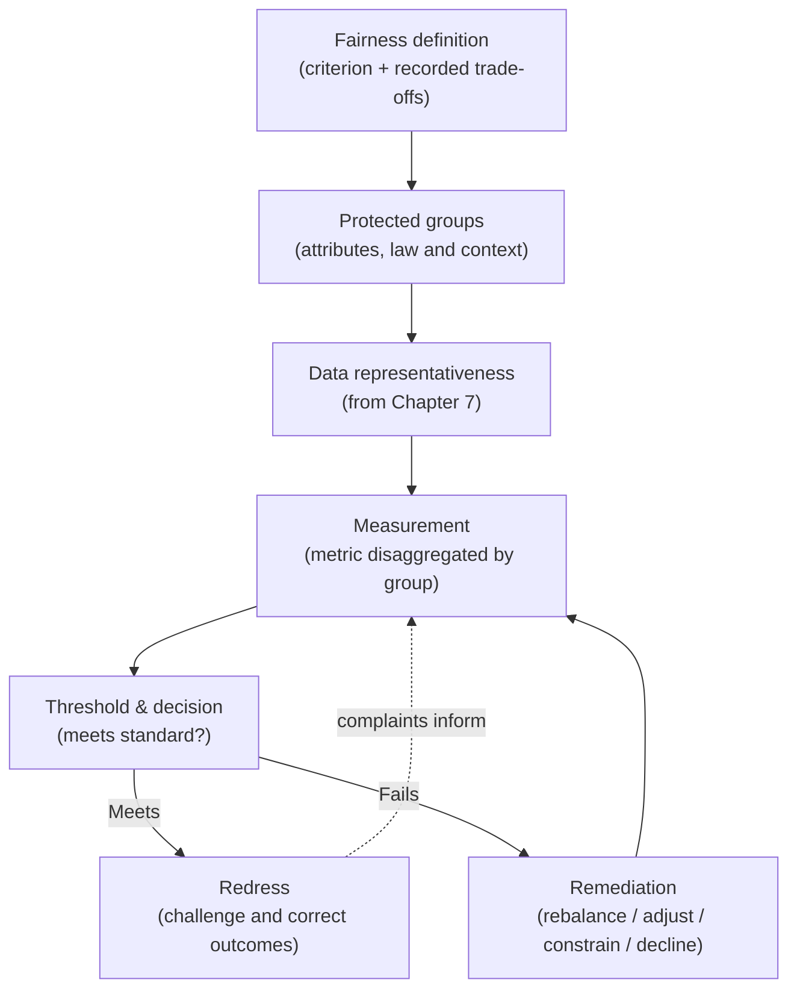
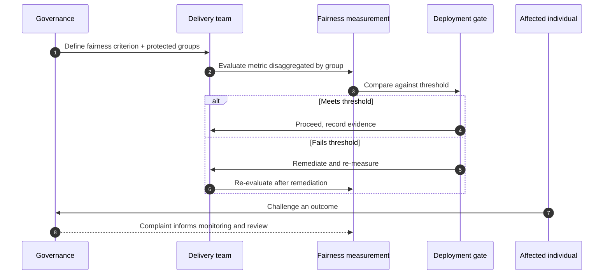

# Chapter 12: Fairness, Bias and Non-discrimination Controls

This chapter opens Part IV, which turns the responsible AI outcomes the organisation has committed to into enforceable controls. It begins with fairness, because fairness is the outcome most often proclaimed in principle and least often operationalised in practice. A policy that says AI must be fair governs nothing until someone decides what fairness means for a given decision, measures it, sets a line that must not be crossed, and acts when it is. The earlier chapters referred to fairness as a signal to classify, a property to evaluate, and a condition to monitor; this chapter is where it becomes a specific, checkable control. The skill on display here is precision about a word that is easy to invoke and hard to pin down.

---

## 1. The Governance Problem

An organisation deploys a model that influences decisions about people, who is offered a loan, shortlisted for a role, prioritised for a service, and commits publicly to fairness. Then a pattern emerges: the model systematically serves one group worse than another. The disparity was not intended, and no one chose it. It arrived through the data the model learned from, which reflected a world that was already unequal, and it survived into production because fairness was treated as a value to affirm rather than a property to measure. The organisation discovers the problem the way the public does, through the outcome, and only then asks the questions it should have asked before deployment.

The problem has two roots. The first is that bias in AI is usually inherited, not authored. A model trained on historical decisions learns the patterns in them, including the discriminatory ones, so a model can be unfair without anyone writing an unfair rule. This makes bias hard to see: there is no line of code to inspect, only a statistical disparity in outcomes. The second root is that fairness is not a single thing. There are several mathematical definitions of fairness, they can conflict, and satisfying one can mean violating another, so an organisation that says it wants fairness without saying which fairness has not yet said anything a model can be built or tested against.

The constraint that matters most is that fairness must be defined before it can be controlled, and the definition is a decision with trade-offs that belongs to governance, not to whoever happens to pick a metric. The governance question is therefore not "is our AI fair?" but "which definition of fairness applies to this decision, how is it measured across the affected groups, what threshold must it meet, and what happens when it does not?"

---

## 2. 🧩 The Mechanism at a Glance

- **Mechanism name:** Fairness, Bias and Non-discrimination Controls
- **Risk addressed:** Models that discriminate, usually through inherited bias, against groups they affect, undetected because fairness was affirmed rather than measured.
- **Primary objective:** A defined fairness standard for each affected decision, measured across groups, held to a threshold, and enforced with remediation and redress.
- **When to use:** For any AI system whose output affects people's rights, opportunities, treatment or access to services.
- **When not to use:** For systems that do not make or materially influence decisions about people, where a fairness control would be misapplied effort.
- **Relevant frameworks / obligations:** Anti discrimination and equality law; EU AI Act requirements on bias and high risk systems; employment automated decision rules (for example NYC Local Law 144); sector fair treatment regimes.
- **Primary governance concern:** Choosing an appropriate, defensible definition of fairness and measuring it across groups, recognising that fairness definitions can conflict.

Fairness is the outcome: comparable treatment or outcomes across groups, as defined for the decision. Bias is the mechanism that undermines it, usually inherited from data. Non discrimination is the legal floor the controls must secure, below which the organisation cannot design.

---

## 3. The Operating Model

The reference model embeds fairness controls across the lifecycle rather than bolting a single test onto the end:

- **Fairness definition** selects, for the decision, which fairness criterion applies, with its trade-offs recorded as a governance decision.
- **Protected groups** are identified: the attributes across which fairness must hold, informed by law and context.
- **Data representativeness**, drawn from Chapter 7, ensures the groups are adequately represented before training.
- **Measurement** evaluates the chosen fairness metric disaggregated across groups, at evaluation and in production.
- **Threshold and decision** compare the measurement against the required standard and gate deployment accordingly.
- **Remediation** acts when the standard is not met: rebalance, adjust, constrain, add oversight, or decline.
- **Redress** gives affected people a route to challenge an outcome and have it corrected.

Each component has a clear role. The definition makes fairness a specific, testable property rather than a sentiment. Group identification scopes the measurement. Representativeness addresses bias at its usual source. Measurement and threshold turn fairness into a gate. Remediation gives the gate consequence. Redress acknowledges that no control is perfect and that affected people must be able to contest an outcome.

---

## 4. The Decision & Control Flow

> **Step 1:** For a decision affecting people, governance selects which definition of fairness applies and records why, including the trade-offs against other definitions.
> **Step 2:** The protected or relevant groups are identified, informed by anti discrimination law and the context of the decision.
> **Step 3:** Before training, data representativeness across those groups is checked, drawing on data governance.
> **Step 4:** During evaluation, the chosen fairness metric is measured disaggregated across the groups, not in aggregate.
> **Step 5:** The measurement is compared against the threshold set for the use case's risk tier.
> **Step 6:** If the threshold is met, the result and evidence are recorded and the deployment gate proceeds.
> **Step 7:** If the threshold is not met, remediation is applied, rebalancing data, adjusting the model, constraining use, or declining to deploy.
> **Step 8:** Remediated models are re-measured, because a fairness fix can degrade performance or shift disparity elsewhere.
> **Step 9:** In production, the fairness metric is monitored disaggregated over time, as Chapter 10 requires, because fairness can erode with drift.
> **Step 10:** Affected individuals are given a route to challenge an outcome and seek correction.
> **Step 11:** Complaints and monitoring feed back into measurement and, where needed, reclassification and revalidation.

The flow makes fairness concrete: a definition chosen deliberately, measurement disaggregated across groups, a threshold that gates deployment, remediation that is itself re-measured, production monitoring, and a redress route for the people affected.

---

## 5. Why This Mechanism Works

The mechanism works because it forces fairness to be defined before it is claimed. By making the choice of fairness criterion an explicit governance decision, with its trade-offs recorded, it replaces a vague commitment with a specific property a model can be built and tested against, and it puts the choice where it belongs, with governance accountable for the trade-off, rather than with an engineer selecting a convenient metric. Measuring that property disaggregated across groups then exposes the inherited bias that an aggregate figure conceals, which is the only reliable way to see a disparity that no one authored.

It also works because it attaches consequence and recourse to the measurement. A threshold that gates deployment means an unfair model does not go live merely because it is accurate on average, and re-measuring after remediation guards against fixes that shift the problem rather than solve it. Redress completes the mechanism by recognising that measurement at a population level cannot guarantee a just outcome in every individual case, so the people affected must be able to challenge and correct a decision that went wrong for them.

---

## 6. 🏛️ Governance Decisions

| Decision | Options | Recommended approach | Reason |
| --- | --- | --- | --- |
| Fairness definition | Unspecified / Chosen criterion with trade-offs | Chosen criterion with recorded trade-offs | Fairness definitions conflict; one must be selected deliberately |
| Who decides | Engineer picks a metric / Governance decides | Governance decides | The choice is a value trade-off, not a technical detail |
| Measurement | Aggregate / Disaggregated by group | Disaggregated by group | Inherited bias is invisible in an average |
| Bias source | Treat at the model / Treat at the data too | Treat at the data too | Bias is usually inherited from data, not authored in the model |
| Threshold | Advisory / Gating by risk tier | Gating by risk tier | Fairness must have consequence, proportionate to impact |
| Individual recourse | None / Redress route | Redress route | Population fairness does not guarantee a just individual outcome |

These defaults make fairness defined, measured and consequential. If an organisation claims fairness but cannot name the criterion it used or show the disaggregated measurement, the control does not exist.

---

## 7. ⚖️ Trade-offs

**Benefits:** Inherited bias made visible before deployment; a defined, defensible fairness standard; fairness maintained over time; and recourse for individuals wronged by a decision.

**Friction:** Choosing a fairness definition forces a hard, sometimes uncomfortable value decision, and measuring disaggregated fairness requires knowing or inferring group membership, which itself raises privacy and legal questions. Teams may prefer the comfort of an unexamined aggregate.

**Cost:** The effort of definition, disaggregated measurement, remediation and re-measurement, plus the standing cost of a redress route. Concentrated on decisions that affect people.

**Operational overhead:** Fairness must be measured at evaluation and monitored in production, and the definition revisited as law and context change. Without ownership, a fairness control becomes a one time test that drift invalidates.

**Risk reduction:** High for systems affecting people, because discrimination is among the most consequential and most regulated AI harms, and inherited bias is both common and invisible to aggregate measures.

**Speed to deliver:** A clear fairness standard set up front can speed delivery by telling teams exactly what they must meet. Discovering a fairness problem after deployment, by contrast, is slow and costly to resolve.

**Unintended consequences:** Fairness definitions genuinely conflict, so improving one metric can worsen another, and a crude fix can degrade accuracy or move disparity to a different group. Re-measurement and an honest account of the trade-off are the mitigations; pretending a single number settles fairness is not.

---

## 8. 🔐 Risk, Safety & Responsible AI

This chapter is itself a responsible AI control, so the emphasis here is on how fairness connects to the others. Fairness depends on data governance, because representativeness is the first and often most effective bias control, and a disparity is frequently better fixed at the data than patched at the model. It depends on transparency and explainability, covered next, because a person told a decision was fair is entitled to understand the basis for it, and a fairness claim that cannot be explained is hard to trust. And it depends on human oversight, because the redress route requires a human with the authority and information to review and correct an individual outcome.

Fairness also carries a distinctive honesty obligation. Because fairness definitions conflict, the organisation cannot truthfully claim a model is simply fair; it can claim the model meets a named fairness criterion, with known trade-offs against others. Overstating this, presenting a single satisfied metric as comprehensive fairness, is a form of the ethics washing the book warns against. The responsible position is to state which fairness was chosen, why, and what was traded away.

---

## 9. 📜 Regulatory & Assurance Alignment

Fairness and non discrimination are among the most directly regulated AI concerns, drawing on established equality law as well as new AI regulation.

**Anti discrimination and equality law** prohibits discrimination on protected grounds and applies to automated decisions as it does to human ones, setting the non discrimination floor these controls must secure. The **EU AI Act** requires high risk systems to address bias, including through appropriate data governance and testing, and ties into fundamental rights protections. **Employment specific rules** are increasingly explicit: New York City's Local Law 144, for example, requires bias audits of automated employment decision tools, a direct mandate for disaggregated fairness measurement.

Sector regimes add fair treatment duties. In **financial services**, fair lending and consumer protection rules prohibit discriminatory outcomes in credit and pricing, and regulators expect firms to test for them. In the **public sector**, equality duties require that automated decisions do not discriminate and, in some jurisdictions, that their impact on different groups be assessed. In **healthcare**, equitable performance across patient groups is both a safety and a fairness concern. These regimes often determine which groups must be considered and what evidence of testing is expected.

The evidence an auditor or regulator expects includes the recorded fairness definition and its rationale, disaggregated measurement across the relevant groups, the threshold and the gating decision, remediation records, and the redress mechanism. A control that produces these as it operates meets the expectation directly. As throughout, this is governance guidance rather than legal advice, and which fairness obligations apply, and to which groups, requires local legal interpretation.

---

## 10. ⚠️ Failure Modes & Resilience

- **Fairness by assertion:** Claiming fairness without defining or measuring it is the signature failure. A recorded definition and disaggregated measurement are the mitigation.
- **Aggregate blindness:** Measuring only overall accuracy hides the group level disparity that constitutes the unfairness. Disaggregation exposes it.
- **Metric shopping:** Choosing, after the fact, the fairness definition the model happens to satisfy makes the claim meaningless. Deciding the criterion in advance, as a governance decision, prevents it.
- **Bias patched at the model only:** Treating a disparity as a modelling problem when its source is the data produces fragile fixes. Addressing representativeness at the data is often the more durable control.
- **Fix without re-measurement:** A fairness adjustment can degrade accuracy or move the disparity to another group. Re-measuring after remediation is essential.
- **Fairness that erodes:** A model fair at release can drift into unfairness as data changes. Disaggregated production monitoring is the control, and its absence is a common gap.
- **No individual recourse:** Population level fairness can still produce an unjust individual outcome. A redress route is the mitigation, and without it fairness remains abstract.

The theme is that fairness fails by being treated as a sentiment rather than a measured, consequential property. Resilience comes from defining it in advance, measuring it disaggregated, giving it a threshold, and letting affected people contest the result.

---

## 11. 👁️ Monitoring & Operations

The function should monitor, at minimum: the proportion of people affecting systems with a recorded fairness definition and disaggregated measurement; fairness metrics by group in production against the deployment baseline; the rate and outcome of fairness related remediations; the volume, pattern and resolution of redress requests, which often reveal disparities measurement missed; and the currency of fairness definitions against changing law and context. These signals show whether fairness is a live control or a one time claim.

Distinguish monitoring the fairness of the model, the metrics by group, from monitoring the fairness control itself, whether definitions are set, measurements taken and redress honoured. Note too that redress data is a distinctive early warning: a cluster of complaints from one group can surface a disparity that the chosen metric did not capture, which is why complaints should feed back into measurement rather than being handled only case by case.

---

## 12. 💷 Cost & Proportionality

The cost drivers are the effort of selecting and justifying a fairness definition, obtaining or inferring group membership for measurement, running disaggregated evaluation and monitoring, performing and re-measuring remediation, and operating a redress route. These should scale with the consequence of the decision for the people it affects.

Proportionality is essential because fairness controls are not free of their own risks. Measuring fairness requires data about protected attributes, which carries privacy and legal sensitivity, so applying heavy fairness machinery to a system that does not affect people is both wasteful and potentially intrusive. A low stakes decision may need a light representativeness check; a high stakes decision about a person's livelihood or liberty warrants full definition, disaggregated measurement, gating and redress. The lever is whether and how much the decision affects people, which should set the depth of the control. Applying fairness controls where they do not belong is a miscalibration as real as omitting them where they do.

---

## 13. When to Use This Mechanism

Use this mechanism when:

- an AI system makes or materially influences decisions about people;
- those decisions affect rights, opportunities, treatment or access to services;
- the system learns from historical data that may embed existing inequality;
- anti discrimination or sector fair treatment obligations apply; and
- affected individuals should be able to challenge an outcome.

In practice this is any people affecting decision system, which is where the most serious and most regulated AI harms concentrate.

---

## 14. When NOT to Use This Mechanism

The caution is about misapplication, because fairness controls themselves carry cost and data sensitivity:

- Do not apply it to systems that **do not affect people**; fairness machinery on a non personal use case is wasted effort and may introduce needless collection of sensitive attributes.
- Do not reduce it to a **single fairness metric** treated as settling the question; fairness definitions conflict and one number does not capture them.
- Do not **collect protected attributes indiscriminately** to measure fairness; the measurement must itself respect privacy and legal limits.

The lighter alternative for lower stakes people affecting decisions is a representativeness check and a straightforward disparity measure, not the full apparatus. Match the control to the consequence.

---

## 15. Mechanism Variations

- **Small organisation:** A recorded fairness definition for the few decisions that affect people, a disaggregated disparity check at evaluation, and a simple complaint and correction route.
- **Scaling organisation:** Standard fairness definitions by decision type, disaggregated evaluation and production monitoring, remediation with re-measurement, and a defined redress process.
- **Large enterprise:** A federated model in which a central function owns fairness standards and the approach to defining criteria, while business units measure and monitor their own systems within the framework.
- **Highly regulated enterprise:** Mandatory bias audits aligned to sector or local requirements, documented fairness trade-off decisions, independent review for high stakes systems, and formal redress aligned to regulatory expectations.

The variations differ in formality and independence, not in the principle that fairness must be defined, measured across groups, held to a threshold, and open to individual challenge.

---

## 16. Governance Decision Checklist

- [ ] Does each people affecting decision have a fairness definition chosen and recorded by governance?
- [ ] Are the trade-offs against other fairness definitions acknowledged rather than hidden?
- [ ] Are the relevant protected or affected groups identified, informed by law and context?
- [ ] Is representativeness addressed at the data as a primary bias control?
- [ ] Is fairness measured disaggregated across groups, not in aggregate?
- [ ] Does the fairness threshold gate deployment in proportion to risk?
- [ ] Is a remediated model re-measured to check the fix did not shift the problem?
- [ ] Is fairness monitored disaggregated in production against the baseline?
- [ ] Is there a redress route for individuals to challenge and correct an outcome?
- [ ] Is the depth of the control proportionate to how much the decision affects people?

---

## 17. 📐 The Governance Verdict

> Fairness, bias and non discrimination controls are the mechanism that turns a proclaimed value into an enforceable property, and they are required for any system that makes or materially influences decisions about people. The mechanism earns its place by forcing fairness to be defined before it is claimed, measuring it disaggregated across groups to expose the inherited bias an average conceals, gating deployment on a threshold, and giving affected people a route to challenge an outcome. Its weaknesses are the evasions of a hard problem: fairness by assertion, aggregate blindness, metric shopping, fixes that are never re-measured, and the absence of individual recourse. Choose the fairness criterion deliberately and own its trade-offs, measure across groups, treat bias at the data where it usually originates, and let the people affected contest the result. Do not claim your AI is fair; state which fairness it meets, what you traded away, and how you will know if that changes. Bias is usually inherited, not authored, which is exactly why it must be measured rather than merely disavowed.
