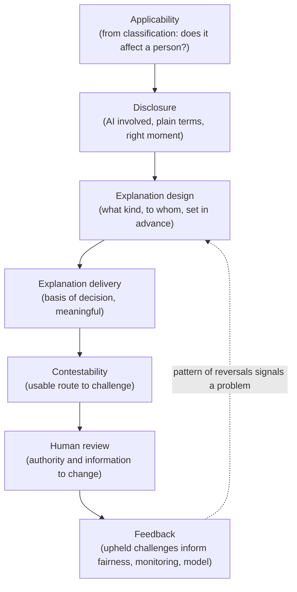
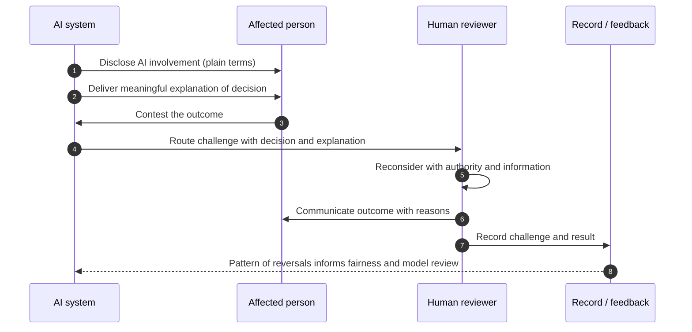

# Chapter 13: Transparency, Explainability and Contestability

Chapter 12 made fairness a measured, enforceable property. This chapter addresses the three outcomes that let people understand and challenge what AI does to them: knowing that AI was involved, understanding the basis of a decision, and being able to contest it. These three are often collapsed into a single demand for transparency, but they are distinct controls serving distinct purposes, and an organisation can satisfy one while failing the others. The skill on display here is matching each to the obligation it actually meets, rather than producing a generic gesture towards openness that explains nothing and changes nothing.

---

## 1. The Governance Problem

A person is refused a service, declined for a product, or passed over in a process, and an AI system made or shaped the decision. They are not told AI was involved. When they ask why, they receive either silence or a response so generic it explains nothing. When they try to challenge the outcome, there is no route to do so, because the organisation treats the model's decision as final and unquestionable. The person is left subject to an automated judgement they cannot see, cannot understand, and cannot contest.

The problem is that organisations often treat transparency as a communications matter rather than a set of controls with specific purposes. Disclosure, telling someone AI was used, is not the same as explanation, giving them the basis of the decision, which is not the same as contestability, giving them a way to challenge it. Each answers a different question and each is undermined by a different failure. Disclosure fails through silence. Explanation fails through opacity, because many models cannot be read like a rule, and through explanations that are technically present but useless to the person. Contestability fails through the absence of any route to a human who can review and change the outcome.

The constraint that matters most is that these controls exist for the person affected, not for the organisation's comfort, so their adequacy is judged by whether a real person can understand and act, not by whether a disclosure notice exists. The governance question is therefore not "are we being transparent?" but "does the person know AI was involved, can they understand the basis of the decision in terms meaningful to them, and can they contest it to someone able to change it?"

---

## 2. 🧩 The Mechanism at a Glance

- **Mechanism name:** Transparency, Explainability and Contestability
- **Risk addressed:** People subject to automated decisions they are not told about, cannot understand, and cannot challenge.
- **Primary objective:** Appropriate disclosure that AI is used, meaningful explanation of decisions, and a usable route to contest them.
- **When to use:** For any AI system whose output affects a person, especially where it makes or materially influences a decision about them.
- **When not to use:** As blanket disclosure on systems that do not affect people, or as technical explanations that satisfy no one.
- **Relevant frameworks / obligations:** Data protection rights on automated decision making and the right to an explanation; EU AI Act transparency obligations; public sector algorithmic transparency; sector disclosure and appeal rights.
- **Primary governance concern:** Serving the affected person, matching each control to its purpose, so disclosure, explanation and contestability each actually work.

Disclosure tells a person that, and when, AI is involved. Explanation gives the basis of a decision in terms the recipient can use. Contestability provides a route to challenge an outcome and reach a human who can review and change it.

---

## 3. The Operating Model

The reference model treats the three as linked but distinct controls, scoped by how much the system affects the person:

- **Applicability** determines, from classification, whether and how much the system affects a person, setting which controls apply.
- **Disclosure** informs the person that AI is involved, at the right moment and in plain terms.
- **Explanation design** decides, in advance, what kind of explanation the decision requires and to whom.
- **Explanation delivery** provides the basis of the decision in terms meaningful to the recipient, not only to a data scientist.
- **Contestability** offers a usable route to challenge an outcome.
- **Human review** routes a challenge to a person with the authority and information to reconsider and change the decision.
- **Feedback** returns upheld challenges to monitoring, fairness and the model, because a pattern of successful challenges signals a deeper problem.

Each component has a clear role. Applicability stops the controls being applied where they are pointless. Disclosure establishes that a person is interacting with AI. Explanation is designed before it is delivered, so it fits the recipient rather than the model's internals. Contestability and human review make the decision reviewable by someone empowered to change it. Feedback treats challenges as a signal, not just a case to close.

---

## 4. The Decision & Control Flow

> **Step 1:** Classification establishes whether the system affects a person and how materially, setting which of the three controls apply and how strongly.
> **Step 2:** The person is told, at the appropriate point, that AI is involved in the interaction or decision, in plain language.
> **Step 3:** For a decision about a person, the required kind of explanation is designed in advance: what it must convey and to whom.
> **Step 4:** When a decision is made, an explanation of its basis is delivered in terms meaningful to the recipient.
> **Step 5:** The explanation states the main factors behind the decision, not a technical description the person cannot use.
> **Step 6:** The person is informed of their route to contest the outcome.
> **Step 7:** A challenge is routed to a human reviewer with the authority and the information to reconsider it.
> **Step 8:** The reviewer examines the decision, its explanation and any new information, and may uphold or overturn it.
> **Step 9:** The outcome of the challenge is communicated to the person, with reasons.
> **Step 10:** The challenge, its basis and its result are recorded.
> **Step 11:** A pattern of overturned decisions is fed back to fairness measurement, monitoring and model review as a warning signal.

The flow makes the three controls concrete and distinct: the person is told AI is involved, given a usable explanation, offered a real route to challenge, and heard by a human who can change the decision, with the pattern of challenges fed back as a signal.

---

## 5. Why This Mechanism Works

The mechanism works because it separates three controls that are routinely conflated and matches each to the obligation it meets. Disclosure discharges the duty to tell people AI is involved; explanation discharges the duty to give them the basis of a decision; contestability discharges the duty to let them challenge it. Treating them separately means an organisation can see which it has and which it lacks, rather than assuming a single transparency notice satisfies all three, which it never does.

It also works because it judges each control by the affected person rather than the organisation. An explanation is adequate only if the recipient can use it, which rules out the technically accurate but incomprehensible output that opacity tempts organisations to offer. Contestability is real only if it reaches a human who can actually change the decision, not a form that disappears into a queue. By anchoring adequacy to the person and feeding a pattern of successful challenges back into fairness and model review, the mechanism turns transparency from a gesture into a control that both serves individuals and surfaces systemic problems.

---

## 6. 🏛️ Governance Decisions

| Decision | Options | Recommended approach | Reason |
| --- | --- | --- | --- |
| Treatment of the three | As one transparency notice / As distinct controls | Distinct controls | Each meets a different obligation and fails differently |
| Disclosure | Silent / Clear AI involvement notice | Clear notice at the right moment | People are entitled to know AI is involved |
| Explanation audience | For data scientists / For the affected person | For the affected person | An explanation no recipient can use is not an explanation |
| Explanation depth | Full model internals / Meaningful main factors | Meaningful main factors | Usability, not completeness, is the test |
| Contestability | None or form only / Route to empowered human | Route to empowered human | A challenge must reach someone able to change the decision |
| Challenges | Closed case by case / Fed back as a signal | Fed back as a signal | A pattern of reversals reveals a systemic problem |

These defaults make the three controls distinct and person centred. If an organisation points to a disclosure notice as evidence of explainability and contestability, it has conflated controls that are not the same.

---

## 7. ⚖️ Trade-offs

**Benefits:** People know when AI affects them, can understand decisions in usable terms, and can challenge outcomes; and the organisation gains an early signal of systemic problems through the pattern of challenges.

**Friction:** Designing meaningful explanations for opaque models is genuinely hard, and providing human review for challenges has a real operational cost. Disclosure can also prompt questions the organisation must then be ready to answer.

**Cost:** The effort of explanation design, the standing capacity for human review of challenges, and the handling and recording of contestations. Concentrated on decisions that materially affect people.

**Operational overhead:** Explanations must be maintained as models change, and the review and contestability routes must be staffed and responsive. A contestability route that does not respond is worse than none, because it implies a right that is not honoured.

**Risk reduction:** High for people affecting systems, because the inability to explain or contest an automated decision is both a direct harm to individuals and a frequent regulatory failing.

**Speed to deliver:** Designing explanation and contestability up front adds work before launch but avoids the far costlier scramble when a regulator or a wronged individual demands an explanation the system cannot produce.

**Unintended consequences:** Explanations can be gamed or made misleading, presenting a plausible but inaccurate rationale, which is worse than honest opacity. And detailed explanation can conflict with privacy or security if it exposes other people's data or the model's exploitable internals. The explanation must be faithful and bounded, not merely satisfying.

---

## 8. 🔐 Risk, Safety & Responsible AI

These controls connect tightly to the others in Part IV. Explanation underpins fairness, because a person told a decision was fair is entitled to understand its basis, and because faithful explanations help the organisation itself detect when a model is relying on something it should not. Contestability depends on human oversight, the subject of Chapter 15, because the route to challenge must end with a human who holds genuine authority to change the decision, not one who merely confirms the machine.

There is a distinctive honesty obligation here too. An explanation must be faithful, an accurate account of the factors that actually drove the decision, not a reassuring narrative constructed after the fact. A plausible explanation that does not reflect the model's real basis is a form of deception, and it is more dangerous than admitting that a model is hard to explain, because it invites misplaced trust. Where a model genuinely cannot be explained to the standard a decision requires, that is itself a governance finding: it may mean the model is unsuitable for that use, which is a more honest conclusion than dressing opacity in a convincing story.

---

## 9. 📜 Regulatory & Assurance Alignment

Transparency, explanation and contestability are among the most explicitly regulated AI outcomes, drawing on both data protection and AI specific law.

**Data protection law**, such as the EU GDPR and equivalents, grants rights around automated decision making, including being informed of it, obtaining meaningful information about the logic involved, and, in defined cases, obtaining human intervention and contesting the decision, which map directly onto the three controls. The **EU AI Act** imposes transparency obligations, including that people are informed when they interact with an AI system in certain contexts and that high risk systems are designed to be sufficiently transparent for their output to be interpreted and used. **Public sector algorithmic transparency** initiatives in various jurisdictions require disclosure of where and how automated tools are used in public decisions.

Sector regimes add specific disclosure and appeal rights. In **financial services**, adverse action and consumer credit rules can require that a person be told the principal reasons for a decision such as a credit refusal, a direct explanation obligation. In the **public sector**, administrative law duties of reasoned decision making and the right to appeal apply to automated decisions as to human ones. In **employment**, rules on automated decision tools can require notice to candidates. These regimes often set the minimum content of an explanation and the existence of an appeal.

The evidence an auditor or regulator expects includes the disclosure provided, the explanation approach and samples of delivered explanations, the contestability route with its human review, and records of challenges and their outcomes. A mechanism that produces these as it operates meets the expectation directly. As throughout, this is governance guidance rather than legal advice, and the specific right to an explanation or to contest requires local legal interpretation.

---

## 10. ⚠️ Failure Modes & Resilience

- **Conflation:** Treating a single disclosure notice as satisfying explanation and contestability leaves two obligations unmet. Separating the three controls is the mitigation.
- **Silent automation:** Not disclosing that AI was involved denies the person the basis for every other right. Clear, timely disclosure is the control.
- **Explanation for the wrong audience:** A technically correct explanation the recipient cannot understand fails its purpose. Designing explanations for the affected person is essential.
- **Unfaithful explanation:** A plausible but inaccurate rationale is deception that invites misplaced trust. Faithfulness to the model's actual basis is required, and admitting unexplainability is more honest than fabricating a reason.
- **Hollow contestability:** A challenge route that reaches no one empowered to change the decision is a right in name only. Routing to a human with authority and information is the control.
- **Challenges closed in isolation:** Handling each contestation as a one off misses the pattern that reveals a systemic fault. Feedback to fairness and model review mitigates this.
- **Explanation that leaks:** An explanation detailed enough to expose other people's data or the model's exploitable internals creates new harm. Explanations must be bounded by privacy and security.

The theme is that these controls fail by being gestures rather than services: a notice no one can act on, an explanation no one can use, a challenge no one answers. Resilience comes from judging each by the affected person and keeping explanations faithful and bounded.

---

## 11. 👁️ Monitoring & Operations

The function should monitor, at minimum: the proportion of people affecting systems with appropriate disclosure in place; the availability and, where testable, the comprehensibility of explanations for decisions that require them; the existence and responsiveness of contestability routes, including time to resolve a challenge; the volume and outcome of challenges, especially the rate of overturned decisions; and the extent to which patterns in challenges have prompted fairness or model review. These signals show whether the controls serve people or merely exist on paper.

A distinctive operational signal here is the overturn rate. A high or rising rate of successful challenges is not only a workload; it is evidence that the model, or its explanation, is getting decisions wrong in a way affected people can see, and it should trigger investigation upstream. Contestability therefore doubles as a monitoring instrument, which is why challenges must feed back rather than simply be resolved.

---

## 12. 💷 Cost & Proportionality

The cost drivers are explanation design and maintenance, the standing capacity for human review of challenges, and the handling and recording of contestations. These should scale with how materially the system affects the person.

Proportionality is essential because these controls, applied indiscriminately, waste effort and can even cause harm. Blanket AI disclosure on systems that do not affect people trains users to ignore notices, and detailed explanations can conflict with privacy. A low impact interaction may need only disclosure; a consequential decision about a person warrants meaningful explanation, a real contestability route and human review. The lever is the degree to which the output affects the person, drawn from classification, which should set which of the three controls apply and how strongly. Over applying them is a miscalibration as real as omitting them, particularly where explanation would expose data it should protect.

---

## 13. When to Use This Mechanism

Use this mechanism when:

- an AI system interacts with or makes decisions about people;
- a person would reasonably want to know AI was involved;
- a decision affects a person's rights, opportunities, treatment or access;
- data protection, AI or sector rules grant rights to explanation or appeal; and
- the organisation needs to detect, through challenges, when decisions are going wrong.

In practice the three controls apply, in proportion, to any people affecting system, with the strongest obligations on consequential decisions about individuals.

---

## 14. When NOT to Use This Mechanism

The caution is against misapplication, since these controls can waste effort or cause harm if applied where they do not belong:

- Do not apply **blanket disclosure** to systems that do not affect people; notice fatigue erodes the disclosures that matter.
- Do not provide **explanations aimed at experts** when the recipient is a member of the public; completeness is not the test, usability is.
- Do not give **detailed explanations that expose** other people's data or the model's exploitable internals; explanation must be bounded by privacy and security.

The lighter alternative for low impact systems is disclosure alone, or disclosure with a simple query route, not the full apparatus of designed explanation and formal contestability. Match the control to the impact on the person.

---

## 15. Mechanism Variations

- **Small organisation:** Clear disclosure, a plain explanation of the main factors for consequential decisions, and a simple route to a human who can review them.
- **Scaling organisation:** Standard disclosure patterns, designed explanations by decision type, a defined contestability process, and recorded challenge handling.
- **Large enterprise:** A federated model in which a central function owns transparency standards and the explanation approach while business units deliver disclosure, explanation and contestability for their own systems within the framework.
- **Highly regulated enterprise:** Explanation content aligned to specific legal requirements, formal appeal processes with defined timelines, independent review of high stakes contestations, and published transparency where required of public bodies.

The variations differ in formality and in the rigour of explanation and appeal, not in the principle that disclosure, explanation and contestability are distinct controls judged by the affected person.

---

## 16. Governance Decision Checklist

- [ ] Are disclosure, explanation and contestability treated as distinct controls, not one notice?
- [ ] Is the person told, clearly and at the right moment, that AI is involved?
- [ ] Is the kind of explanation a decision requires designed in advance and aimed at the recipient?
- [ ] Are explanations faithful to the model's actual basis rather than plausible fabrications?
- [ ] Is there a usable route to contest an outcome?
- [ ] Does a challenge reach a human with the authority and information to change the decision?
- [ ] Are explanations bounded so they do not expose others' data or exploitable internals?
- [ ] Do patterns in challenges feed back into fairness and model review?
- [ ] Is the overturn rate monitored as a signal of decisions going wrong?
- [ ] Are the controls applied in proportion to how much the system affects the person?

---

## 17. 📐 The Governance Verdict

> Transparency, explainability and contestability are three distinct controls, not one, and they are required for any system that makes or shapes decisions about people. The mechanism earns its place by matching each to the obligation it meets, disclosure to the duty to inform, explanation to the duty to give reasons, contestability to the duty to allow challenge, and by judging each not by whether a notice exists but by whether a real person can understand and act. Its weaknesses are the gestures that imitate the controls: silent automation, explanations aimed at experts, plausible but unfaithful rationales, and challenge routes that reach no one empowered to change anything. Keep the three distinct, write explanations for the person not the model, make them faithful even when that means admitting the model is hard to explain, and ensure a challenge reaches a human who can actually reverse the decision. If a model cannot be explained to the standard a decision demands, the honest conclusion may be that it should not make that decision. Openness that explains nothing and changes nothing is not transparency.
