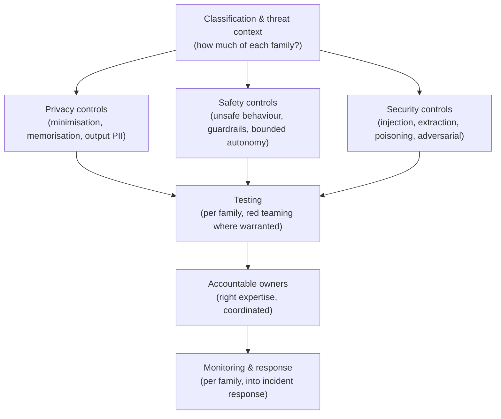
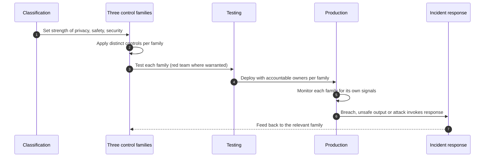

# Chapter 14: Privacy, Safety and Security Controls

This chapter addresses three responsible AI outcomes that are often treated together and are genuinely distinct: keeping personal data protected, keeping the system's behaviour within safe bounds, and keeping the system itself defended against attack. They share a chapter because AI introduces new forms of each at once, but they demand different controls, different expertise and different owners. The skill on display here is distinguishing a privacy harm from a safety harm from a security attack, because conflating them produces controls that address none of them well.

---

## 1. The Governance Problem

An organisation deploys a capable AI system and encounters three different failures that it was not prepared to tell apart. The system reproduces a fragment of someone's personal data that was in its training set, a privacy failure. It produces confidently unsafe output, advice that could cause harm if acted upon, a safety failure. And a user crafts an input that subverts the system's instructions and extracts information it should have withheld, a security attack. Each is serious, each has a different cause, and an organisation that treats them as a single category of risk will defend against them with a single category of control and remain exposed to all three.

The problem is that AI widens the attack and failure surface in ways conventional controls do not fully cover. Privacy is sharpened because personal data can be memorised in a model, inferred from outputs, or exposed through retrieval, not merely stored in a database. Safety is new in character because a probabilistic system can generate output that is plausible and wrong, or harmful, without any rule being broken. Security gains AI specific threats, prompt injection, model extraction, data poisoning, adversarial inputs, that sit alongside ordinary cyber risk and require their own defences. An organisation that applies only its existing privacy policy, its existing safety process and its existing security controls will miss the parts that are peculiar to AI.

The constraint that matters most is that these are three distinct control families with distinct owners, so they must be addressed separately even though they share a system. The governance question is therefore not "is the system safe?" as a single undifferentiated concern, but "is personal data protected across training, inference and output, is the system's behaviour bounded against unsafe output, and is the system defended against AI specific attacks?"

---

## 2. 🧩 The Mechanism at a Glance

- **Mechanism name:** Privacy, Safety and Security Controls
- **Risk addressed:** Exposure of personal data, generation of unsafe output, and AI specific attacks, each distinct and each requiring its own controls.
- **Primary objective:** Personal data protected across the AI data path, behaviour bounded against unsafe output, and the system defended against AI specific threats.
- **When to use:** For any AI system, with the strength of each control family set by the data it handles, the harm it could cause, and its exposure to attack.
- **When not to use:** As a single undifferentiated safety process, or as fear based control design disconnected from likelihood and impact.
- **Relevant frameworks / obligations:** Data protection law; EU AI Act accuracy, robustness and cybersecurity requirements; NIST AI RMF; established security standards extended to AI; sector safety regimes.
- **Primary governance concern:** Distinguishing privacy, safety and security so each is controlled by the right means and the right owner.

Privacy controls protect personal data across training, inference and output. Safety controls bound the system's behaviour so unsafe output is prevented or caught. Security controls defend the system against AI specific attacks as well as ordinary cyber threats.

---

## 3. The Operating Model

The reference model runs three control families in parallel over the same system, coordinated but distinct:

- **Classification and threat context**, from earlier chapters, set how much of each control family a use case needs.
- **Privacy controls**: data minimisation, purpose limitation, protection against memorisation and inference, and control of personal data in outputs.
- **Safety controls**: defined unsafe behaviour, input and output guardrails, bounded autonomy, and safe failure.
- **Security controls**: defences against prompt injection, model extraction, data poisoning and adversarial inputs, layered with ordinary cyber controls.
- **Testing**: privacy, safety and security each tested by the appropriate method, red teaming where warranted.
- **Owners**: each family has an accountable owner with the right expertise, coordinated rather than merged.
- **Monitoring and response**: each family monitored in production and connected to incident response.

Each component has a clear role. The context sets proportionate strength for each family. The three families address their distinct risks with distinct controls. Testing proves each rather than assuming it. Distinct owners bring the right expertise. Monitoring and response keep each live in production. The families are coordinated through shared classification and shared incident response, but never merged into a single vague notion of safety.

---

## 4. The Decision & Control Flow

> **Step 1:** Classification and the data assessment establish the personal data involved, the potential for harm, and the exposure to attack, setting the strength of each control family.
> **Step 2:** Privacy controls are applied: minimise the personal data used, limit it to the stated purpose, and guard against memorisation and inference.
> **Step 3:** Output privacy is controlled so the system does not reveal personal data through its responses.
> **Step 4:** Safety controls define what unsafe behaviour means for this system and place input and output guardrails against it.
> **Step 5:** Where the system acts autonomously, its authority is bounded so the consequence of a wrong action is contained.
> **Step 6:** The system is designed to fail safely, defaulting to a safe state rather than an unpredictable one.
> **Step 7:** Security controls defend against AI specific attacks, prompt injection, extraction, poisoning, adversarial inputs, alongside ordinary cyber controls.
> **Step 8:** Each family is tested by the appropriate method, including red teaming for higher risk systems.
> **Step 9:** Each family is assigned an accountable owner with the relevant expertise, coordinated through classification and incident response.
> **Step 10:** In production, each family is monitored for its own failure signals and connected to incident response.
> **Step 11:** A privacy breach, safety failure or security attack invokes incident response and feeds back to the relevant controls.

The flow makes the distinction concrete: three families scoped by context, controlled by distinct means, tested separately, owned by the right expertise, and monitored for their own signals, coordinated but never collapsed into one.

---

## 5. Why This Mechanism Works

The mechanism works because it refuses to treat privacy, safety and security as a single concern. A privacy breach is prevented by minimisation and output control; an unsafe output is prevented by guardrails and bounded autonomy; an attack is prevented by AI specific security defences. These require different controls and different expertise, and only by separating them can an organisation apply the right control to the right risk and assign it to an owner competent to run it. Conflation is the characteristic failure, and distinction is the mechanism's central move.

It also works because it scales each family to its own risk and proves each by testing rather than assumption. A system handling little personal data but capable of harmful output needs strong safety controls and light privacy ones; a system processing sensitive data in a low harm context needs the reverse. Testing each family, including red teaming where the risk warrants, replaces the comfortable assumption that a control exists with evidence that it works, which for security in particular is the only trustworthy basis, since an untested defence is an untested hypothesis.

---

## 6. 🏛️ Governance Decisions

| Decision | Options | Recommended approach | Reason |
| --- | --- | --- | --- |
| Treatment | One safety concern / Three distinct families | Three distinct families | Each has a different cause, control and owner |
| Privacy in models | Storage controls only / Across the AI data path | Across the AI data path | Data can be memorised, inferred or exposed, not only stored |
| Safety | Assume safe output / Define and guard unsafe behaviour | Define and guard unsafe behaviour | Probabilistic systems can be plausibly and harmfully wrong |
| Autonomy | Maximal / Bounded to contain consequence | Bounded to contain consequence | A wrong autonomous action has a larger blast radius |
| Security scope | Ordinary cyber only / AI specific threats too | AI specific threats too | Injection, extraction and poisoning are not covered by ordinary controls |
| Assurance of controls | Assume present / Tested, red teamed where warranted | Tested, red teamed where warranted | An untested defence is an untested hypothesis |

These defaults keep the three families distinct and evidence based. If an organisation has one undifferentiated safety process, it is likely controlling one family well and the others by accident.

---

## 7. ⚖️ Trade-offs

**Benefits:** Each distinct risk, privacy, safety, security, addressed by the right control and the right owner; proportionate strength per family; and tested rather than assumed defences.

**Friction:** Running three control families with three kinds of expertise is more demanding than a single process, and testing, especially red teaming, requires specialist capability. Guardrails can also constrain legitimate functionality, frustrating users and developers.

**Cost:** The expertise and tooling for privacy, safety and security separately, plus testing capacity. Concentrated where data is sensitive, harm potential high, or exposure to attack significant.

**Operational overhead:** Three families to monitor and maintain, with controls that must keep pace as models and threats change. Security in particular is a moving target that decays without ongoing attention.

**Risk reduction:** High and broad, because it closes three distinct exposures that a single undifferentiated process leaves partly open. The distinctiveness is the value.

**Speed to deliver:** Clear control requirements per family can be designed in up front; retrofitting privacy, safety or security after an incident is far slower and more costly.

**Unintended consequences:** Over strong guardrails can make a system unusable or push users to unsafe workarounds, and fear based security design can impose cost out of proportion to real likelihood. Controls must be grounded in likelihood and impact, not alarm, and balanced against usability.

---

## 8. 🔐 Risk, Safety & Responsible AI

This chapter is itself a cluster of responsible AI controls, so the emphasis is on how the three families relate to the rest and to each other. Privacy connects to data governance, since minimisation and lawful basis originate there, and to transparency, since an explanation must not leak personal data. Safety connects to evaluation, since unsafe behaviour must be tested for, and to human oversight, since a human in the loop is often the control that catches an unsafe output before it causes harm. Security connects to all of them, because an attack can defeat a privacy or safety control that was sound against honest use.

The book's stance on security writing applies directly here: threats must be described in terms of attack surface, likelihood, impact and control, not sensational alarm. Prompt injection, model extraction, data poisoning and adversarial inputs are real and should be defended against proportionately, based on how exposed a given system actually is and what an attacker could gain. Fear based design, hardening every system to the maximum regardless of its exposure, wastes resources and can degrade usability without reducing meaningful risk. The responsible position is to assess each threat realistically and control it in proportion.

---

## 9. 📜 Regulatory & Assurance Alignment

Privacy, safety and security each attract their own regulatory expectations, which reinforces treating them as distinct.

**Privacy** is governed by data protection law, such as the EU GDPR and equivalents, including minimisation, purpose limitation, security of processing, and rules on the personal data that models hold or reveal. **Safety and robustness** appear in the **EU AI Act**, which requires high risk systems to be accurate, robust and resilient, and in sector safety regimes. **Security** is addressed by the EU AI Act's cybersecurity requirement for high risk systems, by the **NIST AI RMF** as part of managing risk, and by established security standards extended to cover AI specific threats.

Sector regimes add specific duties. In **healthcare**, device safety regimes require that an AI enabled device perform safely and that risks to patients be controlled and monitored. In **financial services**, operational resilience and security expectations apply to AI systems as to other critical systems, and conduct rules bear on harmful outputs. In **critical infrastructure**, safety assurance regimes govern systems where failure affects physical or operational safety. These regimes often dictate the testing and evidence required for each family.

The evidence an auditor or regulator expects differs by family: for privacy, minimisation and the handling of personal data in training and output; for safety, the definition of unsafe behaviour, the guardrails and the testing; for security, the threat assessment, the defences and the results of security testing including red teaming. A mechanism that produces these as it operates meets the expectation directly. As throughout, this is governance guidance rather than legal advice, and the specific obligations for each family require local interpretation.

---

## 10. ⚠️ Failure Modes & Resilience

- **Conflation:** Treating the three as one safety concern leaves two families controlled by accident. Distinct controls, testing and owners are the mitigation.
- **Privacy as storage only:** Protecting data at rest while ignoring memorisation, inference and output exposure misses the AI specific privacy risk. Controlling the whole data path is the control.
- **Assumed safety:** Trusting a probabilistic system to produce safe output without guardrails invites confident, plausible harm. Defining unsafe behaviour and guarding against it is essential.
- **Unbounded autonomy:** An autonomous component with excessive authority turns a single error into a large consequence. Bounding authority contains the blast radius.
- **Ordinary security only:** Applying only conventional cyber controls leaves prompt injection, extraction and poisoning undefended. AI specific defences, tested, are required.
- **Untested defences:** Assuming controls work without red teaming leaves the organisation confident and exposed. Testing, especially for security, is the only trustworthy basis.
- **Fear based over control:** Hardening every system to the maximum regardless of exposure wastes resources and harms usability. Proportionate, likelihood based control is the mitigation.

The theme is that these failures come from either collapsing the three families or controlling them by assumption. Resilience comes from distinction, proportionality and testing.

---

## 11. 👁️ Monitoring & Operations

The function should monitor, per family: for privacy, incidents of personal data exposure through outputs or inference, and the currency of minimisation and purpose controls; for safety, the rate of unsafe outputs caught by guardrails and any that escaped, and the behaviour of autonomous components against their bounds; for security, attempted and successful attacks of the AI specific kinds, and the results of ongoing security testing. Each family has its own signals, and collapsing them into a single safety dashboard loses the distinctions that make the signals actionable.

Distinguish monitoring the three families from the general production monitoring of Chapter 10, into which they feed. A privacy breach, an unsafe output and a security attack are different incident types with different response paths, affected parties and reporting obligations, which is a further reason to keep them distinct in operation as well as in design.

---

## 12. 💷 Cost & Proportionality

The cost drivers are the distinct expertise and tooling for each family, the testing capacity including red teaming, and the ongoing maintenance of controls against changing models and threats. These should scale independently: a system's privacy, safety and security exposures are not the same, and each family's strength should match its own risk.

Proportionality is especially important for safety and security, where over control is a real cost. Guardrails strong enough to block legitimate use frustrate users and drive unsafe workarounds, and security hardening beyond a system's actual exposure consumes resources without reducing meaningful risk. The failure in one direction is maximal control everywhere, driven by alarm; in the other, uniform light control that leaves a high exposure system defenceless. The lever is a realistic, per family assessment of likelihood and impact, which should set each family's strength independently. An organisation that hardens a low exposure system to the maximum has miscalibrated as surely as one that leaves a high exposure system open.

---

## 13. When to Use This Mechanism

Use this mechanism when:

- an AI system processes personal or sensitive data at any lifecycle stage;
- the system's output could cause harm if it is wrong or misused;
- the system acts autonomously or with access to consequential actions;
- the system is exposed to inputs from untrusted sources; and
- regulation imposes privacy, safety or security obligations on the system.

In practice every AI system needs some of each family; the strength of each is set independently by the data it handles, the harm it could cause and its exposure to attack.

---

## 14. When NOT to Use This Mechanism

The caution is against conflation and over control rather than against the controls:

- Do not run a **single undifferentiated safety process**; it will control one family and neglect the others.
- Do not apply **maximal control to every system** regardless of exposure; fear based hardening wastes resources and harms usability.
- Do not **assume controls work** without testing them, especially for security; an untested defence is a hypothesis.

The lighter alternative for a low exposure system is proportionate controls in each family matched to its actual risk, not the absence of any. Each family should be present in proportion, not uniformly maximised.

---

## 15. Mechanism Variations

- **Small organisation:** Core privacy controls for any personal data, basic safety guardrails and safe failure, and standard security extended with awareness of the main AI specific threats, owned pragmatically.
- **Scaling organisation:** Distinct control standards per family by risk tier, defined testing including some red teaming for higher risk systems, and separate owners for privacy, safety and security.
- **Large enterprise:** A federated model in which central privacy, safety and security functions own standards and specialist testing while business units implement the controls for their own systems.
- **Highly regulated enterprise:** Formal controls aligned to sector privacy, safety and security regimes, mandatory red teaming for defined categories, independent security assessment, and documented safety cases where required.

The variations differ in formality, specialism and testing depth, not in the principle that privacy, safety and security are distinct families, each proportionate, each tested, each owned.

---

## 16. Governance Decision Checklist

- [ ] Are privacy, safety and security treated as three distinct families with distinct owners?
- [ ] Is personal data controlled across training, inference and output, not only at rest?
- [ ] Is unsafe behaviour defined for the system, with guardrails against it?
- [ ] Is autonomous authority bounded to contain the consequence of a wrong action?
- [ ] Does the system fail to a safe state?
- [ ] Are AI specific security threats defended against, alongside ordinary cyber controls?
- [ ] Is each family tested, with red teaming where the risk warrants it?
- [ ] Is each family monitored for its own signals and connected to incident response?
- [ ] Are controls grounded in likelihood and impact rather than alarm?
- [ ] Is the strength of each family proportionate to that system's actual exposure?

---

## 17. 📐 The Governance Verdict

> Privacy, safety and security controls are three distinct families sharing a system, and they are required, in proportion, for essentially every AI system. The mechanism earns its place by refusing to conflate them: a privacy breach, an unsafe output and an attack have different causes, demand different controls and expertise, and must be owned separately even as they are coordinated through classification and incident response. Its weaknesses are collapse and assumption: one undifferentiated safety process that controls one family by design and the others by luck, and defences believed in rather than tested. Treat the three distinctly, control privacy across the whole data path, bound behaviour and autonomy against unsafe output, defend against AI specific attacks as well as ordinary ones, and test what you build, especially the security. Scale each family to its own exposure and resist the pull of fear based over control, which harms usability without reducing real risk. Ask not whether the system is safe, but whether its data is protected, its behaviour bounded, and its defences proven. Those are three questions, and they need three answers.
