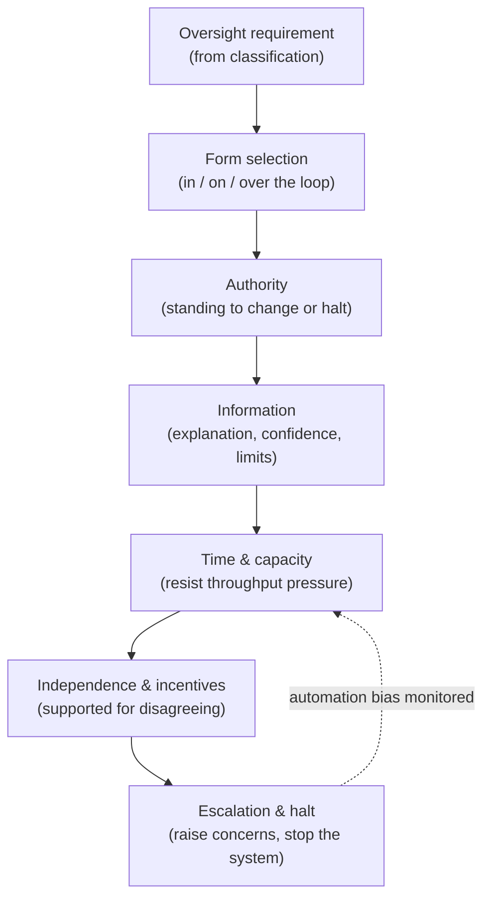
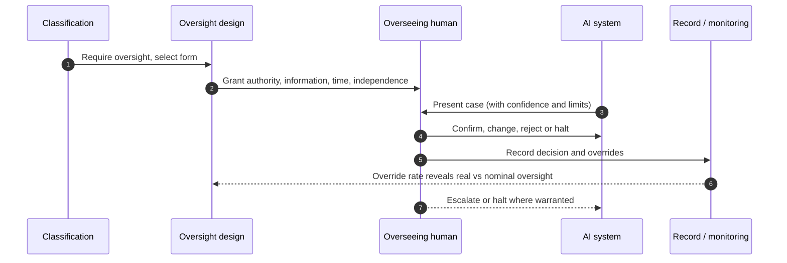

# Chapter 15: Human Oversight and Meaningful Control

This chapter closes Part IV. The previous chapters turned fairness, transparency, privacy, safety and security into controls; this one addresses the control that so many of the others ultimately rely upon, a human able to intervene. Human oversight is the responsible AI requirement most often asserted and least often real. Almost every policy promises a human in the loop, yet in practice the human frequently has neither the authority, the information, the time, nor the independence to change what the machine has decided. The skill on display here is distinguishing oversight that is meaningful from oversight that is merely present, because a human who cannot actually intervene is not a control but an alibi.

---

## 1. The Governance Problem

An organisation deploys an AI system that makes consequential decisions and reassures everyone that a human remains in control. On inspection, the human's role turns out to be nominal. They are shown the model's recommendation and asked to confirm it, hundreds of times a day, with no time to examine any single case and no information beyond the recommendation itself. They are measured on throughput, so disagreeing with the model is slow and penalised. They lack the standing to overrule a system the organisation has invested in and trusts. In form there is a human in the loop; in substance the machine decides and the human signs. When something goes wrong, the organisation points to the human as the safeguard, and the human points out they never had the means to be one.

The problem is that human oversight is easy to claim and hard to make real. The claim is satisfied by placing a person somewhere in the process; the reality requires that the person can actually change the outcome. Two forces undermine this. The first is automation bias: people tend to defer to a confident machine, especially under time pressure, so a human asked to review model output will mostly rubber stamp it unless the process is designed to resist that tendency. The second is organisational: oversight costs time and slows throughput, so the pressures of delivery quietly hollow it out, leaving a role that looks like a control and functions as a formality.

The constraint that matters most is that oversight is meaningful only if the human has the authority, information, time and independence to intervene, and the willingness to use them. The governance question is therefore not "is there a human in the loop?" but "can that human actually understand the decision, has the standing to change it, has the time and information to do so, and is supported rather than penalised for overruling the machine?"

---

## 2. 🧩 The Mechanism at a Glance

- **Mechanism name:** Human Oversight and Meaningful Control
- **Risk addressed:** Nominal oversight that looks like a safeguard but cannot actually intervene, undermined by automation bias and throughput pressure.
- **Primary objective:** Oversight that is genuinely capable of intervention, with the right form of oversight matched to the risk and the human equipped to use it.
- **When to use:** For any AI system where a human must be able to intervene in or override decisions, especially consequential decisions about people.
- **When not to use:** As a nominal human placed in the loop to satisfy a policy, or as oversight applied where it adds no protection.
- **Relevant frameworks / obligations:** Data protection rights to human intervention in automated decisions; EU AI Act human oversight requirements for high risk systems; sector decision accountability regimes.
- **Primary governance concern:** Making oversight real, authority, information, time, independence, rather than nominal, and matching its form to the risk.

Human oversight ranges across forms: a human in the loop decides each case with the model advising; a human on the loop supervises and can intervene; a human over the loop governs the system without touching each decision. Meaningful control is the property that, whichever form applies, the human can actually understand and change what matters.

---

## 3. The Operating Model

The reference model designs oversight as a capability, not a checkbox, matched to risk and defended against the forces that hollow it out:

- **Oversight requirement**, set from classification, determines whether oversight is needed and which form fits the risk.
- **Form selection** chooses human in, on, or over the loop according to the decision's consequence and volume.
- **Authority** gives the overseeing human genuine standing to change or halt the decision.
- **Information** provides what the human needs to judge the case, including a meaningful explanation and the confidence and limits of the model.
- **Time and capacity** ensure the human can actually examine cases, resisting throughput pressure that forces rubber stamping.
- **Independence and incentives** support and protect the human for disagreeing with the model rather than penalising it.
- **Escalation and halt** let the human raise concerns and, where warranted, stop the system.

Each component has a clear role. The requirement and form fit oversight to the risk rather than applying it everywhere or nowhere. Authority, information, time and independence are the four conditions without which oversight is nominal, and the mechanism treats all four as design requirements, not assumptions. Escalation and halt give the overseer real power. The feedback loop acknowledges automation bias as a condition to be monitored and designed against, not wished away.

---

## 4. The Decision & Control Flow

> **Step 1:** Classification determines whether the decision requires human oversight and, if so, which form fits its consequence and volume.
> **Step 2:** For a high consequence, lower volume decision, a human in the loop decides each case with the model advising.
> **Step 3:** For a higher volume decision, a human on the loop supervises, samples and can intervene, rather than reviewing every case superficially.
> **Step 4:** The overseeing human is granted genuine authority to change, reject or halt the model's output.
> **Step 5:** The human is given the information to judge the case: a meaningful explanation, the model's confidence, and its known limitations.
> **Step 6:** The process allocates enough time and capacity for genuine review, rather than a rate that forces rubber stamping.
> **Step 7:** The human is supported and protected for disagreeing with the model, and not measured solely on throughput or agreement.
> **Step 8:** Automation bias is designed against, for example by withholding the recommendation until the human has formed a view, where appropriate.
> **Step 9:** The human can escalate concerns and, where warranted, halt the system.
> **Step 10:** Oversight decisions, including overrides, are recorded.
> **Step 11:** The rate and pattern of overrides are monitored as a signal both of model quality and of whether oversight is real or nominal.

The flow makes meaningful control concrete: oversight scoped to risk, the human equipped with the four conditions, automation bias designed against, and the override rate watched as evidence of whether the oversight is genuine.

---

## 5. Why This Mechanism Works

The mechanism works because it treats oversight as a capability to be engineered rather than a person to be named. By making authority, information, time and independence explicit design requirements, it exposes the gap between a human who is present and a human who can intervene, and it closes that gap deliberately rather than assuming it away. By matching the form of oversight to the decision's consequence and volume, it avoids both the nominal review of every case that throughput makes meaningless and the absence of oversight where it is genuinely needed.

It also works because it confronts automation bias directly rather than pretending it does not exist. Recognising that people defer to confident machines, it designs the process to resist that tendency and then monitors the override rate as evidence. An oversight process where the human almost never disagrees is not necessarily a sign of a good model; it is often a sign of rubber stamping, and treating the override rate as a diagnostic turns oversight into something the organisation can actually verify rather than merely assert.

---

## 6. 🏛️ Governance Decisions

| Decision | Options | Recommended approach | Reason |
| --- | --- | --- | --- |
| Oversight reality | Nominal human in loop / Meaningful control | Meaningful control | A human who cannot intervene is an alibi, not a safeguard |
| Form | One size / Matched to consequence and volume | Matched to consequence and volume | Per case review does not scale; absence leaves high stakes uncovered |
| Authority | Confirm only / Standing to change or halt | Standing to change or halt | Oversight without power to change the outcome is form only |
| Information | Recommendation only / Explanation, confidence, limits | Explanation, confidence, limits | A human cannot judge what they cannot understand |
| Incentives | Throughput and agreement / Supported for disagreeing | Supported for disagreeing | Penalising disagreement guarantees rubber stamping |
| Automation bias | Ignored / Designed against and monitored | Designed against and monitored | People defer to confident machines unless the process resists it |

These defaults make oversight real and verifiable. If the human almost never overrides the model and is measured on throughput, the oversight is nominal regardless of what the policy says.

---

## 7. ⚖️ Trade-offs

**Benefits:** A genuine safeguard capable of catching errors the model makes; a defensible answer to the right to human intervention; and, through the override rate, a live diagnostic of both model quality and oversight reality.

**Friction:** Meaningful oversight costs time and therefore throughput, which is precisely the pressure that hollows it out. Giving a human genuine authority to overrule an invested in system can also create organisational tension.

**Cost:** The time of competent overseers, the design to give them information and resist automation bias, and the capacity to sustain genuine review rather than rubber stamping. Concentrated on consequential decisions.

**Operational overhead:** Oversight must be staffed, supported and monitored continuously, and its form revisited as volume and risk change. An oversight role that is quietly starved of time degrades into formality without anyone deciding it should.

**Risk reduction:** High for consequential decisions, because the human is often the last line that catches a confident error before it reaches a person, provided the oversight is real.

**Speed to deliver:** Designing meaningful oversight adds cost and can cap throughput, which is a genuine tension with delivery. The alternative, nominal oversight, is cheaper but provides no protection and exposes the organisation when it is tested.

**Unintended consequences:** Oversight can become a liability sink, a human placed in the loop chiefly so the organisation has someone to blame, which is both unjust and ineffective. And too much mandatory per case review can make a system so slow it is abandoned for an ungoverned alternative. Matching form to risk and resourcing it honestly are the mitigations.

---

## 8. 🔐 Risk, Safety & Responsible AI

Human oversight is the control on which several others depend. Contestability in Chapter 13 requires a human with authority to reconsider a decision; the right to halt in Chapters 5 and 9 requires a human empowered to stop a system; the catching of an unsafe output in Chapter 14 often depends on a human in the loop. If oversight is nominal, all of these inherit its weakness: the appeal reaches someone who cannot really change the decision, the halt authority is never exercised, the unsafe output is waved through. Making oversight meaningful is therefore not one control among many but a precondition for others.

There is an honesty obligation here as elsewhere. Claiming meaningful human oversight while providing only a nominal reviewer is a form of the ethics washing the book warns against, and it is particularly damaging because it offers false assurance precisely where the stakes are highest. Where genuine oversight is not feasible, because the volume is too high or the decision too fast for a human to meaningfully intervene, that is itself a finding: it may mean the system should not operate autonomously at that consequence, which is a more honest conclusion than installing a human who cannot actually oversee.

---

## 9. 📜 Regulatory & Assurance Alignment

Human oversight is explicitly required by AI regulation and data protection law, which makes meaningful control a direct compliance matter.

**Data protection law**, such as the EU GDPR and equivalents, gives individuals, in defined cases, the right not to be subject to a solely automated decision with significant effects, and the right to obtain human intervention, which requires that the intervention be genuine rather than nominal. The **EU AI Act** requires that high risk systems be designed so they can be effectively overseen by humans, including that overseers can understand the system's capacities and limits, remain aware of automation bias, interpret the output, and intervene or halt the system, a close match to the four conditions this chapter sets out.

Sector regimes add their own expectations. In **financial services**, accountability regimes require that a responsible human stands behind material decisions, which an automated process must not obscure. In the **public sector**, administrative law requires that a decision maker apply their own judgement, so a human who merely rubber stamps an algorithm may render the decision legally defective. In **healthcare**, clinical responsibility typically remains with a qualified professional, so an AI enabled device supports rather than replaces their judgement. These regimes often determine where solely automated decisions are permitted at all.

The evidence an auditor or regulator expects includes the oversight design, who oversees with what authority, what information and time, the measures against automation bias, and records of overrides and halts. A high override rate, or a near zero one with evidence of rubber stamping, is itself a finding. A mechanism that produces this evidence as it operates meets the expectation directly. As throughout, this is governance guidance rather than legal advice, and where human intervention is legally required depends on local interpretation.

---

## 10. ⚠️ Failure Modes & Resilience

- **Nominal oversight:** A human in the loop who lacks authority, information, time or independence is a formality. Treating the four conditions as design requirements is the mitigation.
- **Automation bias:** Deference to a confident machine turns review into rubber stamping. Designing the process to resist it, and monitoring the override rate, are the controls.
- **Throughput erosion:** Delivery pressure quietly cuts the time available for review until oversight is hollow. Protecting oversight capacity and matching form to volume prevent this.
- **Perverse incentives:** Measuring overseers on throughput or agreement penalises the disagreement that makes oversight valuable. Supporting and protecting disagreement is essential.
- **Liability sink:** Placing a human in the loop mainly to have someone to blame is unjust and provides no real protection. Oversight must be a capability, not a scapegoat.
- **Oversight that cannot keep pace:** Where volume or speed makes meaningful intervention impossible, nominal oversight is installed to paper over the gap. The honest response is to question whether the system should be autonomous at that consequence.

The theme is that oversight fails by being present without being real, hollowed out by automation bias, throughput pressure and incentives. Resilience comes from engineering the four conditions and verifying them through the override rate.

---

## 11. 👁️ Monitoring & Operations

The function should monitor, at minimum: the override rate and its trend, interpreted carefully, since both an implausibly low rate and a very high one are signals worth investigating; the time actually spent per case against the rate needed for genuine review; the outcomes of overrides, whether the human was right to disagree; the incentives and measures applied to overseers, to detect throughput pressure; and the exercise of escalation and halt authority. These signals reveal whether oversight is a live control or a formality.

The override rate deserves particular attention because it is the clearest single indicator of whether oversight is real. A rate near zero, combined with high throughput and recommendation first presentation, strongly suggests rubber stamping rather than a flawless model. Treating this rate as a diagnostic, and investigating when it looks too good, is how the organisation keeps itself honest about a control that is otherwise easy to fake.

---

## 12. 💷 Cost & Proportionality

The cost drivers are the time of competent overseers, the design and information needed to make their judgement genuine, and the throughput foregone by allocating real review time. These are significant and fall precisely where delivery pressure pushes hardest, which is why oversight is so often quietly underfunded into formality.

Proportionality is the discipline that keeps oversight both real and affordable. Applying per case human review to a high volume, low consequence decision is unaffordable and will degrade into rubber stamping; applying only over the loop governance to a high consequence individual decision leaves a gap where intervention is most needed. The failure in one direction is nominal oversight everywhere, cheap and useless; in the other, mandatory per case review that makes the system unusable. The lever is the form of oversight matched to consequence and volume, with resources sufficient to make whichever form is chosen genuine. Oversight that is real but unaffordable will be cut; oversight that is affordable but nominal protects no one. The art is the form that is both.

---

## 13. When to Use This Mechanism

Use this mechanism when:

- an AI decision has consequences that warrant a human able to intervene;
- individuals have a right to human intervention in an automated decision;
- a confident model error could reach a person without a human to catch it;
- accountability regimes require a responsible human behind a decision; and
- the organisation needs a genuine safeguard rather than a nominal one.

In practice meaningful oversight is required wherever other controls, contestability, the right to halt, the catching of unsafe output, depend on a human able to act.

---

## 14. When NOT to Use This Mechanism

The caution is against nominal and misapplied oversight:

- Do not install a **nominal human** to satisfy a policy; a human who cannot intervene provides no protection and false assurance.
- Do not apply **per case review** where volume makes it impossible; it will degrade into rubber stamping and should prompt a question about autonomy instead.
- Do not use oversight as a **liability sink**; placing a human in the loop mainly to assign blame is unjust and ineffective.

The lighter alternative for lower consequence decisions is human on or over the loop oversight, supervision and sampling rather than per case review, not a nominal reviewer. And where meaningful oversight is genuinely infeasible, the honest alternative is to reconsider whether the system should make that decision autonomously at all.

---

## 15. Mechanism Variations

- **Small organisation:** A clearly empowered human for the few high consequence decisions, given the information and time to review them, with simple recording of overrides.
- **Scaling organisation:** Oversight forms defined by decision type, overseers trained against automation bias, incentives that protect disagreement, and override rate monitoring.
- **Large enterprise:** A federated model in which a central function sets oversight standards and the approach to automation bias while business units operate oversight for their own systems, with override data consolidated.
- **Highly regulated enterprise:** Oversight designed to specific legal requirements, documented overseer competence and authority, independent review of oversight effectiveness, and formal reconsideration of autonomy where meaningful oversight is infeasible.

The variations differ in formality and rigour, not in the principle that oversight must be meaningful, authority, information, time and independence, and matched in form to the risk.

---

## 16. Governance Decision Checklist

- [ ] Is the form of oversight, in, on or over the loop, matched to the decision's consequence and volume?
- [ ] Does the overseeing human have genuine authority to change, reject or halt the output?
- [ ] Is the human given a meaningful explanation and the model's confidence and limits?
- [ ] Is there enough time and capacity for genuine review rather than rubber stamping?
- [ ] Are overseers supported and protected for disagreeing, not measured only on throughput?
- [ ] Is automation bias designed against and monitored?
- [ ] Can the human escalate concerns and halt the system where warranted?
- [ ] Is the override rate monitored and investigated when it looks implausibly low?
- [ ] Where meaningful oversight is infeasible, has autonomy at that consequence been reconsidered?
- [ ] Is oversight resourced enough to be real, and proportionate enough to be affordable?

---

## 17. 📐 The Governance Verdict

> Human oversight and meaningful control is the mechanism that so many other controls depend upon, and it is required wherever a human must be able to intervene in a consequential AI decision. It earns its place by treating oversight as a capability to be engineered, authority, information, time and independence, rather than a person to be named, by matching the form of oversight to the risk, and by confronting automation bias directly and monitoring the override rate as evidence that the oversight is real. Its weaknesses all reduce to the same thing: a human who is present but cannot intervene, hollowed out by automation bias, throughput pressure and incentives, and sometimes placed there only to absorb blame. Give the overseer real power and the means to use it, resist the deference that turns review into rubber stamping, and watch the override rate as your honest diagnostic. Where meaningful oversight is impossible, say so, and reconsider whether the system should decide alone. A human who cannot change the outcome is not oversight. They are the story the organisation tells itself about a decision the machine already made.
