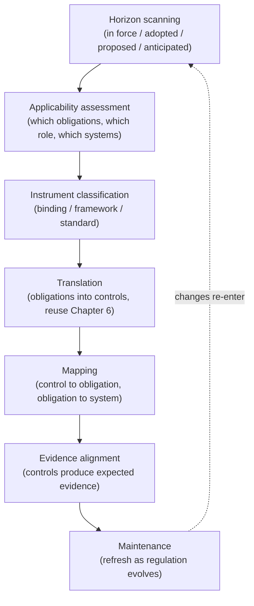
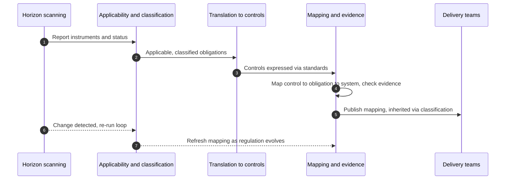

# Chapter 16: Cross Cutting Regulation

This chapter opens Part V, which turns to regulation and assurance. It addresses the cross cutting instruments that apply to AI across sectors, principally the EU AI Act, the NIST AI Risk Management Framework and ISO/IEC 42001, and, crucially, how an organisation turns them into something it can actually do. The instinct on meeting a new regulation is to read it, summarise it, and file the summary. That produces knowledge of the rules and no change in behaviour. The mechanism in this chapter is the capability that converts a moving body of regulation into current, mapped, operable controls, and keeps doing so as the rules evolve. The skill on display here is translation under uncertainty: turning text that is partly settled and partly in flux into controls the organisation can run today without over committing to rules that may still change.

---

## 1. The Governance Problem

An organisation becomes aware that AI regulation is arriving. It commissions a legal summary of the EU AI Act, notes that the NIST AI Risk Management Framework and ISO/IEC 42001 exist, and circulates a slide deck. Everyone now knows the regulation is coming, and nothing in how the organisation builds or governs AI has changed. A year later it discovers that knowing a regulation is not the same as complying with it: the obligations were never translated into controls, never mapped to specific systems, and never kept current as guidance and timelines shifted. The organisation is informed and non compliant at the same time.

The problem has three parts. First, regulation describes obligations, not controls; the gap between an article of the EU AI Act and a thing a delivery team must do is exactly the translation work most organisations skip. Second, these instruments differ in kind, the EU AI Act is binding law, the NIST AI RMF is a voluntary framework, ISO/IEC 42001 is a certifiable standard, so treating them identically produces confusion about what is mandatory and what is advisory. Third, the landscape moves: provisions phase in over time, guidance emerges, and new instruments appear, so a one time mapping is wrong within months.

The constraint that matters most is that regulation must be converted into operable controls and kept current, under genuine uncertainty about how some provisions will finally settle. The governance question is therefore not "do we know the regulations?" but "have we translated the applicable obligations into controls mapped to our systems, distinguished what is binding from what is advisory, and built the capability to keep that mapping current as the rules evolve?"

---

## 2. 🧩 The Mechanism at a Glance

- **Mechanism name:** Cross Cutting Regulatory Alignment
- **Risk addressed:** Being informed about AI regulation yet non compliant, because obligations were never translated into controls or kept current.
- **Primary objective:** Applicable cross cutting obligations translated into mapped, operable controls, with binding and advisory instruments distinguished and the mapping maintained as regulation evolves.
- **When to use:** As a standing capability wherever AI regulation applies or is reasonably anticipated.
- **When not to use:** As a one time legal summary, or as gold plating that treats every advisory framework as a binding requirement.
- **Relevant frameworks / obligations:** EU AI Act (binding); NIST AI Risk Management Framework (voluntary framework); ISO/IEC 42001 (certifiable standard); and the sector regimes addressed in Chapter 18.
- **Primary governance concern:** Translating obligations into controls and keeping them current, while distinguishing binding law from advisory framework.

Regulatory alignment is not knowledge of the rules; it is the operating capability that identifies applicable obligations, translates them into the controls defined in Chapter 6, maps those controls to specific systems, and refreshes the mapping as the regulation and guidance change.

---

## 3. The Operating Model

The reference model is a continuous alignment loop rather than a one time analysis:

- **Horizon scanning** tracks the state of relevant instruments: in force, adopted, proposed and anticipated.
- **Applicability assessment** determines which obligations apply to the organisation, its role (for example provider or deployer) and its systems.
- **Instrument classification** distinguishes binding law from voluntary framework from certifiable standard, setting what is mandatory.
- **Translation** converts applicable obligations into the organisation's own controls and standards, reusing the control layer rather than inventing a parallel one.
- **Mapping** links each control to the obligations it satisfies and each obligation to the systems it reaches.
- **Evidence alignment** ensures the controls produce the evidence the regulation expects.
- **Maintenance** refreshes the whole loop as provisions phase in, guidance emerges and new instruments appear.

Each component has a clear role. Horizon scanning keeps the picture current. Applicability narrows the vast body of regulation to what actually binds this organisation. Instrument classification prevents advisory frameworks being treated as law and vice versa. Translation and mapping convert obligations into controls tied to systems. Evidence alignment ensures compliance is demonstrable. Maintenance makes the whole thing a loop, because a static mapping decays as the rules move.

---

## 4. The Decision & Control Flow

> **Step 1:** Horizon scanning identifies the relevant cross cutting instruments and the status of each, in force, adopted, proposed or anticipated.
> **Step 2:** An applicability assessment determines which obligations apply, given the organisation's jurisdictions, its role, and the systems it operates.
> **Step 3:** Each instrument is classified as binding law, voluntary framework or certifiable standard, establishing what is mandatory versus advisory.
> **Step 4:** Applicable obligations are prioritised by whether they are binding and by when they take effect.
> **Step 5:** Each obligation is translated into one or more controls, expressed through the existing policy and standards layer rather than a separate regime.
> **Step 6:** Controls are mapped to the obligations they satisfy, and obligations are mapped to the systems they reach.
> **Step 7:** The evidence each control produces is checked against what the regulation would require to demonstrate compliance.
> **Step 8:** Gaps, obligations with no control, or controls producing insufficient evidence, are identified and remediated.
> **Step 9:** The organisation decides, deliberately, where to go beyond binding requirements and where not to, avoiding unconsidered gold plating.
> **Step 10:** The mapping is published so delivery teams inherit the right controls through classification.
> **Step 11:** As provisions phase in, guidance emerges or new instruments appear, the loop re-runs and the mapping is refreshed.

The flow makes alignment concrete: obligations identified and classified, translated into controls, mapped to systems with their evidence checked, and the whole loop refreshed as the regulation moves, so the organisation is compliant in practice rather than merely informed.

---

## 5. Why This Mechanism Works

The mechanism works because it closes the gap that leaves organisations informed and non compliant: the gap between knowing an obligation and operating a control that meets it. By translating obligations into the organisation's existing control and standards layer, it avoids a parallel compliance regime and lets delivery teams inherit regulatory controls through the same classification they already use. By mapping each control to its obligation and each obligation to its systems, it can answer, for any requirement, where it is met and by what, which is exactly what a regulator asks.

It also works because it is built as a loop for a moving target. Treating regulation as something that phases in, accrues guidance and grows new instruments, the mechanism refreshes its mapping rather than freezing a one time analysis that is wrong within months. And by classifying instruments as binding, framework or standard, it lets the organisation meet what is mandatory, use what is advisory as useful input, and decide deliberately where to exceed the minimum, rather than either under complying with law or gold plating every voluntary framework into a self imposed obligation.

---

## 6. 🏛️ Governance Decisions

| Decision | Options | Recommended approach | Reason |
| --- | --- | --- | --- |
| Treatment of regulation | One time summary / Standing alignment capability | Standing alignment capability | The landscape moves; a static mapping decays |
| Instrument status | Treat all alike / Classify binding, framework, standard | Classify by status | Confusing advisory with mandatory misallocates effort |
| Translation | Keep as legal text / Convert to controls | Convert to controls via Chapter 6 | Obligations govern nothing until they are operable controls |
| Control regime | Parallel compliance regime / Reuse existing controls | Reuse existing controls | A separate regime duplicates effort and fragments governance |
| Mapping | Untracked / Control to obligation to system | Control to obligation to system | Regulators ask where each obligation is met and by what |
| Beyond the minimum | Gold plate everything / Deliberate choice | Deliberate choice | Exceeding binding rules should be chosen, not accidental |

These defaults make regulation operable and current. If the organisation can cite the regulation but cannot show which control meets which obligation on which system, it has knowledge without compliance.

---

## 7. ⚖️ Trade-offs

**Benefits:** Obligations become operable controls mapped to systems; binding and advisory are distinguished; compliance is demonstrable; and the mapping stays current as regulation evolves.

**Friction:** Translation and mapping are real, specialist work combining legal and governance expertise, and maintaining the loop is a standing commitment. Under uncertainty, teams may resist building controls for provisions that are not yet settled.

**Cost:** The legal and governance effort of scanning, assessment, translation and mapping, and the ongoing cost of maintenance. Concentrated on binding obligations and higher risk systems.

**Operational overhead:** The alignment loop runs continuously, and the mapping must be versioned alongside the standards it feeds. An alignment capability that lapses leaves the organisation confident in a mapping that is quietly out of date.

**Risk reduction:** High, because it converts regulatory exposure, a major and growing risk, into managed, evidenced controls, and because non compliance with binding AI law carries direct legal and financial consequence.

**Speed to deliver:** A current mapping accelerates delivery by telling teams exactly which regulatory controls their system inherits. The absence of one slows every regulated project and invites last minute compliance scrambles.

**Unintended consequences:** Two opposite errors. Gold plating treats every advisory framework as binding, imposing cost without legal necessity. Premature hard coding builds rigid controls around provisions still in flux, which then must be rebuilt. Classifying instruments by status and translating proportionately to certainty are the mitigations.

---

## 8. 🔐 Risk, Safety & Responsible AI

This chapter connects regulation to the responsible AI controls of Part IV, because much cross cutting regulation is, in substance, a requirement for those very controls. The EU AI Act's obligations on high risk systems, risk management, data governance, transparency, human oversight, accuracy and robustness, are the regulatory expression of the mechanisms in Chapters 4 through 15. This is why translation reuses the existing control layer rather than inventing a new one: in most cases the organisation is not building novel controls to meet regulation but demonstrating that the responsible AI controls it already operates satisfy the obligation.

The honesty obligation here concerns regulatory status. The book requires distinguishing established from emerging, and this mechanism operationalises that distinction: in force, adopted, proposed and anticipated are treated differently, and draft or anticipated regulation is not presented, internally or externally, as if it were binding. Claiming compliance with a regulation not yet in force, or presenting a voluntary framework as a legal requirement, misrepresents the organisation's position. The responsible stance is to state precisely what binds, what is adopted but not yet effective, and what remains proposed.

---

## 9. 📜 Regulatory & Assurance Alignment

This chapter is itself about regulatory alignment, so this section focuses on the three primary cross cutting instruments and how they differ, which is the distinction the mechanism must preserve.

The **EU AI Act** is binding law with extraterritorial reach, applying a risk tiered regime with the heaviest obligations on high risk systems and specific duties by role, and it phases in over time, so the alignment loop must track which provisions are effective when. The **NIST AI Risk Management Framework** is a voluntary framework, not law; it offers a structured approach through its Govern, Map, Measure and Manage functions and is valuable as a source of controls and a common language, but treating it as mandatory is a category error. **ISO/IEC 42001** is a certifiable management system standard; an organisation can be audited and certified against it, which makes it useful both as a control framework and as external evidence of a functioning governance system, but certification is a choice rather than a legal obligation.

Sector regimes, addressed fully in Chapter 18, layer on top of these and are often binding and stricter. The alignment mechanism must therefore hold all three cross cutting instruments and the applicable sector obligations in a single mapping, distinguishing their status, so the organisation knows what it must do, what it has chosen to do, and what it is preparing for.

The evidence an auditor or regulator expects is the mapping itself: applicable obligations identified and classified, controls translated from them, the control to obligation to system links, and the evidence each control produces. A mechanism that maintains this mapping as a living artefact meets the expectation directly. As throughout, this is governance guidance rather than legal advice, and the applicability and interpretation of any instrument require qualified local legal counsel.

---

## 10. ⚠️ Failure Modes & Resilience

- **Summary without translation:** Knowing the regulation while never converting it into controls leaves the organisation informed and non compliant. Translation into the control layer is the mitigation.
- **Status confusion:** Treating a voluntary framework as binding, or a binding law as optional, misallocates effort and creates either gold plating or exposure. Classifying instruments by status prevents it.
- **Static mapping:** A one time analysis is wrong within months as provisions phase in and guidance emerges. The alignment loop and maintenance are the controls.
- **Parallel regime:** Building a separate compliance structure duplicates the control layer and fragments governance. Reusing existing controls keeps alignment coherent.
- **Unmapped obligations:** Obligations with no control, or controls not linked to systems, leave gaps invisible until a regulator finds them. Explicit control to obligation to system mapping surfaces them.
- **Premature hard coding:** Building rigid controls around provisions still in flux wastes effort when they change. Translating in proportion to certainty, firmly for in force law, lightly for the merely proposed, is the mitigation.

The theme is that this mechanism fails by stopping at knowledge or freezing a snapshot. Resilience comes from translating obligations into controls, classifying by status, and running alignment as a continuous loop.

---

## 11. 👁️ Monitoring & Operations

The function should monitor, at minimum: coverage, the proportion of applicable binding obligations translated into mapped controls; currency, the age of the mapping against the latest regulatory developments and the backlog of unprocessed changes; gaps, obligations without a control or controls without sufficient evidence; and readiness, the state of preparation for provisions that are adopted but not yet effective. These signals show whether the organisation is actually aligned or merely aware.

Distinguish monitoring the alignment capability, is it current and complete, from the compliance of individual systems, which the mapping enables and assurance, in Chapter 17, tests. A particular operational signal is the lead time on regulatory change: how quickly a new provision or piece of guidance moves from horizon scanning into updated controls. A long lead time means the organisation is structurally behind the regulation it is subject to.

---

## 12. 💷 Cost & Proportionality

The cost drivers are the specialist legal and governance effort of scanning, applicability assessment, translation and mapping, and the standing cost of maintaining the loop. These should concentrate on binding obligations and the systems they most affect.

Proportionality here has a particular shape, because it concerns how firmly to respond to uncertain regulation. In force binding law warrants firm, fully evidenced controls; adopted but not yet effective law warrants preparation and readiness; proposed regulation warrants monitoring and light contingency, not fully built controls; voluntary frameworks warrant selective adoption where they add value. The failure in one direction is gold plating, building heavy controls for advisory frameworks and speculative provisions, which wastes resources; in the other, treating binding law as optional until a deadline forces a scramble. The lever is instrument status and effective date, which should set how much the organisation invests now. Matching the firmness of the response to the firmness of the obligation is the discipline that keeps alignment both compliant and affordable.

---

## 13. When to Use This Mechanism

Use this mechanism when:

- AI regulation applies to the organisation or is reasonably anticipated;
- the organisation operates in multiple jurisdictions with differing obligations;
- obligations must become operable controls rather than legal summaries;
- the organisation must demonstrate compliance with evidence; and
- the regulatory landscape is changing and a static view will fall behind.

In practice every organisation subject to AI regulation needs this capability; its depth scales with regulatory exposure and the number of jurisdictions and systems involved.

---

## 14. When NOT to Use This Mechanism

The caution is against the two distortions of regulatory response:

- Do not treat it as a **one time legal summary**; knowledge without translated controls is awareness, not compliance.
- Do not **gold plate**, treating every voluntary framework and proposed provision as binding; this imposes cost without legal necessity.
- Do not **hard code controls prematurely** around provisions still in flux; build firmly for what is in force and lightly for what is merely proposed.

The lighter alternative for an organisation with limited exposure is a focused mapping of the few binding obligations that apply, maintained periodically, not an elaborate standing function. Match the capability to the exposure.

---

## 15. Mechanism Variations

- **Small organisation:** A focused assessment of the binding obligations that apply, translated into a small set of controls, with periodic review as the law develops.
- **Scaling organisation:** A maintained mapping across the primary cross cutting instruments, instrument status tracked, and controls inherited through classification.
- **Large enterprise:** A federated model in which a central legal and governance function owns horizon scanning, applicability and the master mapping while business units apply the inherited controls to their systems.
- **Highly regulated, multi jurisdiction enterprise:** A standing regulatory alignment function tracking multiple regimes and their interactions, readiness programmes for phased provisions, and ISO/IEC 42001 certification used as external assurance where valuable.

The variations differ in the breadth of the landscape tracked and the formality of the function, not in the principle that obligations must be translated into mapped controls and kept current, with status distinguished.

---

## 16. Governance Decision Checklist

- [ ] Is regulatory alignment a standing capability rather than a one time summary?
- [ ] Is horizon scanning tracking relevant instruments and their status, in force to anticipated?
- [ ] Has an applicability assessment identified which obligations apply, given role and jurisdiction?
- [ ] Are instruments classified as binding law, voluntary framework or certifiable standard?
- [ ] Are obligations translated into controls through the existing standards layer, not a parallel regime?
- [ ] Is each control mapped to its obligation and each obligation to the systems it reaches?
- [ ] Does each control produce the evidence the regulation expects?
- [ ] Is going beyond binding requirements a deliberate choice rather than accidental gold plating?
- [ ] Is the firmness of controls matched to the firmness of the obligation, in force versus proposed?
- [ ] Is the mapping refreshed as provisions phase in and guidance emerges?

---

## 17. 📐 The Governance Verdict

> Cross cutting regulatory alignment is the mechanism that converts a moving body of regulation into current, mapped, operable controls, and it is required wherever AI regulation applies or is reasonably anticipated. It earns its place by closing the gap between knowing an obligation and operating a control that meets it, translating obligations into the organisation's existing control layer, mapping each to the systems it reaches, and running as a continuous loop rather than a one time summary. Its weaknesses are stopping at knowledge, confusing advisory with binding, freezing a snapshot that the law soon overtakes, and the twin errors of gold plating and premature hard coding. Translate obligations into controls, distinguish binding law from voluntary framework from certifiable standard, map control to obligation to system, and match the firmness of your response to the firmness of the rule. Keep the mapping alive as the regulation moves. Knowing the regulation changes nothing; operating the controls it requires, and proving you do, is compliance.
