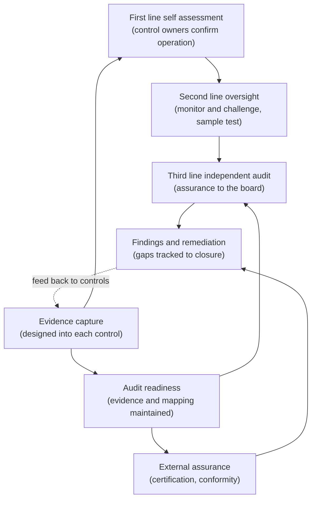
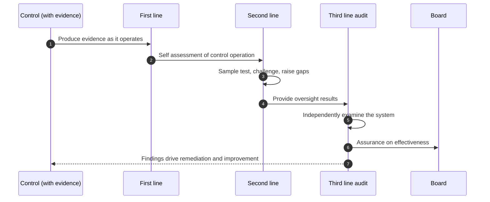

# Chapter 17: Assurance, Audit and Evidence

This chapter completes Part V by addressing the question every other mechanism eventually faces: how does the organisation know, and how does it prove, that its governance actually works? Controls that exist on paper are not controls that operate; a policy honoured in the breach is worse than none, because it offers false assurance. Assurance is the discipline of independently confirming that the governance system does what it claims, and evidence is what turns that confirmation into something an auditor, a regulator or a board can rely on. The skill on display here is scepticism applied to one's own house: testing whether the controls work rather than assuming they do because they were designed well.

---

## 1. The Governance Problem

An organisation has built a governance system. It has classification, an operating model, policies and controls, lifecycle gates and responsible AI mechanisms, all well designed. Then an auditor arrives, or a regulator asks, or an incident prompts a board to look closely, and the system's reality diverges from its design. Classifications were completed but not challenged. Controls were specified but, in several systems, never actually implemented. Evidence that a fairness test ran, or that a human reviewed a decision, cannot be found. The governance looked complete from the inside because everyone assumed the controls were operating. No one had independently checked, and when the organisation needs to prove its governance works, it discovers it cannot.

The problem is that designing a control and operating it are different things, and the gap between them is invisible without independent verification. The people who run a control are not well placed to judge whether it works, both because they are close to it and because they are not incentivised to find it wanting. Meanwhile evidence, the proof that a control operated on a specific system at a specific time, is routinely treated as something to assemble when asked rather than something to capture as work happens, so by the time it is needed it is incomplete or gone. The organisation ends up asserting that its governance works, with nothing to substantiate the claim.

The constraint that matters most is that assurance must be independent of the controls it assures, and evidence must be captured as work happens, not reconstructed on demand. The governance question is therefore not "do we have controls?" but "has someone independent confirmed the controls actually operate, and can we produce the evidence to prove it?"

---

## 2. 🧩 The Mechanism at a Glance

- **Mechanism name:** Assurance, Audit and Evidence
- **Risk addressed:** Governance that exists in design but not in operation, undetected because no one independently checks and no evidence is captured.
- **Primary objective:** Independent confirmation that controls operate as intended, supported by evidence captured as work happens, sufficient to satisfy auditors, regulators and the board.
- **When to use:** As the standing verification layer over the whole governance system, scaled to the risk of what is being assured.
- **When not to use:** As self assessment dressed as assurance, or as an evidence exercise reconstructed only when an audit looms.
- **Relevant frameworks / obligations:** The three lines model and internal audit standards; ISO/IEC 42001 audit and certification; EU AI Act documentation and conformity evidence; sector assurance regimes.
- **Primary governance concern:** Independence of assurance from the controls it tests, and evidence produced as a by-product of operating rather than assembled on demand.

Assurance is the independent confirmation that controls operate. Audit is the structured examination, internal or external, that provides it. Evidence is the durable record, produced as controls run, that both supports assurance and demonstrates compliance to outside parties.

---

## 3. The Operating Model

The reference model layers assurance across the three lines and treats evidence as continuous output rather than a periodic gathering:

- **First line self assessment** has control owners confirm their controls operate, as the base layer, not the whole of assurance.
- **Second line oversight** monitors and challenges control operation across the estate, testing a sample rather than trusting self reports.
- **Third line independent audit** provides assurance to the board, independent of both the first and second lines.
- **Evidence capture** is designed into each control so operating it produces the proof, rather than requiring later reconstruction.
- **Audit readiness** maintains the evidence and mapping so an internal or external examination can be satisfied on request.
- **External assurance** draws on certification (for example ISO/IEC 42001) and regulatory conformity where valuable.
- **Findings and remediation** turn assurance into improvement, tracking gaps to closure and feeding them back to the controls.

Each component has a clear role. The three lines give layered assurance with increasing independence. Evidence capture, feeding all of them, is the foundation, because assurance without evidence is opinion. Audit readiness keeps the organisation examinable at any time. External assurance adds independent credibility. Findings and remediation close the loop, turning verification into improvement rather than a report that is filed and forgotten.

---

## 4. The Decision & Control Flow

> **Step 1:** Each control is designed, per Chapter 6, to produce evidence as it operates, so the proof accrues continuously.
> **Step 2:** Control owners in the first line confirm their controls are operating, forming the base layer of assurance.
> **Step 3:** The second line monitors control operation across the estate and tests a sample rather than relying on self reports.
> **Step 4:** Where the second line finds a control specified but not operating, or evidence missing, it raises a gap.
> **Step 5:** The third line, independent of the first and second, examines whether the governance system as a whole works, and reports to the board.
> **Step 6:** Assurance activity is scaled to risk, with the highest risk systems and controls examined most rigorously.
> **Step 7:** Evidence, classifications, assessments, approvals, test results, oversight records, is maintained so an examination can be satisfied on request.
> **Step 8:** Where valuable, external assurance is obtained through certification or regulatory conformity, providing independent credibility.
> **Step 9:** Findings from any line are classified by severity and assigned for remediation.
> **Step 10:** Remediation is tracked to closure, and systemic findings feed back into the controls, standards or operating model.
> **Step 11:** The board receives independent assurance on whether the governance system is operating effectively.

The flow makes assurance concrete: evidence produced continuously, self assessment challenged by independent sampling, an independent third line reporting to the board, and findings tracked to closure so verification improves the system rather than merely describing it.

---

## 5. Why This Mechanism Works

The mechanism works because it introduces independence where self interest would otherwise prevail. Control owners cannot reliably assure their own controls, so the layered three lines model places increasingly independent eyes on the question of whether governance actually operates, culminating in a third line that reports to the board rather than to the functions it examines. This is what converts the comfortable internal assumption that controls work into an externally defensible confirmation that they do, or an honest finding that they do not.

It also works because it treats evidence as a by-product of operating rather than a task performed under audit pressure. When each control is designed to produce its proof as it runs, the organisation is examinable at any time without a scramble, and the evidence is contemporaneous and therefore trustworthy rather than reconstructed and therefore suspect. Closing the loop through findings and remediation then ensures assurance is not merely diagnostic: a control found wanting is fixed, and a systemic weakness feeds back to the design, so the governance system improves rather than merely being reported upon.

---

## 6. 🏛️ Governance Decisions

| Decision | Options | Recommended approach | Reason |
| --- | --- | --- | --- |
| Assurance independence | Self assessment only / Layered three lines | Layered three lines | Owners cannot reliably assure their own controls |
| Third line reporting | To the function / To the board | To the board | Independence is lost if audit reports to the audited |
| Evidence | Reconstructed for audits / Captured as controls run | Captured as controls run | Contemporaneous evidence is trustworthy; reconstructed is suspect |
| Assurance depth | Uniform / Scaled to risk | Scaled to risk | Effort should concentrate on the highest risk controls and systems |
| External assurance | None / Certification where valuable | Certification where valuable | Independent credibility for regulators, customers and the board |
| Findings | Reported and filed / Tracked to closure and fed back | Tracked to closure and fed back | Assurance must improve the system, not merely describe it |

These defaults make assurance independent and evidence based. If the only confirmation that controls work comes from the people who run them, the organisation has self assessment, not assurance.

---

## 7. ⚖️ Trade-offs

**Benefits:** Independent confirmation that governance operates; contemporaneous evidence that satisfies auditors and regulators; early detection of controls that exist only on paper; and improvement through tracked remediation.

**Friction:** Independent assurance is resource intensive and can feel adversarial to the teams examined, and designing evidence capture into every control adds effort to each. Sustained independence can also create organisational tension with the functions being assured.

**Cost:** The standing cost of second line oversight and third line audit capacity, the tooling to capture and maintain evidence, and any external certification. Concentrated on higher risk controls and systems.

**Operational overhead:** Assurance runs continuously, evidence must be maintained over time, and findings must be tracked to closure. An assurance function that lapses, or a findings log that is never cleared, undermines the credibility of the whole system.

**Risk reduction:** High, because it is the control that detects the failure of all the others. Without assurance, a governance system can degrade silently while appearing intact, which is precisely the condition that surfaces catastrophically in an incident or audit.

**Speed to deliver:** Assurance does not slow delivery directly, and evidence captured as controls run imposes little marginal cost. Audit cycles consume some capacity, but far less than the cost of a failed external audit or an enforcement action.

**Unintended consequences:** Assurance can become a box ticking audit that checks whether controls exist without testing whether they work, which provides false comfort. And an adversarial assurance posture can drive teams to conceal rather than disclose. Testing operation not just existence, and positioning assurance as improvement rather than blame, are the mitigations.

---

## 8. 🔐 Risk, Safety & Responsible AI

Assurance is where the responsible AI controls of Part IV are proven to operate rather than merely to exist. A fairness control, a human oversight arrangement, a safety guardrail, each is only as good as the evidence that it actually ran and worked, and assurance is what tests that. The disaggregated fairness measurements, the override records, the safety test results and the incident logs described in earlier chapters are not only operational artefacts; they are the evidence that assurance examines and that demonstrates to an outside party that responsible AI is real in this organisation rather than aspirational.

The honesty obligation is central here, because assurance is the organisation's defence against self deception. The purpose of independent examination is precisely to find the gap between what the organisation believes about its governance and what is true, and that purpose is defeated if assurance is softened into a sympathetic review. An assurance function that never reports a significant finding is not evidence of perfect governance; it is usually evidence of insufficient independence or insufficient rigour. The responsible posture is to want assurance to find problems, because a problem found internally is far less costly than the same problem found by a regulator or an incident.

---

## 9. 📜 Regulatory & Assurance Alignment

Assurance and evidence are where regulatory compliance is ultimately demonstrated, which makes this mechanism the point at which much of the book's regulatory alignment is realised.

The **three lines model** and established **internal audit standards** provide the recognised structure for assurance, and auditors expect to see it applied to AI. **ISO/IEC 42001**, as a certifiable management system standard, is itself an assurance instrument: external certification provides independent evidence that a functioning AI governance management system exists, and internal audit against the standard is a defined requirement. The **EU AI Act** requires high risk systems to maintain documentation and, for providers, to undergo conformity assessment, both of which depend on exactly the contemporaneous evidence this mechanism produces.

Sector regimes bring their own assurance expectations. In **financial services**, independent model validation and internal audit coverage of model risk are established requirements, and regulators examine the evidence directly. In **healthcare**, conformity assessment and quality management system audits apply to AI enabled devices. In the **public sector**, audit and transparency obligations require that decisions and their governance be examinable. These regimes determine what evidence must be retained, for how long, and to whom it must be produced.

The evidence an auditor or regulator expects is, in effect, the output of every mechanism in this book: classifications and assessments, approvals and conditions, data lineage, evaluation and validation results, deployment and change records, monitoring and incident logs, fairness measurements, oversight records, and the regulatory mapping. A mechanism that captures these as controls operate, and maintains them for audit, satisfies the request as a matter of routine. As throughout, this is governance guidance rather than legal advice, and specific evidentiary and audit obligations require local interpretation.

---

## 10. ⚠️ Failure Modes & Resilience

- **Self assessment as assurance:** Treating control owners' confirmation as sufficient leaves no independent check. The layered three lines, with sampling and independent audit, is the mitigation.
- **Captured audit:** A third line that reports to the function it examines loses the independence that gives its assurance value. Reporting to the board is essential.
- **Existence not operation:** An audit that confirms controls are documented without testing that they work provides false comfort. Testing operation, on real systems with real evidence, is the control.
- **Reconstructed evidence:** Assembling proof under audit pressure yields incomplete, late or unreliable records. Designing evidence capture into each control prevents it.
- **Findings without closure:** Assurance that reports problems but does not track them to remediation changes nothing. A tracked findings log feeding back to the controls is the mitigation.
- **Suspiciously clean assurance:** An assurance function that never finds significant issues usually lacks independence or rigour rather than having nothing to find. Reviewing the assurance itself guards against this.
- **Adversarial posture:** Assurance experienced purely as blame drives concealment. Positioning it as improvement encourages disclosure.

The theme is that assurance fails by lacking independence, testing the wrong thing, or lacking evidence, each of which produces confidence without substance. Resilience comes from genuine independence, testing operation, and evidence captured as work happens.

---

## 11. 👁️ Monitoring & Operations

The function should monitor, at minimum: assurance coverage, the proportion of high risk controls and systems independently examined within the cycle; evidence completeness, whether controls are producing the evidence they were designed to; the finding profile, the number, severity and, tellingly, whether significant findings are being raised at all; remediation, the backlog and ageing of open findings; and external assurance status, certifications held and conformity assessments passed. These signals show whether assurance is a real, independent discipline or a comfortable formality.

A distinctive signal here is the finding rate itself, read sceptically. A plausible flow of findings, with the serious ones remediated, indicates assurance that is working; a near empty findings log, especially alongside a complex estate, is more often a sign that assurance is not independent or rigorous enough than that governance is flawless. Monitoring the assurance function's own effectiveness, assurance over the assurance, is what keeps this final control honest.

---

## 12. 💷 Cost & Proportionality

The cost drivers are the standing capacity for second line oversight and third line audit, the tooling to capture and retain evidence over time, and any external certification or conformity assessment. These should scale with the risk of what is being assured.

Proportionality determines where independent rigour is spent. The highest risk systems and the controls that matter most, the fairness tests on consequential decisions, the human oversight on automated judgements about people, the security of exposed systems, warrant the deepest, most independent assurance; low risk controls can rely more on first line self assessment with lighter second line sampling. The failure in one direction is assuring everything to the same depth, which is unaffordable and dilutes attention; in the other, assuring high risk controls as lightly as low risk ones, which leaves the consequential failures undetected. The lever is the risk of the control and the system, which should set the depth and independence of the assurance applied. Evidence capture, by contrast, should be near universal and cheap, because it is designed into controls and costs little to maintain once built.

---

## 13. When to Use This Mechanism

Use this mechanism when:

- the organisation needs to know, not assume, that its governance operates;
- an auditor, regulator or board will ask for proof that controls work;
- controls may exist in design but fail silently in operation;
- regulation requires documentation, conformity or independent validation; and
- the organisation wants assurance to improve its governance, not merely describe it.

In practice every organisation operating an AI governance system needs assurance over it; the depth and independence scale with the risk of what is governed.

---

## 14. When NOT to Use This Mechanism

The caution is against assurance that is not really assurance:

- Do not treat **self assessment as assurance**; confirmation by those who run the controls lacks the independence that gives assurance value.
- Do not run an **existence only audit**; checking that controls are documented without testing that they operate provides false comfort.
- Do not **reconstruct evidence** only when an audit looms; capture it as controls run, or it will be incomplete and untrustworthy.

The lighter alternative for a small or low risk context is proportionate assurance, more first line self assessment, lighter independent sampling, external certification only where it adds value, not the absence of independent verification. Even a small organisation needs some independent check that its controls actually operate.

---

## 15. Mechanism Variations

- **Small organisation:** First line self assessment, a periodic independent review by someone outside the control, contemporaneous evidence captured by the controls, and external certification only where a customer or regulator values it.
- **Scaling organisation:** A defined second line oversight function sampling control operation, internal audit coverage of AI, evidence maintained for audit, and tracked findings.
- **Large enterprise:** A federated model in which business units self assess, a central second line tests across the estate, and an independent internal audit function reports to the board, with evidence consolidated.
- **Highly regulated enterprise:** Formal independent validation and audit aligned to sector regimes, ISO/IEC 42001 certification and regulatory conformity assessment, retained evidence to defined schedules, and independent review of the assurance function itself.

The variations differ in the formality and independence of the assurance, not in the principle that controls must be independently confirmed to operate and that evidence must be captured as work happens.

---

## 16. Governance Decision Checklist

- [ ] Is assurance layered across the three lines, with increasing independence?
- [ ] Does independent audit report to the board rather than to the functions it examines?
- [ ] Does assurance test whether controls operate, not merely whether they are documented?
- [ ] Is evidence captured as controls run, rather than reconstructed for audits?
- [ ] Is assurance depth scaled to the risk of the control and the system?
- [ ] Is external certification or conformity used where it adds independent credibility?
- [ ] Are findings classified, tracked to closure and fed back to the controls?
- [ ] Is a suspiciously clean findings log investigated as a sign of weak independence?
- [ ] Can the organisation produce, on request, the evidence that any given control operated?
- [ ] Is the effectiveness of the assurance function itself reviewed?

---

## 17. 📐 The Governance Verdict

> Assurance, audit and evidence is the mechanism that detects the failure of all the others, and it is required wherever an organisation must know, and prove, that its governance works. It earns its place by introducing independence where self interest would otherwise prevail, layering the three lines so that increasingly independent eyes confirm whether controls actually operate, and by treating evidence as a by-product of running controls rather than a scramble under audit pressure. Its weaknesses are the imitations of assurance: self assessment dressed as independent review, audits that check existence rather than operation, evidence reconstructed too late to be trusted, and a suspiciously clean findings log that signals weak rigour rather than strong governance. Make assurance independent and report it to the board, test operation not existence, capture evidence as work happens, and track every finding to closure. Want your assurance to find problems, because the problem you find yourself is far cheaper than the one a regulator finds for you. A control no one has independently confirmed is a belief, not a control, and a governance system that cannot prove itself is, to everyone outside it, indistinguishable from one that does not work.
