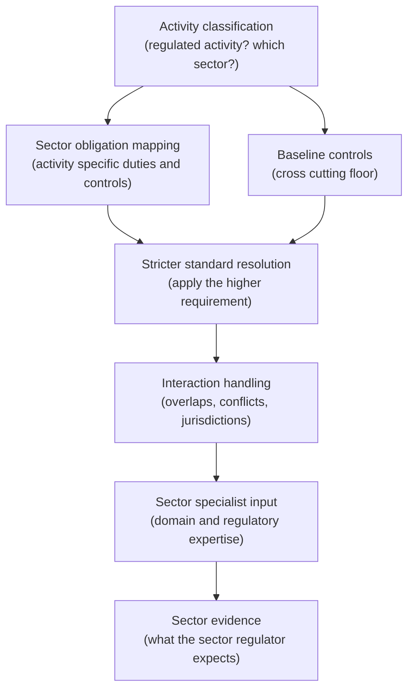
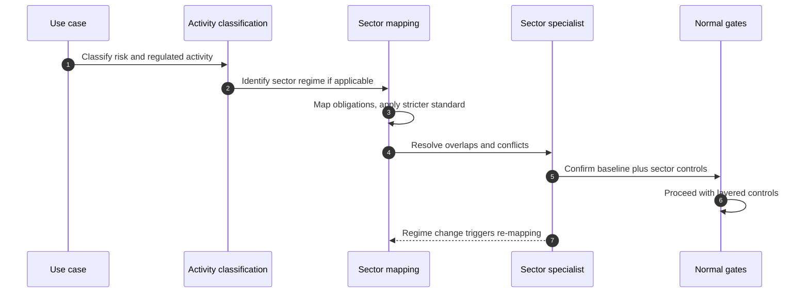

# Chapter 18: Sector Specific Governance

The cross cutting regulation of Chapter 16 sets a floor that applies across the economy. This chapter addresses what sits on top of it: the sector specific obligations that make AI governance in a bank materially different from AI governance in a hospital, a government department, an employer or an operator of critical infrastructure. These obligations are not a refinement of the cross cutting rules; they are often older, stricter and more specific, and they can determine whether a given AI use is permitted at all. The skill on display here is layering: holding the cross cutting baseline and the sector regime together, understanding which is stricter where, and reasoning through obligations that sometimes overlap and occasionally conflict.

---

## 1. The Governance Problem

An organisation builds a competent, cross cutting compliant AI governance system and assumes it is covered. Then it deploys AI into a regulated activity, credit decisioning, clinical support, a benefits determination, a hiring screen, a safety critical control, and discovers that its general governance misses obligations specific to that activity. The sector regulator expects independent model validation the general framework did not require, or a clinical safety case, or a published algorithmic transparency record, or a bias audit mandated by local employment law. The organisation was compliant in general and non compliant in particular, because it treated AI governance as a single horizontal discipline when the binding detail lives in the verticals.

The problem has two parts. First, sector obligations predate and often exceed cross cutting AI regulation: financial services has governed model risk for years, medical devices have a mature safety regime, public administration has long standing accountability duties. A general AI framework that ignores these is not a lighter version of compliance; it is a different and incomplete one. Second, the obligations layer and sometimes conflict: a transparency duty may pull towards disclosure while a security or privacy duty pulls towards restraint, and a global organisation faces different sector rules in different jurisdictions at once. Treating sectors as an afterthought leaves these interactions unmanaged.

The constraint that matters most is that sector obligations layer on top of the cross cutting baseline and may be stricter, so the governance system must apply the higher standard where they differ and reason explicitly where they interact. The governance question is therefore not "are we compliant with AI regulation?" but "for each regulated activity, have we identified the sector specific obligations, applied the stricter standard where they exceed the baseline, and reasoned through where obligations overlap or conflict?"

---

## 2. 🧩 The Mechanism at a Glance

- **Mechanism name:** Sector Specific Governance
- **Risk addressed:** Being generally compliant yet failing the stricter, activity specific obligations that govern AI in regulated sectors.
- **Primary objective:** Sector obligations identified for each regulated activity, the stricter standard applied where they exceed the baseline, and overlaps and conflicts reasoned through.
- **When to use:** Wherever AI is deployed into a regulated activity, in addition to the cross cutting controls.
- **When not to use:** As a replacement for cross cutting governance, or applied to activities that are not sector regulated.
- **Relevant frameworks / obligations:** Financial services model risk and conduct regimes; medical device and health data regimes; public sector transparency and administrative law; employment automated decision rules; critical infrastructure safety regimes; plus cross cutting data protection throughout.
- **Primary governance concern:** Layering sector obligations onto the baseline, applying the stricter standard, and managing interaction between regimes.

Sector specific governance is not a separate system but a layer: the cross cutting controls of the earlier chapters remain, and sector obligations are mapped on top, raising the required standard for the activities they govern and adding controls the baseline does not.

---

## 3. The Operating Model

The reference model routes each AI use case through sector identification and layers the applicable regime onto the baseline:

- **Activity classification** determines whether a use case falls within a regulated activity and, if so, which sector regime applies.
- **Baseline controls**, from the earlier chapters, apply to every use case as the floor.
- **Sector obligation mapping** identifies the activity specific obligations and the controls they require.
- **Stricter standard resolution** applies the higher requirement wherever the sector regime exceeds the baseline.
- **Interaction handling** reasons through overlaps and conflicts between regimes and jurisdictions, recording the resolution.
- **Sector specialist input** brings the domain and regulatory expertise the activity requires.
- **Sector evidence** produces the specific evidence the sector regulator expects, on top of the general assurance record.

Each component has a clear role. Activity classification is the trigger that decides whether a sector regime applies at all. The baseline is never removed; it is the floor on which the sector layer sits. Mapping and stricter standard resolution raise the bar where the sector demands. Interaction handling manages the layering explicitly. Specialist input supplies expertise a general function lacks. Sector evidence satisfies the particular regulator.

---

## 4. The Decision & Control Flow

> **Step 1:** A use case is classified not only for risk but for whether it falls within a regulated activity, and if so which sector regime governs it.
> **Step 2:** The cross cutting baseline controls are applied as they are to every use case.
> **Step 3:** The sector specific obligations for the activity are identified, drawing on sector and legal expertise.
> **Step 4:** Each sector obligation is translated into the controls and evidence it requires, reusing the control layer where possible.
> **Step 5:** Where a sector obligation is stricter than the baseline, the stricter standard is applied to that use case.
> **Step 6:** Where obligations from different regimes overlap or conflict, the interaction is reasoned through and the resolution recorded.
> **Step 7:** For a global activity, differing sector rules across jurisdictions are reconciled, applying the most restrictive where a single system serves several.
> **Step 8:** Sector specialists review the use case against the regime, confirming the activity specific controls are adequate.
> **Step 9:** The use case proceeds through the normal gates, now carrying both baseline and sector controls.
> **Step 10:** Sector specific evidence is captured alongside the general assurance record.
> **Step 11:** Changes to the sector regime feed back through regulatory alignment and reclassification.

The flow makes layering concrete: every use case gets the baseline, regulated activities additionally get the sector regime, the stricter standard wins where they differ, and specialists confirm the activity specific controls before the use case proceeds.

---

## 5. Why This Mechanism Works

The mechanism works because it treats sector obligations as a layer rather than a substitute, preserving the cross cutting baseline for everything while raising the standard for regulated activities. This avoids the two opposite errors: building only a general framework that misses the binding sector detail, and building sector silos that neglect the common controls. By resolving to the stricter standard wherever the sector regime exceeds the baseline, it ensures the organisation is compliant in the particular as well as the general, which is where enforcement actually bites.

It also works because it brings the right expertise to bear and manages interaction explicitly. Sector regimes are specialist domains, and a general governance function cannot interpret a medical device regulation or a model risk expectation without domain input, so the mechanism routes regulated activities to specialists. And by reasoning through overlaps and conflicts rather than hoping they do not arise, it handles the genuine difficulty of a global, multi regime estate, recording resolutions so they are consistent and defensible rather than improvised case by case.

---

## 6. 🏛️ Governance Decisions

| Decision | Options | Recommended approach | Reason |
| --- | --- | --- | --- |
| Sector treatment | General framework only / Sector layer on baseline | Sector layer on baseline | Sector obligations are binding, specific and often stricter |
| Baseline | Replace for regulated activities / Keep as floor | Keep as floor | The cross cutting controls still apply underneath |
| Standard where they differ | Lower or average / Stricter standard | Stricter standard | Compliance means meeting the higher requirement |
| Expertise | General function only / Sector specialist input | Sector specialist input | Sector regimes need domain and regulatory interpretation |
| Conflicts | Hope they do not arise / Reason through and record | Reason through and record | Overlaps and conflicts are real and must be resolved consistently |
| Multi jurisdiction | Per jurisdiction only / Most restrictive for shared systems | Most restrictive for shared systems | A single system serving several must meet all their rules |

These defaults layer the sector regime onto the baseline and resolve upward. If an organisation's governance is uniform across a bank, a hospital and a public body, it has a general framework and not sector specific governance.

---

## 7. ⚖️ Trade-offs

**Benefits:** Compliance in the particular as well as the general; the stricter standard applied where it binds; specialist expertise where the regime demands it; and explicit, consistent handling of overlapping obligations.

**Friction:** Layering sector obligations onto the baseline adds complexity and requires specialist input that a general function lacks. Regulated activities move more slowly through governance as the additional regime is applied.

**Cost:** The specialist expertise for each relevant sector, the mapping of sector obligations, and the additional controls and evidence. Concentrated on regulated activities.

**Operational overhead:** Multiple sector regimes to track and keep current, each changing on its own timetable, and the interaction between them to maintain. A sector mapping that lapses leaves the organisation exposed in exactly the activities that are most regulated.

**Risk reduction:** High for regulated activities, because sector regimes carry the most mature enforcement and the most specific obligations, and because failing them often means an activity was unlawful rather than merely imperfectly governed.

**Speed to deliver:** Clear sector layering accelerates regulated delivery by telling teams which additional controls their activity requires. The absence of it produces late discovery that a regulated activity was non compliant, which is slow and costly to remedy.

**Unintended consequences:** Over classifying activities as regulated applies sector burden where it does not belong, and treating every jurisdiction's rules as applying everywhere can impose the most restrictive regime on activities that never touch it. Accurate activity classification is the mitigation.

---

## 8. 🔐 Risk, Safety & Responsible AI

Sector specific governance is where several responsible AI controls acquire their sharpest, legally mandated form. Fairness becomes fair lending in financial services and a mandated bias audit in employment; safety becomes a clinical safety case in healthcare and a safety assurance regime in critical infrastructure; transparency becomes a published algorithmic record in the public sector. The responsible AI mechanisms of Part IV are not replaced by sector governance; they are intensified and made specific by it, so the organisation applies the general control and then raises it to the sector's standard.

The honesty obligation here concerns the floor. Cross cutting data protection, in particular rules on automated decision making and the processing of personal and special category data, applies across all sectors and is easy to overlook when attention is on the headline sector regime. A health AI system is governed by both the medical device regime and health data protection; an employment tool by both anti discrimination law and data protection. The responsible position is to recognise that the sector layer adds to, rather than displaces, the cross cutting duties, and to apply both.

---

## 9. 📜 Regulatory & Assurance Alignment

This chapter is itself about sector regulation, so this section sets out the primary regimes and what each demands, which is the substance the mechanism must map. These are illustrative of the obligations, not a complete legal account.

### 9.1 Financial services
Model risk management expectations, such as the US Federal Reserve and OCC SR 11-7 guidance and comparable supervisory expectations from regulators including the UK FCA and PRA, require independent model validation, ongoing monitoring and documentation proportionate to a model's materiality. Fair lending and consumer protection rules prohibit discriminatory credit and pricing outcomes. Conduct and operational resilience expectations apply to AI as to other critical systems. The governance implication is that material financial models need validation independent of development and demonstrable fair treatment, beyond the cross cutting baseline.

### 9.2 Healthcare and life sciences
Medical device and software as a medical device regimes, such as US FDA guidance on AI and machine learning enabled devices and the EU Medical Device Regulation, require clinical and analytical validity, risk management and post market surveillance before and after deployment. Health data attracts heightened protection, for example under HIPAA. The governance implication is that AI touching clinical safety needs a safety case, conformity evidence and clinical accountability, with a qualified professional retaining responsibility.

### 9.3 Public sector
Administrative law requires that decisions affecting individuals be lawful, reasoned and subject to challenge, which constrains solely automated public decisions. Algorithmic transparency obligations in various jurisdictions require disclosure of where and how automated tools inform public decisions, and public records duties require that decisions and their basis be retained. The governance implication is published transparency, reasoned decisions and preserved records beyond the baseline.

### 9.4 Employment and education
Anti discrimination law applies to automated decisions about candidates and workers, and specific rules, such as New York City's Local Law 144 on automated employment decision tools, can require bias audits and candidate notice. Education adds duties around decisions affecting learners, often including young people. The governance implication is mandated bias auditing, disclosure to those affected, and particular care where minors are involved.

### 9.5 Critical infrastructure and safety critical sectors
Sectors where AI affects physical or operational safety, energy, transport, utilities, industrial control, are governed by safety assurance regimes and sector regulators that require demonstrable safety, resilience and often certification before deployment. The governance implication is a safety assurance case and heightened resilience and security, well above the baseline.

### 9.6 The cross cutting floor beneath them all
Data protection law, such as the EU GDPR and equivalents, including rules on automated decision making and profiling, applies across every sector and layers beneath each regime. No sector obligation removes it, and it must be applied together with the sector rules.

The evidence each sector regulator expects differs, independent validation records in finance, a clinical safety case and conformity evidence in healthcare, a published transparency record in the public sector, a bias audit in employment, a safety assurance case in critical infrastructure, but in every case it sits on top of the general assurance record from Chapter 17. As throughout, this is governance guidance rather than legal advice, and the applicability and interpretation of any sector regime require qualified local legal counsel.

---

## 10. ⚠️ Failure Modes & Resilience

- **General framework blindness:** Assuming cross cutting compliance covers regulated activities misses the binding sector detail. Activity classification that triggers the sector layer is the mitigation.
- **Baseline displacement:** Treating the sector regime as replacing the baseline drops the cross cutting controls, especially data protection. Keeping the baseline as a floor prevents this.
- **Lower standard applied:** Where regimes differ, applying the weaker requirement leaves the stricter obligation unmet. Resolving to the stricter standard is the control.
- **Missing specialist input:** A general function interpreting a specialist regime makes errors of fact and emphasis. Routing regulated activities to specialists mitigates this.
- **Unmanaged conflict:** Overlapping or conflicting obligations resolved ad hoc produce inconsistent, indefensible decisions. Reasoning them through and recording the resolution is the control.
- **Jurisdiction sprawl:** Either ignoring foreign sector rules a system touches, or imposing the most restrictive regime on activities that never touch it, is a miscalibration. Accurate activity and jurisdiction scoping is the mitigation.
- **Stale sector mapping:** Sector regimes change on their own timetables, and a lapsed mapping exposes the most regulated activities. Keeping each regime current through regulatory alignment is essential.

The theme is that this mechanism fails by treating sectors as either irrelevant or as a replacement for the baseline. Resilience comes from layering, resolving upward, and bringing specialist expertise.

---

## 11. 👁️ Monitoring & Operations

The function should monitor, at minimum: the proportion of regulated activity use cases correctly identified and carrying the applicable sector layer; coverage of each relevant sector regime in the obligation mapping and its currency; the resolution of known overlaps and conflicts; the availability of sector specialist input for the activities that need it; and the completeness of sector specific evidence for regulated use cases. These signals show whether regulated activities are governed to their sector's standard or only to the general baseline.

Distinguish monitoring the sector layer from the general governance monitoring of earlier chapters. A particular signal is misclassification in both directions: regulated activities governed only to the baseline, which is an exposure, and unregulated activities carrying unnecessary sector burden, which is waste. Both indicate that activity classification, the trigger for the whole mechanism, needs attention.

---

## 12. 💷 Cost & Proportionality

The cost drivers are sector specialist expertise, the mapping and maintenance of multiple sector regimes, and the additional controls and evidence each demands. These concentrate on regulated activities and should not be spread across the whole estate.

Proportionality here is about scope rather than depth: the sector layer should apply to the activities a regime actually governs and no further. The failure in one direction is applying sector burden broadly, treating every activity as if it were regulated or every jurisdiction's rules as universal, which imposes cost and friction without obligation; in the other, applying the baseline alone to genuinely regulated activities, which leaves the stricter obligations unmet in the areas of greatest enforcement risk. The lever is accurate activity classification: whether a use case falls within a regulated activity, and which jurisdictions it touches, should determine whether and how much of the sector layer applies. Getting this scoping right is what keeps sector governance both complete and affordable.

---

## 13. When to Use This Mechanism

Use this mechanism when:

- AI is deployed into a regulated activity such as credit, clinical care, public decisions, hiring or safety critical control;
- a sector regulator holds specific expectations for AI or for the models and decisions it affects;
- sector obligations exceed the cross cutting baseline;
- a single system serves activities governed by different regimes or jurisdictions; and
- the activity's enforcement risk is concentrated in sector rules rather than general AI regulation.

In practice any organisation operating AI in a regulated sector needs this layer in addition to its cross cutting controls.

---

## 14. When NOT to Use This Mechanism

The caution is against misscoping rather than against sector governance:

- Do not treat it as a **replacement** for cross cutting governance; the baseline remains the floor beneath every sector regime.
- Do not apply the **sector layer to unregulated activities**; sector burden where there is no obligation is waste that invites avoidance.
- Do not impose **every jurisdiction's rules universally**; apply the regimes an activity actually touches, most restrictive where one system genuinely serves several.

The lighter position for an organisation operating in a single, lightly regulated sector is a focused mapping of that sector's obligations on top of the baseline, not an elaborate multi regime apparatus. Match the sector layer to the activities actually regulated.

---

## 15. Mechanism Variations

- **Single sector organisation:** The baseline plus a focused mapping of one sector regime, with specialist input for that sector and sector evidence captured for its regulator.
- **Multi sector organisation:** Distinct sector layers applied by activity, specialist input per sector, and explicit handling of activities that span regimes.
- **Large, multi jurisdiction enterprise:** A federated model in which central functions own the sector regime mappings and specialists while business units apply the appropriate layer to their activities, with the most restrictive standard applied to shared systems.
- **Highly regulated enterprise:** Deep sector specialism, formal independent validation or safety cases as the regime requires, sector conformity or certification, and reconciliation of conflicting obligations documented for regulators.

The variations differ in how many regimes are tracked and how formally, not in the principle that sector obligations layer onto the baseline and resolve to the stricter standard.

---

## 16. Governance Decision Checklist

- [ ] Is each use case classified for whether it falls within a regulated activity, and which sector regime applies?
- [ ] Do the cross cutting baseline controls remain in place beneath the sector layer?
- [ ] Are the sector specific obligations identified and translated into controls and evidence?
- [ ] Is the stricter standard applied wherever the sector regime exceeds the baseline?
- [ ] Is cross cutting data protection applied together with the sector regime, not displaced by it?
- [ ] Are overlaps and conflicts between regimes reasoned through and recorded?
- [ ] For shared systems, is the most restrictive applicable regime applied across jurisdictions?
- [ ] Is sector specialist expertise brought to bear on regulated activities?
- [ ] Is the sector specific evidence the regulator expects captured alongside the general record?
- [ ] Is the sector layer scoped to genuinely regulated activities rather than applied uniformly?

---

## 17. 📐 The Governance Verdict

> Sector specific governance is the layer that sits on top of the cross cutting baseline, and it is required wherever AI enters a regulated activity. It earns its place by recognising that sector obligations are binding, specific and often stricter and older than general AI regulation, so compliance in the particular, a validated credit model, a clinical safety case, a published transparency record, a mandated bias audit, a safety assurance case, is where enforcement actually bites. Its weaknesses are treating sectors as irrelevant or as a replacement: a general framework that misses the binding detail, or a sector silo that drops the baseline, especially data protection, beneath it. Keep the baseline as the floor, layer the sector regime on top, resolve to the stricter standard where they differ, bring specialist expertise, and reason explicitly through the overlaps. Scope the layer to the activities actually regulated. You can be compliant in general and unlawful in particular, and in a regulated sector it is the particular that a regulator will test.
