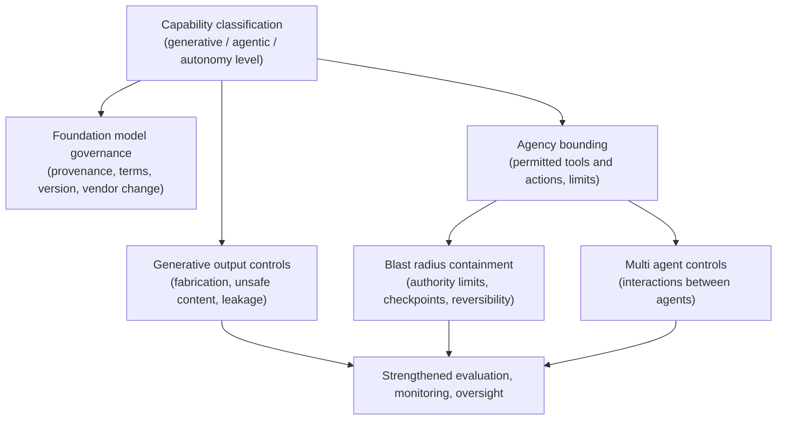
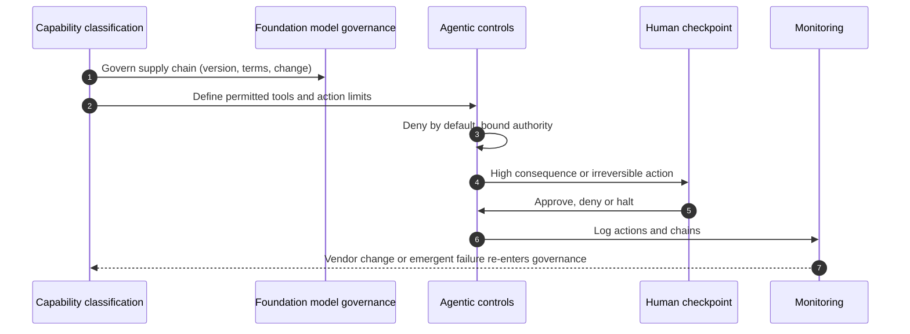

# Chapter 19: Governance for Generative and Agentic AI

The mechanisms of this book apply to AI in general. This chapter asks what changes when the AI is generative or agentic: a system that produces open ended output rather than a bounded prediction, or one that acts, calling tools, taking steps, pursuing a goal, rather than merely advising. These systems do not escape the governance built so far, but they strain it at specific points, and the strain is where new harm concentrates. The skill on display here is distinguishing what genuinely changes from what merely feels new, so that controls are strengthened where generative and agentic behaviour actually raises the risk, and not everywhere at once out of unease.

---

## 1. The Governance Problem

An organisation that has governed predictive models well adopts generative and then agentic AI, and finds its controls straining in unfamiliar places. A predictive model produced a score it could threshold and monitor; a generative model produces open ended text whose quality and safety cannot be reduced to a single metric, and whose failure modes, fabrication, unsafe content, leaked data, are specific to generation. Then the system is given the ability to act, to call a tool, send a message, update a record, take a sequence of steps towards a goal, and the governance question shifts from whether the output is right to what the system might do and how far a wrong action can reach. The organisation discovers its evaluation, monitoring and oversight controls were implicitly designed for bounded, advisory models.

The problem is that generation and agency change the shape of the risk without removing the need for every existing control. Generation makes output unbounded and its failure modes distinctive, so evaluation and safety controls must address fabrication and open ended harm rather than a prediction error. Agency adds autonomy and a wider blast radius: a system that acts can cause consequences directly, can chain actions in ways no one scripted, and, in multi agent arrangements, can interact with other autonomous components in emergent ways. Compounding both is a supply chain concern: these capabilities usually come from foundation models the organisation did not build, cannot inspect, and does not control the versioning of.

The constraint that matters most is that generative and agentic AI strain specific controls rather than requiring a wholly new regime, so the response is to strengthen the controls under strain, not to rebuild governance or to treat every generative use as maximally dangerous. The governance question is therefore not "do we need new governance for generative AI?" but "which existing controls does generation and agency strain, how do we strengthen them where the risk is genuinely higher, and how do we bound autonomy so a wrong action cannot reach too far?"

---

## 2. 🧩 The Mechanism at a Glance

- **Mechanism name:** Governance for Generative and Agentic AI
- **Risk addressed:** Unbounded generative output and autonomous action straining controls designed for bounded, advisory models, with harm concentrated in fabrication, wide blast radius and supply chain opacity.
- **Primary objective:** Existing controls strengthened where generation and agency raise the risk, with autonomy bounded so a wrong action is contained.
- **When to use:** For any system that produces open ended output or takes autonomous action, in addition to the baseline controls.
- **When not to use:** As a wholly separate regime replacing the existing controls, or as maximal restriction applied to every generative use regardless of its actual risk.
- **Relevant frameworks / obligations:** EU AI Act provisions on general purpose AI and transparency of generated content; NIST AI RMF and its generative AI profile; foundation model provider terms; sector rules where generation or action affects regulated outcomes.
- **Primary governance concern:** Bounding autonomy and containing blast radius, and governing a foundation model supply chain the organisation does not control.

The response is additive, not replacement: classification, lifecycle, responsible AI and assurance all still apply, and this mechanism adds the specific strengthening that generative output and autonomous action require, above all the bounding of what an agent is permitted to do.

---

## 3. The Operating Model

The reference model layers generative and agentic controls onto the existing governance, concentrated on output boundlessness, autonomy and supply chain:

- **Capability classification** identifies whether a system is generative, agentic, or both, and the degree of autonomy it has.
- **Foundation model governance** manages the supply chain: provenance, terms, version control and vendor change of the underlying model.
- **Generative output controls** address fabrication, unsafe content and data leakage through input and output guardrails and provenance of generated content.
- **Agency bounding** constrains what an agent may do: permitted tools and actions, limits, and the reach of any single action.
- **Blast radius containment** ensures a wrong or chained action cannot cause disproportionate harm, through authority limits, human checkpoints and reversibility.
- **Multi agent controls** govern interactions between autonomous components where several act together.
- **Strengthened evaluation, monitoring and oversight** extend the existing lifecycle controls to the distinctive failure modes.

Each component has a clear role. Capability classification sizes the strain. Foundation model governance addresses the supply chain the organisation does not control. Generative output controls handle the distinctive failure modes of open ended generation. Agency bounding and blast radius containment are the heart of agentic governance, limiting both what an agent may do and how far a wrong action reaches. Multi agent controls handle emergent interaction. The lifecycle controls are extended, not replaced.

---

## 4. The Decision & Control Flow

> **Step 1:** A system is classified for capability: whether it generates open ended output, acts autonomously, or both, and how much autonomy it holds.
> **Step 2:** The underlying foundation model is governed for the supply chain: its provenance, the provider's terms, the version in use, and how vendor changes will be detected and controlled.
> **Step 3:** For generative output, controls address the distinctive failure modes, fabrication, unsafe content and leakage of data, through input and output guardrails.
> **Step 4:** Where generated content could be mistaken for human or authoritative, its provenance is marked or disclosed as the context requires.
> **Step 5:** For an agent, the permitted tools and actions are defined explicitly, and everything not permitted is denied by default.
> **Step 6:** The authority of each action is limited so that a single wrong action cannot cause disproportionate harm.
> **Step 7:** High consequence or irreversible actions require a human checkpoint before execution.
> **Step 8:** Where multiple agents interact, their interactions are bounded and monitored for emergent behaviour.
> **Step 9:** Evaluation is extended to the distinctive failure modes, and monitoring watches for them in production.
> **Step 10:** Human oversight is designed for the agentic case, with the authority to interrupt or halt a running agent.
> **Step 11:** A vendor model change or an emergent failure feeds back through change control and reclassification.

The flow makes the strengthening concrete: capability sized, the foundation model supply chain governed, generative failure modes guarded, agency bounded and its blast radius contained, high consequence actions checkpointed, and oversight able to halt a running agent.

---

## 5. Why This Mechanism Works

The mechanism works because it targets the strain precisely rather than rebuilding governance or restricting everything. By classifying capability and autonomy, it applies generative and agentic controls where they are needed and leaves the baseline to carry the rest, which keeps the response proportionate to a genuinely higher but specific risk. The distinctive failure modes of generation, fabrication, unsafe content, leakage, are addressed as themselves, rather than forced into a predictive evaluation that does not fit them.

It also works because it treats autonomy as something to be bounded rather than trusted. The core agentic controls, defining permitted actions, denying the rest by default, limiting each action's authority, checkpointing high consequence or irreversible steps, and retaining the ability to halt a running agent, contain the blast radius so that a wrong action, which a probabilistic system will eventually take, cannot cause disproportionate harm. And by governing the foundation model supply chain explicitly, the mechanism confronts the reality that these capabilities come from models the organisation did not build and cannot inspect, which no amount of internal control alone would otherwise address.

---

## 6. 🏛️ Governance Decisions

| Decision | Options | Recommended approach | Reason |
| --- | --- | --- | --- |
| Response shape | New separate regime / Strengthen existing controls | Strengthen existing controls | Generation and agency strain specific controls, not all of them |
| Generative evaluation | Single metric / Address fabrication, safety, leakage | Address the distinctive failure modes | Open ended output cannot be reduced to one score |
| Agent permissions | Allow by default, restrict / Deny by default, permit explicitly | Deny by default, permit explicitly | Autonomy must be bounded, not assumed safe |
| Action authority | Unbounded / Limited to contain blast radius | Limited to contain blast radius | A wrong autonomous action must not reach too far |
| High consequence actions | Autonomous / Human checkpoint | Human checkpoint | Irreversible or high harm actions need a human gate |
| Foundation model | Treat as internal / Govern as supply chain | Govern as supply chain | The model is external, opaque and version controlled by others |

These defaults strengthen specific controls and bound autonomy. If an agent may take any action by default, or a generative system is evaluated as if it produced a single score, the controls have not been adapted to the capability.

---

## 7. ⚖️ Trade-offs

**Benefits:** Controls strengthened precisely where generation and agency raise the risk; autonomy bounded and blast radius contained; distinctive failure modes addressed as themselves; and the foundation model supply chain governed rather than trusted.

**Friction:** Bounding an agent's actions and checkpointing high consequence steps constrains exactly the autonomy that makes agentic systems useful, and strengthened evaluation of open ended output is harder than thresholding a score. Teams pursuing capability may resist the limits.

**Cost:** The effort of capability classification, foundation model supply chain governance, generative and agentic controls, and extended evaluation and monitoring. Concentrated on highly autonomous and high consequence systems.

**Operational overhead:** Agentic systems need monitoring of actions and chains, not just outputs, and foundation model governance must track vendor changes continuously. The overhead rises with autonomy and with the number of tools an agent can reach.

**Risk reduction:** High for autonomous and high consequence systems, because agency widens the blast radius and generation introduces failure modes that predictive controls do not catch, and because supply chain opacity is otherwise unmanaged.

**Speed to deliver:** Clear capability based controls let teams build generative and agentic systems within known bounds. The alternative, unbounded autonomy, is faster to launch and far more dangerous, and tends to produce the incident that halts the whole programme.

**Unintended consequences:** Over restriction can make agentic systems too constrained to be useful, pushing teams to ungoverned alternatives, and treating every generative use as maximally dangerous wastes effort and breeds avoidance. Proportionality by capability and consequence is the mitigation; the goal is bounded autonomy, not no autonomy.

---

## 8. 🔐 Risk, Safety & Responsible AI

Generative and agentic AI intensify several responsible AI concerns from Part IV. Safety is sharpened because generation can produce confidently unsafe content and agency can act on it, so the safety controls of Chapter 14 must extend to open ended output and to the actions an agent takes. Human oversight from Chapter 15 becomes both more important and harder: an agent acting at speed may complete a sequence before a human can intervene, which is exactly why high consequence actions need a checkpoint before execution and why the authority to halt a running agent matters. Transparency gains a specific duty around generated content, marking or disclosing that output was AI generated where it could otherwise be taken as human or authoritative.

The book's stance against anthropomorphism applies with particular force here. An agent does not want a goal, understand a task or decide in any human sense; it generates actions by probabilistic inference and tool invocation, and describing it otherwise invites both misplaced trust and sloppy governance. The responsible framing is mechanical: the system selects actions, those actions have consequences, and governance bounds which actions it may take and how far their consequences reach. Describing agency plainly, rather than in the language of intention, keeps the controls focused on behaviour and blast radius rather than on an imagined mind.

---

## 9. 📜 Regulatory & Assurance Alignment

Regulation is beginning to address generative and agentic AI specifically, though much of it remains emerging, which the mechanism must reflect honestly.

The **EU AI Act** includes provisions on general purpose AI models, with obligations on their providers, and transparency requirements that certain AI generated content be marked as such, both directly relevant to generative systems. The **NIST AI RMF** has been extended with a generative AI profile that identifies risks characteristic of generative systems, useful as a source of controls. **Foundation model provider terms** are themselves a governance input, since they constrain permitted uses, define responsibilities and bear on liability, and must be read and complied with as part of supply chain governance.

Sector regimes apply where generation or action affects a regulated outcome: a generative tool drafting financial advice, an agent executing a clinical or operational action, or generated content in a public decision brings the sector obligations of Chapter 18 into play, often at a high risk tier. Much agentic regulation specifically is still emerging, so the organisation must distinguish what is in force from what is proposed, and govern autonomy on the basis of risk rather than waiting for rules to settle.

The evidence an auditor or regulator expects includes the capability classification, the foundation model supply chain records, the generative output controls, the definition of permitted agent actions and their limits, the human checkpoints for high consequence actions, and monitoring of actions and chains. A mechanism that records these as it operates meets the expectation directly. As throughout, this is governance guidance rather than legal advice, and the fast moving regulation of generative and agentic AI in particular requires current local interpretation.

---

## 10. ⚠️ Failure Modes & Resilience

- **Treating it as wholly new:** Building a separate regime for generative AI duplicates and fragments governance. Strengthening the existing controls where they strain is the mitigation.
- **Predictive evaluation of generation:** Reducing open ended output to a single score misses fabrication, unsafe content and leakage. Evaluating the distinctive failure modes is the control.
- **Unbounded agency:** An agent permitted to take any action by default has an uncontained blast radius. Deny by default and explicit permitted actions are essential.
- **No blast radius limit:** Even permitted actions, if unbounded in authority or chained freely, can cause disproportionate harm. Authority limits, checkpoints and reversibility contain it.
- **Ungoverned foundation model:** Treating an external model as if it were internal ignores its opacity and silent version changes. Supply chain governance, including change detection, is the mitigation.
- **Oversight too slow for agency:** A human nominally in the loop cannot intervene in an agent that acts faster than review. Pre execution checkpoints for high consequence actions and a halt capability address this.
- **Emergent multi agent behaviour:** Autonomous components interacting can produce behaviour no one designed. Bounding and monitoring their interactions is the control.
- **Over restriction:** Treating every generative use as maximally dangerous breeds avoidance. Proportionality by capability and consequence is the mitigation.

The theme is that these systems fail by having their autonomy trusted rather than bounded, or their novelty either ignored or exaggerated. Resilience comes from bounding agency, containing blast radius, governing the supply chain, and strengthening controls in proportion to capability.

---

## 11. 👁️ Monitoring & Operations

The function should monitor, for generative and agentic systems specifically: the rate of generative failure modes caught and escaped, fabrication, unsafe content, data leakage; for agents, the actions taken, the chains of actions, and any that approached or breached their authority limits; the frequency and outcome of human checkpoints on high consequence actions; emergent behaviour where multiple agents interact; and foundation model supply chain signals, especially detected vendor version changes and behavioural shifts that follow them. These signals extend the production monitoring of Chapter 10 to the distinctive risks of generation and agency.

A distinctive operational signal is the agent action log. Where a predictive system is monitored on its outputs, an agent must be monitored on what it did, because the harm is in the action, not the recommendation. Monitoring action chains also surfaces emergent and unintended sequences that output level monitoring would miss entirely, which is why agentic systems require this additional layer of observation.

---

## 12. 💷 Cost & Proportionality

The cost drivers are capability classification, foundation model supply chain governance, the generative and agentic controls, extended evaluation of open ended output, and action level monitoring. These should scale steeply with autonomy and with the consequence of the actions an agent can take.

Proportionality is central because both over and under control are easy here. Under control, trusting autonomy, leaving agents unbounded, evaluating generation as prediction, leaves the widened blast radius and distinctive failure modes unmanaged. Over control, treating every generative use as maximally dangerous and hedging every agent with checkpoints, makes the systems too slow and constrained to be worth building, driving teams to ungoverned alternatives. The lever is capability and consequence: a low stakes generative assistant needs light output guardrails, while an agent that can take irreversible high consequence actions needs tight bounds, checkpoints and a halt capability. Match the strengthening to the autonomy and the reach of the action, not to the general unease that generative AI provokes.

---

## 13. When to Use This Mechanism

Use this mechanism when:

- a system produces open ended generative output rather than a bounded prediction;
- a system acts autonomously, calling tools or taking steps towards a goal;
- multiple autonomous components interact;
- the capability comes from a foundation model the organisation did not build; and
- a wrong generation or action could cause harm beyond a single prediction error.

In practice any generative or agentic system needs this strengthening layered onto the baseline, in proportion to its autonomy and the consequence of its actions.

---

## 14. When NOT to Use This Mechanism

The caution is against both rebuilding and over restricting:

- Do not build a **wholly separate regime**; strengthen the controls that generation and agency strain, keeping the baseline beneath.
- Do not apply **maximal restriction to every generative use**; a low stakes assistant does not need the bounds an irreversible agent does.
- Do not **trust autonomy** to compensate for light control; bounded autonomy, not unbounded, is the objective.

The lighter position for a low stakes generative system is output guardrails and disclosure on the baseline, not the full agentic apparatus. Reserve the heavy bounding and checkpoints for genuine, high consequence autonomy.

---

## 15. Mechanism Variations

- **Generative, low stakes:** Output guardrails against unsafe content and leakage, disclosure of AI generated content, and basic foundation model supply chain governance.
- **Generative, high stakes:** Strengthened evaluation of fabrication and safety, content provenance, and tighter supply chain control, layered on the full baseline.
- **Agentic, bounded:** Explicit permitted actions, authority limits, human checkpoints for high consequence steps, action level monitoring, and a halt capability.
- **Multi agent and highly autonomous:** All of the above plus controls on inter agent interaction, emergent behaviour monitoring, and reconsideration of whether the autonomy is justified for the consequence.

The variations differ in how much autonomy is bounded and how heavily generation is guarded, not in the principle that controls are strengthened by capability and autonomy is bounded rather than trusted.

---

## 16. Governance Decision Checklist

- [ ] Is each system classified for whether it is generative, agentic, or both, and for its degree of autonomy?
- [ ] Is the underlying foundation model governed as a supply chain, including version and vendor change?
- [ ] Do generative controls address fabrication, unsafe content and data leakage, not just a single metric?
- [ ] Is AI generated content marked or disclosed where it could be taken as human or authoritative?
- [ ] Are an agent's permitted tools and actions defined explicitly, with everything else denied by default?
- [ ] Is each action's authority limited so a wrong action cannot cause disproportionate harm?
- [ ] Do high consequence or irreversible actions require a human checkpoint before execution?
- [ ] Can a running agent be interrupted or halted by a human?
- [ ] Are interactions between multiple agents bounded and monitored for emergent behaviour?
- [ ] Is the strengthening proportionate to capability and consequence rather than to general unease?

---

## 17. 📐 The Governance Verdict

> Governance for generative and agentic AI is not a new regime but a strengthening of the existing one at the points where generation and agency strain it, and it is required for any system that produces open ended output or acts autonomously. It earns its place by addressing the distinctive failure modes of generation, fabrication, unsafe content, leakage, and above all by bounding autonomy so that a wrong action, which a probabilistic system will eventually take, cannot reach too far: deny actions by default, limit their authority, checkpoint the irreversible, and keep the power to halt a running agent. It must also govern the foundation model supply chain the organisation did not build and cannot inspect. Its weaknesses are the opposite errors of trusting autonomy or exaggerating novelty, leaving agents unbounded, or treating every generative use as maximally dangerous. Strengthen in proportion to capability and consequence, describe agency plainly rather than as intention, and pursue bounded autonomy rather than none. The question an agent forces is not whether its output is right but how far a wrong action can reach, and good governance is the answer that keeps that reach short.
