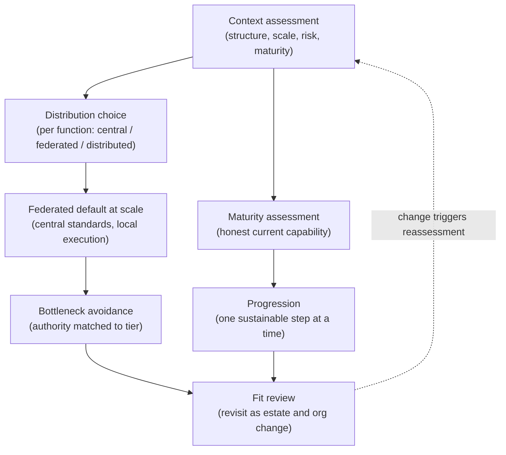
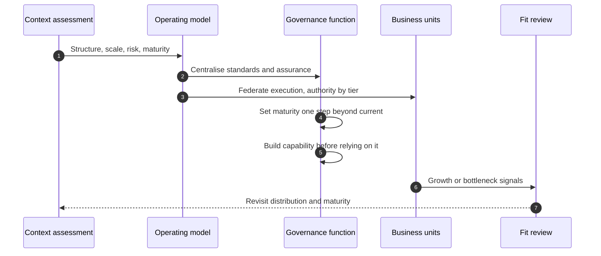

# Chapter 20: Operating Models for Scale and Governance Maturity

The mechanisms of this book describe what good governance does. This chapter addresses how an organisation arranges itself to run them across a growing estate, and how it grows into them rather than attempting everything at once. The operating model, the distribution of governance authority and work across the organisation, and the maturity of the function, how developed its capabilities actually are, together determine whether the mechanisms operate or merely exist. An organisation can hold the right controls on paper and still fail because it centralised what it should have federated, or because it reached for the governance of a mature function while still early in its journey. The skill on display here is fitting the operating model to the organisation and growing the function at a pace it can sustain.

---

## 1. The Governance Problem

An organisation that has designed its governance mechanisms faces two recurring failures as it scales. The first is structural: it centralises governance in a single team that must approve every AI use case, and that team becomes a bottleneck, so delivery slows, the business resents governance, and teams route around it, which leaves more risk than a lighter arrangement would. Or it does the opposite, distributing governance entirely to business units with no common framework, and ends up with inconsistency and no enterprise view, which at scale is indistinguishable from no governance at all. The second failure is developmental: a young function tries to operate the full apparatus of a mature one, formal committees, independent validation, continuous assurance, before it has the people, tooling or culture to sustain them, and produces process without substance, governance theatre that satisfies no one and protects nothing.

The problem is that the right mechanisms do not run themselves; they require an operating model that places authority and work sensibly, and a level of maturity sufficient to operate them for real. These two are often neglected because they are organisational rather than technical, yet they are what determine whether a well designed control actually functions. An organisation that gets the mechanisms right and the operating model or maturity wrong has built a car with no road to drive it on.

The constraint that matters most is that the operating model must fit the organisation's structure and the function's maturity must match what it attempts, because a model the organisation cannot run and a maturity it has not reached both produce the appearance of governance without the substance. The governance question is therefore not "which operating model is best?" but "which distribution of authority fits our structure and scale, and what is the next level of maturity we can actually sustain?"

---

## 2. 🧩 The Mechanism at a Glance

- **Mechanism name:** Operating Models for Scale and Governance Maturity
- **Risk addressed:** Governance that fails at scale through the wrong distribution of authority, or through attempting a maturity the function cannot sustain.
- **Primary objective:** An operating model fitted to the organisation's structure and scale, and a maturity progression the function can actually sustain.
- **When to use:** When establishing the governance function and whenever the AI estate grows beyond what the current arrangement can handle.
- **When not to use:** As a reason to copy another organisation's operating model, or to leap to a target maturity the function cannot yet operate.
- **Relevant frameworks / obligations:** The three lines model; ISO/IEC 42001 management system expectations; NIST AI RMF Govern function; maturity model concepts adapted to AI governance.
- **Primary governance concern:** Fitting the model to the organisation and growing maturity at a sustainable pace, avoiding both bottleneck and governance theatre.

The operating model distributes governance authority and work, centralised, federated or distributed, as defined in Chapter 3. Maturity describes how developed the function's capabilities are. The two are set together, because an ambitious operating model needs the maturity to run it, and a growing maturity may call for a different distribution of authority.

---

## 3. The Operating Model

The reference approach fits the distribution of authority to the organisation and sequences maturity growth deliberately:

- **Context assessment** establishes the organisation's structure, scale, risk profile and current maturity.
- **Distribution choice** selects, per governance function, where authority and work sit, centralised, federated or distributed, rather than applying one setting to everything.
- **Federated default at scale** centralises standards and assurance while federating execution to business units, as the common arrangement for larger organisations.
- **Bottleneck avoidance** ensures no single body must approve everything, matching authority to risk tier.
- **Maturity assessment** locates the function's current capability honestly across the governance mechanisms.
- **Progression** advances maturity one sustainable step at a time, building capability before relying on it.
- **Fit review** revisits both the distribution and the maturity target as the estate and organisation change.

Each component has a clear role. Context assessment grounds the choices in the actual organisation rather than an ideal. Distribution choice is made per function, not once for everything. The federated default and bottleneck avoidance address the commonest structural failures at scale. Maturity assessment and progression grow the function at a sustainable pace. Fit review keeps the model and maturity matched to a changing organisation.

---

## 4. The Decision & Control Flow

> **Step 1:** The organisation's structure, scale, risk profile and current governance maturity are assessed honestly.
> **Step 2:** For each governance function, classification, approval, policy, assurance, the appropriate distribution of authority is chosen rather than applying one setting across all.
> **Step 3:** At scale, standards and assurance are centralised for consistency while execution is federated to business units for local context and speed.
> **Step 4:** Approval authority is matched to risk tier so that no single body must approve every use case, avoiding the bottleneck.
> **Step 5:** The function's maturity is located honestly across the mechanisms, acknowledging where capability is nascent.
> **Step 6:** A target maturity is set that is one sustainable step beyond the current state, not a leap to a mature ideal.
> **Step 7:** Capability, people, tooling, culture, is built before the organisation relies on the control it supports.
> **Step 8:** The mechanisms are operated at the maturity the function can actually sustain, preferring a smaller set done well to a full set done nominally.
> **Step 9:** As the AI estate grows or the organisation restructures, both the distribution of authority and the maturity target are revisited.
> **Step 10:** Signs of bottleneck or governance theatre trigger a reassessment of the operating model.
> **Step 11:** Maturity advances to the next step only once the current one is genuinely operating.

The flow makes the fitting concrete: authority distributed per function and matched to tier, execution federated at scale, and maturity grown one sustainable step at a time, with the whole arrangement revisited as the organisation changes.

---

## 5. Why This Mechanism Works

The mechanism works because it fits the operating model to the organisation rather than importing an ideal. By choosing the distribution of authority per function, and defaulting at scale to centralised standards with federated execution, it captures consistency where consistency matters, standards and assurance, while keeping decisions close to the context and speed of delivery. Matching approval authority to risk tier removes the central bottleneck that is the single most common cause of governance being routed around, so the model scales by proportion rather than by adding reviewers.

It also works because it grows maturity honestly. By assessing current capability without flattery and advancing one sustainable step at a time, it avoids the governance theatre that results when a young function performs the rituals of a mature one without the substance. Building capability before relying on it, and preferring a smaller set of controls operated genuinely to a full set operated nominally, produces governance that is real at every stage, which is both more protective and more credible than an impressive framework no one can actually run.

---

## 6. 🏛️ Governance Decisions

| Decision | Options | Recommended approach | Reason |
| --- | --- | --- | --- |
| Distribution | One setting for all / Chosen per function | Chosen per function | Different functions need different distributions |
| Model at scale | Fully central or fully distributed / Federated | Federated: central standards, local execution | Consistency with local context and speed |
| Approval authority | Single central body / Matched to risk tier | Matched to risk tier | Avoids the bottleneck that drives avoidance |
| Maturity target | Mature ideal now / One sustainable step | One sustainable step | Leaping ahead produces process without substance |
| Capability timing | Rely then build / Build then rely | Build then rely | A control the function cannot sustain is not a control |
| Scope versus depth | Full set nominally / Smaller set genuinely | Smaller set genuinely, then grow | Real governance beats comprehensive theatre |

These defaults fit the model to the organisation and grow maturity sustainably. If one team must approve every use case, or the function performs controls it cannot sustain, the operating model or the maturity target is wrong.

---

## 7. ⚖️ Trade-offs

**Benefits:** Governance that scales without a bottleneck; consistency where it matters with local context where it helps; and a function that is genuinely operating at every stage rather than performing controls it cannot sustain.

**Friction:** Choosing distributions per function and growing maturity deliberately is more demanding than copying a model or declaring a target state. Federation requires clear standards and real assurance, or it degrades into inconsistency.

**Cost:** The effort of designing and maintaining the operating model, and the investment in capability, people, tooling, culture, needed to raise maturity. Spread over time as the function grows.

**Operational overhead:** The operating model must be maintained and revisited as the organisation changes, and maturity must be reassessed honestly rather than assumed. A model set once and never revisited falls out of fit as the estate grows.

**Risk reduction:** High but indirect: the operating model and maturity do not reduce risk themselves; they determine whether the mechanisms that do reduce risk actually operate. A good control in a broken operating model protects little.

**Speed to deliver:** A well fitted model with tiered authority keeps delivery fast by clearing low risk work locally. A bottlenecked central model is the classic cause of slow delivery and governance avoidance.

**Unintended consequences:** Federation without real assurance becomes distribution in disguise, inconsistent and unmonitored, and an over ambitious maturity target produces theatre that gives false comfort. Clear standards with genuine assurance, and honest maturity assessment, are the mitigations.

---

## 8. 🔐 Risk, Safety & Responsible AI

The operating model determines whether the responsible AI controls of Part IV actually operate across the estate. A fairness control, a human oversight arrangement or a safety guardrail is only as effective as the function that runs it, and in a federated model that means business units must have both the capability and the standards to operate these controls locally while the centre assures them. If the operating model federates execution without providing clear standards and real assurance, responsible AI becomes inconsistent across the organisation, strong where a capable unit happens to sit and weak elsewhere, which is precisely the inconsistency federation is supposed to prevent.

Maturity matters here too, and honestly assessing it is a safety matter. A function that claims to operate fairness measurement, meaningful human oversight or independent validation before it genuinely can is not merely inefficient; it is giving false assurance about controls that protect people. The responsible posture is to be candid about what the function can sustain, to operate fewer responsible AI controls genuinely rather than many nominally, and to grow the capability to operate the rest, rather than to perform a maturity the function has not reached.

---

## 9. 📜 Regulatory & Assurance Alignment

The operating model and maturity are where several regulatory expectations about governance structure are satisfied.

The **three lines model** is itself an operating model expectation, and regulators look for the separation of execution, oversight and assurance it describes, which the federated default preserves by centralising assurance. **ISO/IEC 42001**, as a management system standard, expects defined roles, responsibilities and authorities and top management commitment, which the operating model establishes, and its emphasis on continual improvement aligns with deliberate maturity progression. The **NIST AI RMF** places organisational structure and culture in its Govern function, treating a well arranged and adequately resourced governance function as foundational.

Sector regimes often constrain the operating model directly. In **financial services**, senior manager accountability regimes require that specified responsibilities attach to named individuals, which shapes how authority may be distributed. In the **public sector**, administrative accountability affects where decision authority can sit. Across sectors, the requirement for independent validation or assurance constrains how far execution and assurance may be combined. These regimes can make a particular distribution of authority mandatory rather than optional.

The evidence an auditor or regulator expects includes the defined operating model with its distribution of authority, the terms of reference and authorities of governance bodies, and evidence that assurance is genuinely independent of execution. A maturity assessment that is honest about current capability is itself useful evidence of a function that understands its own limits. As throughout, this is governance guidance rather than legal advice, and any mandated structure requires local interpretation.

---

## 10. ⚠️ Failure Modes & Resilience

- **Central bottleneck:** A single body approving every use case stalls delivery and drives avoidance. Tiered authority and federated execution are the mitigation.
- **Distribution in disguise:** Federation without clear standards and real assurance is distribution, inconsistent and unmonitored. Strong central standards and genuine assurance prevent this.
- **Imported model:** Copying another organisation's operating model ignores differences in structure, scale and maturity. Fitting the model to the actual organisation is the control.
- **Maturity leap:** Attempting a mature function's apparatus too early produces governance theatre. Progressing one sustainable step at a time is the mitigation.
- **Rely before build:** Depending on a control the function cannot yet sustain gives false assurance. Building capability before relying on it is essential.
- **Comprehensive theatre:** A full set of controls operated nominally protects less than a smaller set operated genuinely. Preferring real over comprehensive is the control.
- **Set and forget:** An operating model never revisited falls out of fit as the estate grows. Periodic fit review keeps it matched.

The theme is that this mechanism fails by misfitting the model or overreaching the maturity, both of which produce the appearance of governance without the substance. Resilience comes from fitting to the organisation, avoiding the bottleneck, and growing maturity honestly.

---

## 11. 👁️ Monitoring & Operations

The function should monitor, at minimum: approval turnaround and backlog by tier, as the clearest sign of a bottleneck; consistency of governance outcomes across federated units, as a check that federation has not become distribution; the gap between the maturity the function claims and the maturity its evidence supports; the proportion of mechanisms genuinely operating versus nominally present; and signs of avoidance, such as shadow AI, that indicate the operating model is being routed around. These signals show whether the operating model is enabling governance or obstructing it.

A distinctive signal here is the relationship between avoidance and the operating model. Rising shadow AI or governance bypass is often not a compliance problem but an operating model problem: the governed path is too slow or too central, so teams go around it. Reading avoidance as a signal to fix the operating model, rather than only to enforce harder, is what keeps governance both effective and used.

---

## 12. 💷 Cost & Proportionality

The cost drivers are the governance function itself, central and federated, and the investment in capability needed to raise maturity. These should scale with the size and risk of the AI estate, not with an abstract ideal of what a governance function should look like.

Proportionality is the heart of this chapter. The operating model should be no more elaborate than the organisation's scale and structure require: a small organisation needs the three roles discharged with proportionate formality, not a federated multi committee apparatus, while a large regulated enterprise needs genuine functional separation. Maturity should be grown to the level the estate's risk justifies and the function can sustain, not maximised for its own sake. The failure in one direction is an over built model and over reached maturity that cost more than the risk warrants and collapse into theatre; in the other, an under built model and under grown maturity that cannot operate the controls the estate needs. The lever is fit: the model to the organisation, the maturity to the risk and to what can be sustained. A governance function proportionate to its organisation is one that both protects and is used.

---

## 13. When to Use This Mechanism

Use this mechanism when:

- the governance function is being established or is scaling with the AI estate;
- a central arrangement is becoming a bottleneck, or a distributed one is producing inconsistency;
- the function is tempted to operate controls it cannot yet sustain;
- the organisation needs governance that scales without slowing delivery to a halt; and
- the organisation is changing in structure, scale or risk profile.

In practice every organisation scaling AI needs to fit its operating model and grow its maturity deliberately; the arrangement differs by structure, scale and maturity.

---

## 14. When NOT to Use This Mechanism

The caution is against misfit and overreach:

- Do not **import another organisation's operating model**; fit it to your own structure, scale and maturity.
- Do not **leap to a mature target** the function cannot sustain; progress one genuine step at a time.
- Do not **centralise every decision**; tiered, federated authority is what lets governance scale.

The lighter position for a small organisation is the three roles held with proportionate formality and a modest maturity operated genuinely, not a scaled down copy of an enterprise framework. Fit the model to the organisation you are, not the one you might become.

---

## 15. Mechanism Variations

- **Small organisation:** A largely central model with the three roles held by a few people, modest maturity operated genuinely, and authority matched to the few risk tiers that exist.
- **Scaling organisation:** A move towards federation as the estate grows, central standards and emerging assurance, tiered authorities, and maturity advanced step by step.
- **Large enterprise:** A federated model with central standards and independent assurance, local execution and authorities, consolidated reporting, and maturity sustained across many units.
- **Highly regulated enterprise:** A federated model constrained by mandated accountability structures, formal separation of the three lines, independent validation, and a maturity level the regulator's expectations require and the function demonstrably sustains.

The variations differ in the degree of federation and the level of maturity, not in the principle that the model must fit the organisation and maturity must be grown sustainably.

---

## 16. Governance Decision Checklist

- [ ] Is the distribution of authority chosen per governance function rather than applied uniformly?
- [ ] At scale, are standards and assurance centralised while execution is federated?
- [ ] Is approval authority matched to risk tier so no single body approves everything?
- [ ] Is the function's maturity assessed honestly rather than assumed?
- [ ] Is the maturity target one sustainable step beyond the current state?
- [ ] Is capability built before the organisation relies on the control it supports?
- [ ] Is a smaller set of controls operated genuinely preferred to a full set operated nominally?
- [ ] Is federation backed by clear standards and real assurance, not distribution in disguise?
- [ ] Is avoidance read as a signal to fix the operating model, not only to enforce harder?
- [ ] Are the model and maturity target revisited as the estate and organisation change?

---

## 17. 📐 The Governance Verdict

> Operating models and governance maturity determine whether the mechanisms of this book actually run, and they must be addressed whenever a governance function is established or scaled. The approach earns its place by fitting the distribution of authority to the organisation, defaulting at scale to centralised standards with federated execution and authority matched to risk tier, which scales governance without the bottleneck that drives avoidance, and by growing maturity one sustainable step at a time rather than performing the rituals of a mature function too early. Its weaknesses are misfit and overreach: the central bottleneck, federation that is really distribution, the imported model that ignores context, and the maturity leap that produces theatre. Fit the model to the organisation you are, match authority to risk, back federation with real assurance, and grow capability before you rely on it, preferring a smaller set of controls that genuinely operate to a comprehensive set that merely appears to. Read avoidance as a signal that the model, not just the compliance, needs fixing. The best controls in the world protect nothing if the organisation cannot run them, and running them is what the operating model and maturity are for.
