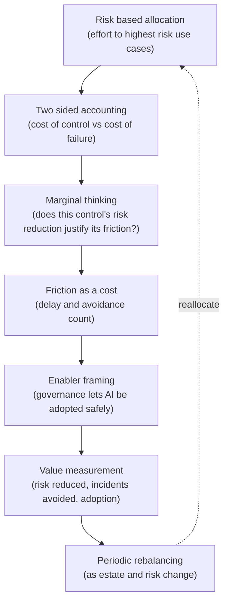
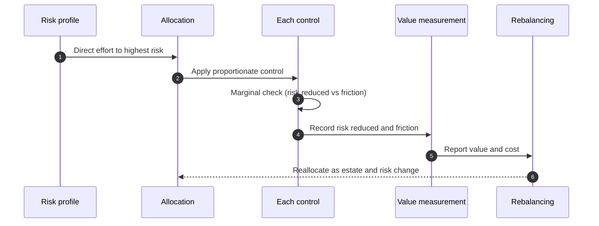

# Chapter 21: The Economics and Proportionality of Governance

This is the final chapter of the main argument, and it addresses the principle that has run beneath every mechanism in the book: proportionality. Governance is not free. It costs money, time and speed, and an organisation that ignores its economics will either spend too much, strangling delivery and breeding avoidance, or too little, leaving consequential risk uncontrolled. Every chapter has insisted that the weight of a control should match the risk it addresses; this chapter makes that insistence explicit, treats governance as an investment to be sized rather than a virtue to be maximised, and gives the organisation a way to decide how much governance is enough. The skill on display here is economic judgement about governance itself: spending where it reduces the most risk per unit of friction, and not spending where it does not.

---

## 1. The Governance Problem

An organisation approaches the cost of governance in one of two mistaken ways. The first treats governance as a pure cost to be minimised: it underfunds the function, applies the lightest controls it can, and discovers the saving was illusory when an ungoverned system causes a harm whose cost, regulatory, financial and reputational, dwarfs everything governance would have spent. The second treats governance as a virtue to be maximised: it applies heavy controls everywhere, subjects trivial use cases to the apparatus meant for consequential ones, and slows delivery so much that the business routes around governance entirely, leaving more risk than a lighter, respected regime would. Both organisations have misunderstood the economics, one by seeing only the cost of control, the other by seeing only the cost of failure.

The problem is that governance has two kinds of cost that must be balanced, and most organisations account for only one. There is the cost of control: the money, time and foregone speed that governance consumes. And there is the cost of failure: the harm, legal exposure, remediation and lost trust that result when risk is uncontrolled. Governance is the deliberate trade of the first to reduce the second, and the right amount is the point where a further unit of control no longer reduces enough risk to justify its friction. An organisation that cannot see both costs cannot find that point.

The constraint that matters most is that governance must be proportionate, enough to reduce the risk that matters, not so much that it strangles delivery or gets bypassed, because disproportion in either direction increases total cost. The governance question is therefore not "how do we minimise the cost of governance?" nor "how do we maximise control?" but "how do we invest in governance so that each unit of control is spent where it reduces the most risk per unit of friction?"

---

## 2. 🧩 The Mechanism at a Glance

- **Mechanism name:** The Economics and Proportionality of Governance
- **Risk addressed:** Governance that costs too much, strangling delivery and breeding avoidance, or too little, leaving consequential risk uncontrolled.
- **Primary objective:** Governance investment sized so that control is concentrated where it reduces the most risk per unit of friction, proportionate to risk throughout.
- **When to use:** As the discipline governing how much of every other mechanism to apply, and how to size the function overall.
- **When not to use:** As an excuse to underfund governance, or as a justification for maximal control regardless of risk.
- **Relevant frameworks / obligations:** Risk based regulatory expectations (EU AI Act tiering, NIST AI RMF, ISO/IEC 42001) that themselves mandate proportionality; sector materiality thresholds.
- **Primary governance concern:** Balancing the cost of control against the cost of failure, concentrating governance where it reduces the most risk.

Proportionality is the unifying principle of the book: the weight of every control should match the risk it addresses. The economics make it explicit, treating governance as an investment whose return is risk reduced, and whose cost includes not only money but the friction it imposes on delivery.

---

## 3. The Operating Model

The reference approach treats governance spend as a portfolio allocated by risk, with proportionality applied at every level:

- **Risk based allocation** directs governance effort towards the use cases and controls that carry the most risk, drawing on classification.
- **Two sided accounting** weighs the cost of control, money, time and friction, against the cost of failure it reduces.
- **Marginal thinking** asks, for each additional control, whether the risk it reduces justifies the friction it adds.
- **Friction as a cost** treats delay and avoidance as real costs of governance, not free side effects.
- **Enabler framing** positions governance as what lets the organisation adopt AI safely, not only as a brake.
- **Value measurement** tracks what governance delivers, risk reduced, incidents avoided, adoption enabled, not only what it costs.
- **Periodic rebalancing** shifts investment as the estate, risk profile and regulation change.

Each component has a clear role. Risk based allocation concentrates spend where it matters. Two sided accounting and marginal thinking find the point where control is worth its friction. Treating friction as a cost prevents the invisible tax of delay and avoidance. The enabler framing reframes governance from brake to enabler. Value measurement counters the tendency to see only cost. Rebalancing keeps the allocation fitted to a changing estate.

---

## 4. The Decision & Control Flow

> **Step 1:** Governance effort is allocated across the estate in proportion to risk, concentrating on the use cases and controls that carry the most.
> **Step 2:** For a given control, both its cost, money, time and the friction it imposes on delivery, and the risk it reduces are made explicit.
> **Step 3:** The marginal question is asked: does the risk this control reduces justify the friction it adds?
> **Step 4:** A control that reduces little risk for significant friction is lightened or removed, regardless of how rigorous it looks.
> **Step 5:** A control that reduces significant risk for modest friction is strengthened or extended.
> **Step 6:** Friction and avoidance are tracked as real costs, so a control that teams route around is recognised as failing economically.
> **Step 7:** Governance is positioned and communicated as the enabler of safe AI adoption, not only as a constraint.
> **Step 8:** The value governance delivers, risk reduced, incidents avoided, adoption safely enabled, is measured alongside its cost.
> **Step 9:** The overall function is sized to the estate's scale and risk, not to an abstract ideal.
> **Step 10:** As the estate grows, the risk profile shifts or regulation changes, the allocation is rebalanced.
> **Step 11:** Disproportion in either direction, strangling friction or uncontrolled risk, triggers reallocation.

The flow makes the economics concrete: effort directed by risk, each control weighed by its risk reduction against its friction, friction counted as a real cost, value measured alongside cost, and the whole allocation rebalanced as the organisation changes.

---

## 5. Why This Mechanism Works

The mechanism works because it accounts for both costs that governance trades between, rather than only one. By weighing the cost of control against the cost of failure, and asking the marginal question for each control, it finds the proportionate point, enough governance to reduce the risk that matters, not so much that the friction exceeds the benefit. This is what lets an organisation escape the twin traps of underfunding, which is cheap until a failure proves otherwise, and over control, which looks rigorous until delivery stalls and teams route around it.

It also works because it treats friction and avoidance as real costs and governance value as real benefit, both of which are usually invisible in conventional accounting. Recognising that a bypassed control protects nothing, and that a delay imposed without a matching risk reduction is pure cost, directs investment towards controls that are both effective and used. And by measuring what governance delivers, not only what it consumes, it supports the framing of governance as an enabler of safe adoption rather than a tax, which is both more accurate and more likely to keep the function resourced and respected.

---

## 6. 🏛️ Governance Decisions

| Decision | Options | Recommended approach | Reason |
| --- | --- | --- | --- |
| View of governance | Cost to minimise / Virtue to maximise / Investment to size | Investment to size | Both minimising and maximising increase total cost |
| Accounting | Cost of control only / Both costs | Cost of control and cost of failure | Proportionality needs both sides of the trade |
| Control decisions | By rigour / By marginal risk per friction | Marginal risk per friction | Rigour that reduces little risk for much friction is waste |
| Friction | Free side effect / Real cost | Real cost | Delay and avoidance consume value and leave risk |
| Framing | Brake / Enabler of safe adoption | Enabler | Accurate, and keeps governance resourced and used |
| Measurement | Cost only / Value and cost | Value and cost | Seeing only cost drives underinvestment |

These defaults size governance as a proportionate investment. If a control is kept because it looks rigorous despite reducing little risk, or cut because it costs money despite reducing much, the economics have been misjudged.

---

## 7. ⚖️ Trade-offs

**Benefits:** Governance investment concentrated where it reduces the most risk per unit of friction; the twin traps of underfunding and over control avoided; friction and value made visible; and governance positioned as an enabler rather than a tax.

**Friction:** Weighing risk reduction against friction for each control is harder than applying a uniform standard, and quantifying either side is imperfect. Judgement is unavoidable, and it can be contested.

**Cost:** The effort of the economic analysis itself, the allocation and the value measurement. Modest relative to the misallocation it prevents.

**Operational overhead:** The allocation must be rebalanced as the estate and risk change, and value measurement maintained. An economics set once decays as the organisation grows.

**Risk reduction:** High and systemic, because it governs how every other mechanism is applied. Getting the economics right makes the whole governance system both more protective and more affordable; getting it wrong undermines everything else.

**Speed to deliver:** Proportionate governance is the single biggest lever on delivery speed, because it removes friction from low risk work and concentrates it where risk justifies it. Disproportionate governance is the classic cause of slow AI delivery.

**Unintended consequences:** The economic framing can be misused to justify underinvestment, dressing a cost cut as proportionality, or to over quantify judgements that cannot be precisely measured. The mitigations are honesty about the cost of failure and acceptance that proportionality requires judgement, not a false precision.

---

## 8. 🔐 Risk, Safety & Responsible AI

The economics of governance bear directly on responsible AI, because the controls that protect people, fairness, oversight, safety, are precisely the ones an organisation is tempted to cut when it sees governance only as cost. Proportionality done honestly protects these controls by recognising that the cost of failure for a consequential, people affecting system is high, which justifies strong controls, while a low stakes internal tool does not warrant the same. The economic argument, correctly applied, concentrates responsible AI effort where harm to people would be greatest, which is exactly where it should be.

The honesty obligation here is to resist dressing cost cutting as proportionality. It is easy to justify weakening a fairness control or a human oversight arrangement by pointing to its cost, while quietly ignoring the cost of the failure it prevents. True proportionality weighs both sides, and for controls that protect people the cost of failure, to individuals and to the organisation, is often severe and must not be understated to make a saving look proportionate. The responsible posture is to apply the economics symmetrically: light where risk is genuinely low, strong where people could be harmed, and candid about the cost of failure rather than optimistic about it.

---

## 9. 📜 Regulatory & Assurance Alignment

Proportionality is not only sound economics; it is built into the regulation itself, which makes this mechanism align naturally with the regulatory approach.

The **EU AI Act** is explicitly risk tiered, imposing the heaviest obligations on high risk systems and little on minimal risk ones, which is proportionality enacted as law: it expects more governance where the risk is greater and tolerates less where it is small. The **NIST AI RMF** is founded on a risk based approach, directing effort according to assessed risk and context rather than uniformly. **ISO/IEC 42001** expects controls to follow from assessed risk, the same proportionate logic. An organisation applying the economics of this chapter is therefore doing what the regulation already requires: matching governance to risk.

Sector regimes reinforce this through materiality. In **financial services**, model risk expectations scale validation and oversight to a model's materiality, more governance for material models, less for immaterial ones. In other sectors, obligations attach to activities by their consequence. These materiality thresholds are regulatory expressions of proportionality, and aligning the governance economics to them satisfies the regulator and sizes the investment at once.

The evidence an auditor or regulator expects is that governance is applied in proportion to risk: that high risk systems carry strong controls with evidence, and that lighter controls on low risk systems are a deliberate, justified choice rather than a gap. A mechanism that allocates by risk and records the rationale demonstrates exactly the proportionality regulation demands. As throughout, this is governance guidance rather than legal advice, and what proportionate means for a specific obligation requires local interpretation.

---

## 10. ⚠️ Failure Modes & Resilience

- **Governance as pure cost:** Underfunding to save money ignores the cost of failure and proves falsely economical when a harm occurs. Two sided accounting is the mitigation.
- **Governance as pure virtue:** Maximising control everywhere strangles delivery and breeds avoidance, raising total cost. Marginal thinking and proportionality by risk prevent this.
- **Invisible friction:** Treating delay and avoidance as free hides a real cost and lets disproportionate controls persist. Counting friction as a cost exposes it.
- **Rigour mistaken for value:** Keeping a control because it looks thorough, despite reducing little risk, is waste dressed as diligence. The marginal question is the control.
- **Cost cutting as proportionality:** Weakening people protecting controls while ignoring the cost of their failure misuses the economic framing. Symmetrical accounting and honesty about failure cost are the mitigations.
- **False precision:** Over quantifying risk reduction and friction to manufacture certainty obscures that proportionality requires judgement. Accepting informed judgement is healthier than fabricated numbers.
- **Set and forget:** An allocation never rebalanced decays as the estate grows. Periodic rebalancing keeps it fitted.

The theme is that the economics fail by seeing only one cost, or by misusing the framing to justify a predetermined answer. Resilience comes from accounting for both costs honestly and applying proportionality symmetrically.

---

## 11. 👁️ Monitoring & Operations

The function should monitor, at minimum: the distribution of governance effort against the distribution of risk, to check that spend concentrates where risk does; friction indicators such as approval turnaround and, tellingly, the rate of avoidance and shadow AI; the value side, incidents avoided, risks reduced, and AI adoption safely enabled; the proportion of controls that survive a marginal review versus those that reduce little risk for much friction; and the balance of the overall investment against the estate's scale and risk. These signals show whether governance is proportionate or disproportionate, and in which direction.

A distinctive signal is avoidance read economically. Shadow AI and bypass are not only compliance failures; they are evidence that the friction of the governed path exceeds what teams will bear, which usually means a control is disproportionate. Reading avoidance as an economic signal, that governance is costing more friction than its risk reduction justifies, points towards lightening the control rather than only enforcing it harder, which is often the more effective response.

---

## 12. 💷 Cost & Proportionality

This chapter is itself about cost and proportionality, so this section turns the lens on the discipline itself. The cost of the economic analysis, allocation, marginal review, value measurement, rebalancing, is modest, and it is repaid many times over by the misallocation it prevents, both the uncontrolled risk of underinvestment and the strangled delivery of over control.

Proportionality applies even here. A small organisation does not need an elaborate governance economics function; it needs the habit of asking, for each control, whether its risk reduction justifies its friction, and sizing its modest function to its modest estate. A large enterprise with a substantial AI estate warrants a more formal allocation and value measurement, because the sums and the risks are larger. The failure in one direction is an elaborate economic apparatus that costs more than the misallocation it prevents; in the other, no economic thinking at all, so governance drifts into one of the twin traps unchecked. The lever, as throughout the book, is fit: the rigour of the economic discipline should itself be proportionate to the scale and risk of the estate it governs. Proportionality applied to proportionality is the final expression of the principle.

---

## 13. When to Use This Mechanism

Use this mechanism when:

- governance is competing for resources and its investment must be justified;
- controls are being applied uniformly rather than in proportion to risk;
- delivery is slowing under governance friction, or avoidance is rising;
- the organisation needs to decide how much governance is enough; and
- the function must be sized to the estate rather than to an ideal.

In practice the economics govern how every other mechanism is applied, so they are relevant to every governance decision about how much control to impose.

---

## 14. When NOT to Use This Mechanism

The caution is against misusing the economic framing:

- Do not use it to **justify underinvestment**; a cost cut that ignores the cost of failure is not proportionality.
- Do not use it to **justify maximal control**; rigour that reduces little risk for much friction is waste, not diligence.
- Do not **over quantify**; proportionality requires honest judgement, not fabricated precision.

The lighter position for a small organisation is the habit of the marginal question, applied without an elaborate apparatus, not the absence of economic thinking. Every organisation should ask whether a control's risk reduction justifies its friction, even if only a large one needs a formal function to do so.

---

## 15. Mechanism Variations

- **Small organisation:** The marginal question applied informally to each control, effort concentrated on the few higher risk use cases, and a function sized to a small estate.
- **Scaling organisation:** A risk based allocation of governance effort, friction and avoidance tracked, and the beginnings of value measurement as the estate grows.
- **Large enterprise:** A formal governance investment allocated across the estate by risk, systematic value measurement, and periodic rebalancing, with proportionality enforced through classification.
- **Highly regulated enterprise:** Proportionality aligned explicitly to regulatory and sector materiality thresholds, documented justification of control weight by risk, and evidence that lighter controls on low risk systems are deliberate choices.

The variations differ in the formality of the economic discipline, not in the principle that governance is an investment to be sized by weighing risk reduction against friction.

---

## 16. Governance Decision Checklist

- [ ] Is governance treated as an investment to be sized, not a cost to minimise or a virtue to maximise?
- [ ] Is effort allocated across the estate in proportion to risk?
- [ ] Is each control weighed by the risk it reduces against the friction it adds?
- [ ] Are controls that reduce little risk for much friction lightened or removed?
- [ ] Is friction, including delay and avoidance, counted as a real cost?
- [ ] Is the cost of failure accounted for honestly, especially for people protecting controls?
- [ ] Is governance framed and communicated as an enabler of safe adoption?
- [ ] Is the value governance delivers measured alongside its cost?
- [ ] Is avoidance read as a signal that a control may be disproportionate?
- [ ] Is the allocation rebalanced as the estate, risk profile and regulation change?

---

## 17. 📐 The Governance Verdict

> The economics and proportionality of governance is the principle beneath every mechanism in this book, and it governs how much of each to apply. It earns its place by treating governance as an investment to be sized rather than a cost to minimise or a virtue to maximise, weighing the cost of control, money, time and friction, against the cost of failure it reduces, and concentrating effort where each unit of control reduces the most risk. Its weaknesses are the misuses of the framing: dressing a cost cut as proportionality while ignoring the cost of failure, or mistaking rigour that reduces little risk for diligence. Account for both costs honestly, ask of every control whether its risk reduction justifies its friction, count avoidance as the economic signal it is, and apply the logic symmetrically, light where risk is genuinely low and strong where people could be harmed. Proportionality is not a compromise between governance and delivery; it is the discipline that gives you both. The right amount of governance is not the most, nor the least, but the amount that reduces the risk that matters at a friction the organisation will actually bear. That judgement, made honestly and revisited often, is the whole art of governing AI at scale.
